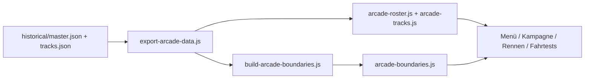

# Architektur des Arcade-Rennspiels

Die aktuelle Anwendung ist ein statisches Browser-Spiel mit geordneten lokalen
Scripts und den Namespaces `CGPArcade` / `CGPArcadeData`. Kein Framework,
Laufzeitserver oder CDN ist notwendig. Relative URLs erhalten den Pages-Pfad
`/carpet-grand-prix/`. Die alte passive Simulation gehört ausschließlich zum
[Git-Archiv](LEGACY_CLEANUP.md).

## Einstieg und Anwendungen

| Datei | Aufgabe |
| --- | --- |
| `index.html` + `src/ui/main-entry.js` | Schlanker Einstieg ins Hauptmenü; `?legacy=1` führt zur Archivinformation |
| `play.html` + `pov-launch.js` | Hauptmenü, freies Rennen, Team-/Streckenauswahl, POV-Spielstand, Einstellungen |
| `run.html` + `run-launch.js` | Aktuelle Roguelite-Run-Kampagne: Auswahl, feste Karte, Events, Abschluss und Archiv |
| `campaign.html` + `campaign-launch.js` | Erhaltener Zugang zu früheren Kampagnenspielständen mit freier Streckenwahl |
| `race.html` + `arcade-main.js` | Gemeinsames fahrbares Rennwochenende aller aktuellen Modi |
| `arcade.html`, `arcade3d.html` | Technische 2D-/3D-Fahrtests für alle 22 Strecken |
| `archive.html` + `classic-archive.js` | Nur Information und unveränderter Export klassischer Browserstände |

## Modulgrenzen

| Bereich | Verantwortung |
| --- | --- |
| `src/racing/` | Physik, Eingaben, KI-Regler, Kontakte, Seile, Brücken, Boxengasse, Zeitmessung, Windschatten, Aufholhilfe, Sessions |
| `src/rendering/` | 2D-/3D-Darstellung, Kamera, Fahrzeugflotte, Materialien und modulare Spielwelten; keine Schreibzugriffe auf Physik |
| `src/data/` | Statische Stammdaten, versionierte Browserexporte, Kampagnenkonfiguration und Rundentabelle |
| `src/championship/` | Kampagne und fortsetzbare aktuelle POV-Meisterschaft; keine klassische Teamchef-Saisonautomatik |
| `src/management/pov-workshop.js` | Aktuelle POV-Fahrzeugentwicklung, unabhängig vom archivierten Managementspiel |
| `src/persistence/` | Getrennte Speicherbereiche, Checkpoints, Validierung und Kampagnenmigration |
| `src/ui/` | Hauptmenü, Kampagne, HUD, pausierte Dialoge, Ergebnisdetails und Fortsetzungs-Countdown |

`RaceWeekend` koordiniert genau eine native Session. `QualifyingSession`
verwendet dieselbe Einzelwagenphysik für Auslaufrunde und zwei schnelle Runden;
KI-Fahrzeuge werden unsichtbar ohne geteilten Verkehr gefahren. Das Rennen
verwendet `RaceSession` mit allen 13 Fahrzeugen. Es gibt keine zweite Simulation.

`race-presentation.js` bereitet dieselben nativen Positionen und Timingdaten
für relatives HUD und vollständiges Klassement auf. `RaceGaps` liefert echte
Passageabstände; historische Ergebnisse verwenden gespeicherte Zeiten.
`resume-countdown.js` hält die Session während 3–2–1 pausiert und gehört nicht
zum Spielstand. Fokusverlust/erneute Menüöffnung verwerfen den UI-Timer.

## Datenweg

Die unabhängigen Quellen erhalten alle 13 Teams, 92 Fahrer und 22 Zeichnungen.
`historical/track-defs.json` bewahrt zusätzlich ursprüngliche Kalender-Tupel.
Der Export erhält Kalenderindizes, POV-Profile, Brücken sowie Bahrain-Unterbett
und parallele Boxengasse. Originaldaten und erzeugte Dateien bleiben unverändert.
`race-formats.js` stammt separat aus dokumentierten Referenzrunden.

`campaign-config.js` definiert acht Strecken und 39 feste Fahrerplätze.
Redwood ist anfänglich das einzige freie Team. Die Kampagnenprofile 64/72
überschreiben historische Teamwerte nur im Kampagnenkontext, ohne Fahrwerte
zu verändern. `CampaignWeekend` erzwingt Qualifying und die einmalige Übernahme
seiner Startaufstellung. Kampagnenablauf und Speicherung: [CAMPAIGN.md](CAMPAIGN.md).

## Rendering und Assetquellen

Three.js wird lokal aus `three-entry.js` gebaut; `src/vendor/three.js` samt Lizenz
wird mitgeliefert. `Tracks3D`, `Fleet3D` und die Kamera lesen nur Renderposen.
Der gemeinsame `illustrated-kit3d` verwaltet wiederverwendbare Geometrien und
Materialien. Zimmerkonfiguration, Möbel-/Spielzeugmodule, Bahrain-Assembler
und datengetriebene Kalenderumgebungen bleiben getrennt von Rennkollisionen.
`pilot-vehicles.js` und `race-sprites.js` sind weiterhin benötigte gemeinsame
Fahrzeugquellen und werden nicht wegen ihres historischen Namens entfernt.

Original-PNGs d001–d035, optimierte WebPs, die 92 SVG-/Identitätsquellen und
sämtliche Teamlackierungen bleiben erhalten. Der unabhängige `build-driver-art.js`
prüft/erzeugt die Vektorquellen; der optionale PNG-/WebP-Encoder liest nur JSON.

## Tests und Offline-Ausgaben

`tests/helpers/project.js` enthält nur Pfade, Serialisierung und statische
Referenzen. Aktuelle Tests führen keinen klassischen VM-Spieladapter aus.
Die vor Entfernung erfassten Geometrie-/Werkstatt-Invarianten nennen ihren
Ausgangscommit. Bereits bestehende historische Fixtures bleiben unverändert.

`build-arcade-offline.js` bettet die tatsächlich referenzierten Scripts, Styles,
Teamfahrzeuge und Kampagnenporträts ein. `build-offline.js` ist der kompatible
Befehl für das aktuelle Hauptmenü, nicht mehr für die klassische Simulation.
Der portable Kampagneneinstieg hält Menü und Rennen wie bisher in einer Datei.

Der Legacy-Cleanup ist abgeschlossen. Klassische Rendering-/UI-/CSS-Module
und deren zwei alte Vorschaugalerien sind entfernt. Alle aktuellen Einstiegspunkte
und ihre Abhängigkeiten bleiben unverändert. Assetquellen und Generatoren:
[ASSETS.md](ASSETS.md). Löschbelege und bewusst erhaltene Quellen: [LEGACY_CLEANUP.md](LEGACY_CLEANUP.md).

## Run Phase 1

Die Run-Kampagne setzt sich um den bestehenden Kampagnen-/Wochenendkontext.
`RunMap` definiert die feste Topologie und Ziele, `RogueliteRun` den validierten
Fortschritt, `RunWeekend` ausschließlich Sessionzugang und Neustartsperre.
`RunStore` speichert aktive und archivierte Runs in einem neuen Bereich.
Physik, KI, Rendering und alle historischen Daten bleiben gemeinsam und unverändert.
Start-/Eventangebote werden einmal pro Run erzeugt, Fähigkeiten bleiben Platzhalter.
Team, Fahrer und Build-Slots liegen außerhalb der Phase; Phasenabschluss und
Prototyp-Abschluss sind getrennte Metadaten. Details: [ROGUELITE_RUN_SYSTEM.md](ROGUELITE_RUN_SYSTEM.md).
