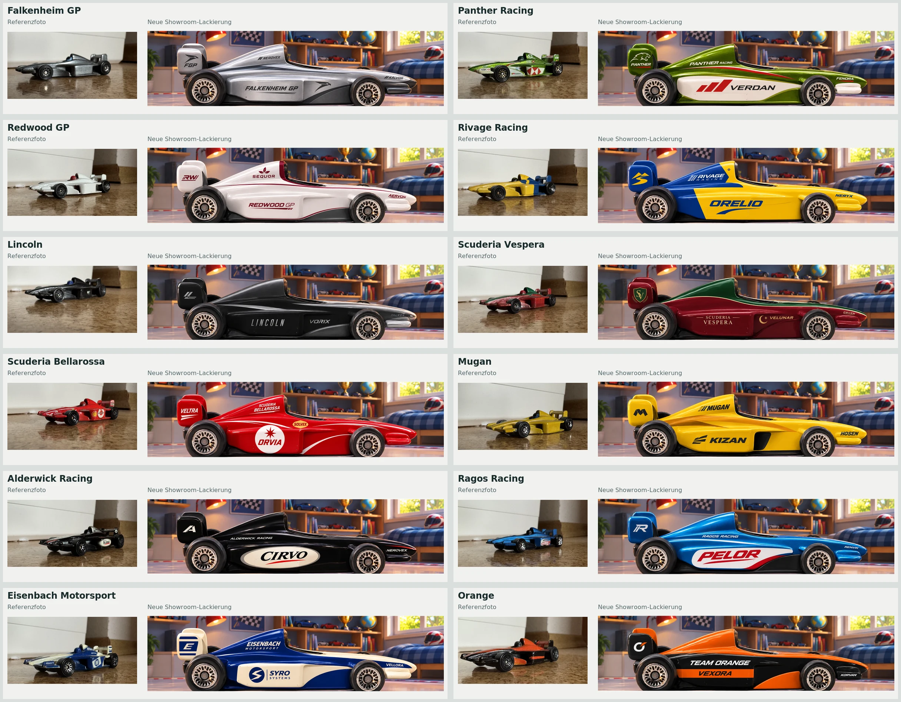

# Fahrzeuglackierungen nach Originalfotos

Entwicklungszweig: `codex/reference-car-liveries`. Ausgangsbasis ist der
übernommene Stand `34f89cc` mit den zwölf Referenzfotos. Kein Merge oder Deployment
ohne Freigabe dieses Design-PRs.

## Gemeinsame Basis

Alle zwölf neuen Fahrzeuge wurden mit Bildbearbeitung aus demselben weißen
Showroom-Fahrzeug entwickelt. Die unveränderte Vorlage liegt dauerhaft unter
`assets/cars/source/showroom-white.webp`; sie stammt aus dem bisherigen weißen
`team-t02.webp`. Seitenansicht, Blickrichtung nach rechts, Chromfelgen, Licht und
Showroom-Szene orientieren sich an dieser gemeinsamen Vorlage.

Vauclair Motorsport (`t01`) bleibt bytegenau erhalten. Die übrigen Bilder behalten
ihre bestehenden Dateinamen und Verweise. Damit erscheinen sie in der Teamauswahl
und auch dort, wo dieselben Fahrzeugbilder bereits im Dashboard verwendet werden.
An HTML, CSS, Teamdaten, Fahrerwerten, Regeln und Speicherformat wurde nichts geändert.

## Referenzen und eigenständige Gestaltung

| Team | Foto | Übernommene Merkmale | Fiktive Sponsoren |
| --- | --- | --- | --- |
| Falkenheim GP | `falkenheim.jpg` | Silber/Graphit, dunkle Nase, eigener Falke | KALVOR, NEROVEX |
| Panther Racing | `panther.jpg` | Metallisches Grün, weiße Felder, rote Schrägmotive | VERDAN, FENORA |
| Redwood GP | `redwood.jpg` | Perlweiß, burgunderroter Cockpitrand und feine Linien | SEQUOR, AERVON |
| Rivage Racing | `rivage.jpg` | Gelber Vorderwagen, blaues Heck, klare Farbgrenzen | ORELIO, NERYX |
| Lincoln | `lincoln.jpg` | Nahezu Schwarz, Graphit, kleine silberne Flächen | VORIX, TALVON |
| Scuderia Vespera | `vespera.jpg` | Burgunderrot, grüne Airbox und Nasenbahn, feine helle Kante | VELUNAR, ORVEN |
| Scuderia Bellarossa | `bellarossa.jpg` | Scharlachrot, weißes Rundfeld, kleiner goldener Akzent | ORVIA, SOLVEX, VELTRA |
| Mugan | `mugan.jpg` | Goldgelb, schwarzer Einlass, bernsteinfarbene Konturen | KIZAN, HOSEN |
| Alderwick Racing | `alderwick.jpg` | Schwarz, helles Oval, rote Unterstreichung | CIRVO, NEROVEX |
| Ragos Racing | `ragos.jpg` | Blau, weißes Seitenfeld mit rotem Schriftzug | PELOR, RENVIK |
| Eisenbach Motorsport | `eisenbach.jpg` | Tiefblau/Elfenbein, helle Nase und Seitenfelder | SYRO SYSTEMS, VELLORA |
| Orange | `orange.jpg` | Orange Oberseite, schwarze Flanken, orange Binde und Keil | VEXORA, KORVAN |

Die realen Sponsorzeichen der Fotos werden nicht in die Spielgrafiken übernommen.
Beispiele: Panthers rote Motive sind eigene versetzte Balken; Bellarossas Rundfeld
enthält einen eigenen Stern; Eisenbach verwendet ein eigenes S-Zeichen. Logos und
Schriftzüge wurden zusammen mit den jeweiligen Flächen gestaltet. Die Fotos
selbst bleiben als unveränderte historische Referenzen erhalten.

## Dateigröße und Nachbearbeitung

Alle Spielbilder bleiben 2172 × 555 Pixel groß. Die generierten Arbeitsbilder
bleiben außerhalb des Repositorys unter `generated_images` erhalten. Der technische
Export entfernt ausschließlich den äußeren Render-Rand und kodiert WebP mit
Qualität 88. Das Fahrzeug wird nicht gestreckt. Die zwölf Dateien benötigen zusammen
rund 1,61 MB; die größte ist rund 157 kB groß. Das Prüf-Limit beträgt 250 kB pro Datei.

Für spätere Entwickler: `node scripts/optimize-car-image.js t03 /pfad/zum/render.png`
benötigt ImageMagick 7. Der Befehl akzeptiert nur `t02` bis `t13`; Vauclair ist bewusst
gesperrt. Die Webversion und ihre Tests benötigen ImageMagick nicht.

`assets/cars/liveries.json` dokumentiert Zuordnung, Referenz-Prüfsummen,
Gestaltungsmerkmale, Sponsoren und Bild-Prüfsummen. `assets/manifest.json` enthält
die aktualisierten Laufzeitbilder für Prüfung und Offline-Ausgabe.

## Absicherung

- Die Spiel- und Speicherstandtests bleiben unverändert.
- Vauclair, Basisvorlage, Strecken und Hintergrund werden gegen ihre ursprünglichen
  Bildbytes geprüft. Die Referenzfotos besitzen dokumentierte SHA-256-Prüfsummen.
- Nur die zwölf ausdrücklich beauftragten Bildinhalte dürfen vom Original abweichen.
  Im Quelltext-Rückvergleich werden ausschließlich diese zwölf Bilddaten im Speicher
  durch die ursprünglichen ersetzt. Der restliche Offline-Quelltext muss weiterhin
  bytegenau dem Original entsprechen. Die ursprünglichen Referenzdateien werden
  nicht neu erzeugt oder überschrieben.
- Browserprüfungen kontrollieren alle 13 Teamzuordnungen, das Laden/Dekodieren und
  die einheitlichen Bildmaße auf Desktop und im Mobilformat. Die bisherigen
  visuellen Vergleiche verwenden weiterhin das unveränderte Vauclair-Modell.
- Die Offline-Ausgabe enthält dieselben neuen Lackierungen wie die Webversion.

Die Designübersicht dient der visuellen Freigabe der Referenznähe und der neuen
fiktiven Zeichen. Die automatischen Tests beurteilen keine gestalterische Qualität
oder die Lesbarkeit einzelner gerenderter Buchstaben; diese wurden zusätzlich
visuell geprüft.
