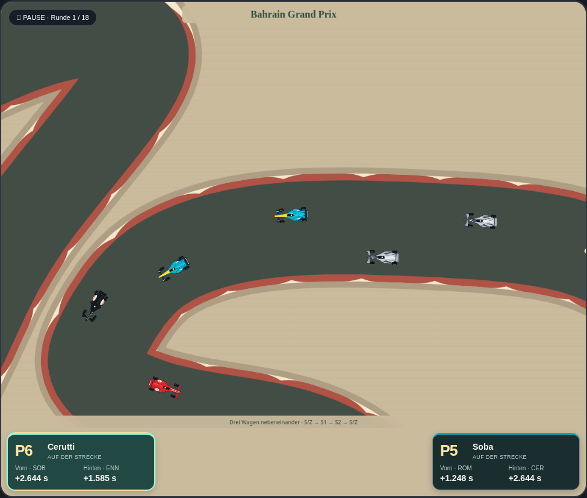
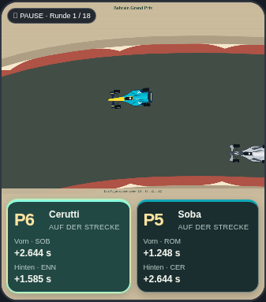

# Fahrer mit der Kamera verfolgen

Entwicklungsbranch `codex/driver-follow-camera`, Ausgangspunkt `2c3f998` auf `main`.
Die bisherige Auswahl-Markierung am Auto wird durch eine Verfolgungskamera ersetzt.

Ein Klick auf eine eigene Fahrerkarte oder eine Tower-Zeile zoomt zum sichtbaren
Fahrzeug und hält seine aktuelle Position exakt in der Mitte des Renn-Canvas.
Die Kamera folgt bei jedem gezeichneten Bild neu. Die Streckenorientierung bleibt
erhalten; es gibt kein Mitdrehen der Karte und kein verzögertes Hinterherziehen.
Ein Klick auf den anderen Fahrer wechselt das Ziel, ein erneuter Klick auf das
gewählte Ziel kehrt zur bisherigen Gesamtstrecke zurück. Die aktive Karte und
Tower-Zeile zeigen weiterhin an, welcher Fahrer ausgewählt ist.

Der grüne Leuchtring und die helle Fahrzeugumrandung werden in dieser Ansicht
nicht gezeichnet. Auch die unabhängige P1-Markierung wird während der Nahansicht
ausgeblendet und erscheint in der Gesamtansicht wieder gemäß der bisherigen
Einstellung. Ist das Kameramodul nicht verfügbar, bleibt die alte Markierung als
Rückfall erhalten.

Die Verfolgung funktioniert auch bei pausiertem Rennen, in der Boxengasse und
bei sichtbaren Qualifying-Fahrern. Ein ausgeschiedener Fahrer kann an seinem
abgestellten Fahrzeug betrachtet werden. Wird das ausgewählte Fahrzeug nicht
mehr gezeichnet, etwa nach Zielankunft oder am Ende seiner Qualifying-Fahrt,
kehrt die Kamera zur Übersicht zurück und hebt die Auswahl auf.

## Umsetzung

`CGPRaceCamera.follow()` verwendet unverändert die bestehende Gesamtansicht,
wenn kein gültiges Ziel vorhanden ist. Für ein Ziel verschiebt sie dessen
Zeichenposition auf `width/2, height/2` und verwendet einen gleichmäßigen Zoom.
Das Auto erhält eine Zielgröße von 56 CSS-Pixeln Länge, mindestens den doppelten
Zoom der Gesamtansicht. Damit bleibt es auch auf schmalen Mobilfenstern gut
sichtbar. Eine geänderte Fensterbreite wird beim nächsten Bild berücksichtigt.

`drawRace()` verwendet für die Kamera dieselbe `racePose()` beziehungsweise
`qualPose()` wie für das gezeichnete Fahrzeug. Das erhält die Darstellung in
Kurven, Boxengassen und an Brücken. Es gibt keine Begrenzung auf die Außenkanten
der Gesamtstrecke: Auch am Rand bleibt das Auto mittig. Außerhalb des Ausschnitts
liegende Streckenteile werden in der Nahansicht erwartungsgemäß nicht angezeigt.

Die vorhandene, nicht gespeicherte `focusedDriverId` und die Aktion `focus-driver`
bleiben die gemeinsame Auswahl für Karten und Tower. Es gibt keinen zweiten
Fokuszustand, keinen neuen Timer und keinen zusätzlichen Speicherschlüssel.
Die Größe des Rennfensters bleibt beim Fahrerwechsel gleich. Physik, KI,
Fahrzeugpositionen, Rennzeiten und Spielstandformat bleiben unverändert.
Titel und Fußzeile erhalten in der Nahansicht einen hellen Hintergrund, damit
sie auch über vorbeiziehender Fahrbahn lesbar bleiben.

Die Laufzeitdateien werden als `race-camera.js?v=3` und `team-driver-hud.js?v=2`
geladen. Der Offline-Builder bettet beide versionierten Verweise vollständig ein.

## Prüfungen

Modultests projizieren bewegte Zielpositionen auf allen 22 Strecken und in drei
Fensterbreiten auf die Bildmitte, prüfen einheitlichen Zoom und unveränderte
Geometrie/Eingabepositionen. Boxengassen und Zielpositionen außerhalb der bisherigen
Streckengrenzen werden ebenfalls geprüft; ohne Ziel muss dieselbe Übersicht
zurückgegeben werden.

Browsertests auf Desktop und Mobilformat erfassen die tatsächliche Canvas-Matrix
beim Zeichnen des ausgewählten Autos. Sie prüfen Mitte und Größe, echte Bewegung,
Fensteränderung, Fahrerwechsel, Rückkehr, pausiertes Rennen und Qualifying. Auch
das Ausbleiben der Auswahl-Leuchtgrafik/P1-Beschriftung und unveränderte
Spielstände beim reinen Kamerawechsel werden geprüft.

Historische Bildvergleiche verwenden nur im Test die vorherige Darstellung.
Der Quelltext-Rückvergleich nimmt zusätzlich nur die konkret benannten
Kamera-Hinweistexte und die beiden geänderten Markierungsbedingungen aus. Die
neue Kamera bleibt im bereits markierten Darstellungsblock; die gesamte
Simulation und bestehende Referenzen bleiben erhalten.

Zum Testen das Artefakt **carpet-grand-prix-offline** entpacken, die HTML-Datei
öffnen, ein Rennen laden oder starten und einen Fahrer anklicken.
Übernahme nach `main` erst nach ausdrücklicher Freigabe des konkreten PRs.
