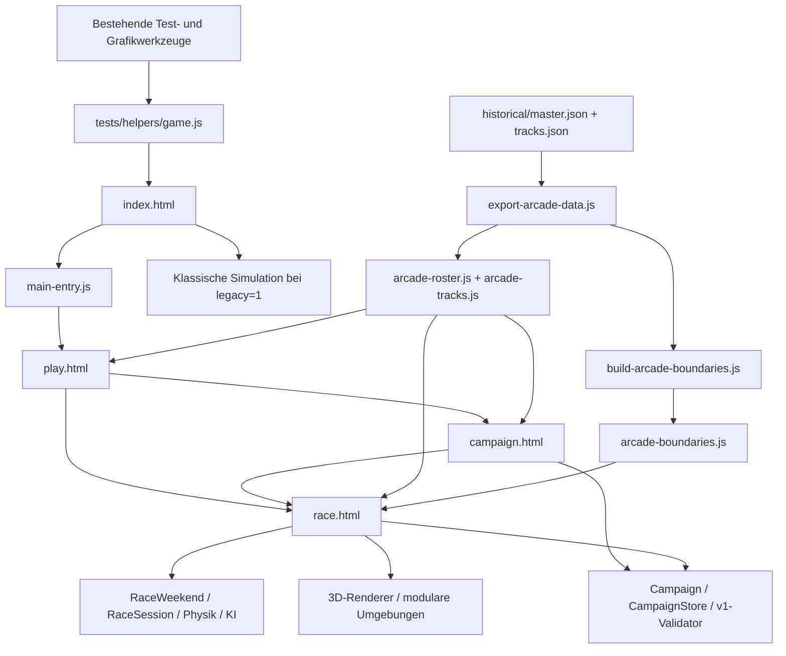

# Legacy Cleanup – PR 1: Abhängigkeiten und Datenentkopplung

Stand: 21. November 2026. Ausgangscommit (vor jeder Änderung):
**`f24cd7481bf474fa42dda6b9bdfe1088d633c16f`**, gemergter PR #51.
Feature-Branch: `codex/legacy-data-decoupling`. Kein Merge ohne Freigabe.

## Umfang und überprüfte Ausgangsbasis

Dieser PR löst die historischen Stammdaten aus der alten Anwendung. Er entfernt
keine aktive Funktion, keine Simulation, Tests, Assets, Styles oder Spielstände.
Die späteren Schritte sind ausdrücklich noch nicht ausgeführt.

Zum Analysezeitpunkt war `main` der neueste funktionierende POV-Stand. Alle
Remote-Branches und offenen PRs wurden über GitHub geprüft. Der einzige offene
PR war #13 (`codex/driver-duo-bust-crop`), eine ältere Darstellungsänderung der
klassischen Fahrerduo-Ansicht; er enthält keine neuere POV-Basis. Die aktuellen
POV-, Kampagnen-, HUD-, Touch- und Countdown-Branches sind bereits in `main`.
Der Branch #13 wird weder mit übernommen noch geschlossen.
Der Ausgangsstand hat außerdem [alle 23 CI-Jobs bestanden](https://github.com/mswierczok/carpet-grand-prix/actions/runs/44885596165).

Gelesen: `AGENTS.md`, `README.md`, `BASELINE.md`, `ARCHITECTURE.md`, `TESTING.md`,
`SAVE_FORMAT.md`, `CAMPAIGN.md`, aktuelle POV-/HUD-Dokumentation. Untersucht:
alle HTML-Einstiege und ihre Script-/CSS-Listen, `src/`, `styles/`, `assets/`,
Build-/Mess-/Preview-Skripte, npm-Abhängigkeiten, Testadapter, Fixtures und beide
versionierten Actions-Workflows. `rg`-Suchen nach HTML-Lesezugriffen,
`MASTER`, `digitizedTracks`, VM-/Adapter-Imports, dynamischen URL-Zuweisungen,
`document.write`, Assetpfaden und Storage-Schlüsseln ergänzen die Einstiegsliste.

## Abhängigkeitsübersicht



Vor PR 1 gab es zusätzlich `index.html → export-arcade-data.js`; diese
Abhängigkeit ist vollständig entfernt. Die letzte Test-/Werkzeugkante bleibt
bewusst sichtbar: Der Export ist unabhängig, die gesamte Testinfrastruktur
ist es in diesem ersten Schritt noch nicht.

### Einstiegspunkte und indirektes Laden

| Einstieg | Aktuelle Rolle | Einstufung / spätere Aktion |
| --- | --- | --- |
| `play.html` | Hauptmenü, Auswahl, Einstellungen, POV-Spielstand und Werkstattzugang | KEEP |
| `campaign.html` | Acht-Strecken-Kampagne, Team-/Fahrerauswahl und Ergebnisarchiv | KEEP |
| `race.html` | Gemeinsame Engine für freies Rennen, Meisterschaft und Kampagne | KEEP |
| `arcade.html`, `arcade3d.html` | Technische 2D-/3D-Fahrtests aller 22 Strecken | KEEP |
| `index.html` | Normale Weiterleitung, zugleich vollständige klassische Anwendung | EXTRACT-Daten erledigt; Simulation ARCHIVE, danach kleiner Root-Einstieg KEEP (PR 2) |
| `src/ui/main-entry.js` | Weiterleitung, Ausnahme `?legacy=1` | KEEP in PR 1; danach durch robusten schlanken Einstieg ersetzen |

Die Anwendungsdateien sind geordnet geladene IIFEs mit gemeinsamen
`CGPArcade`-/`CGPArcadeData`-Namespaces. Ein fehlender ESM-Import beweist deshalb
keine Unbenutztheit. Alle 74 externen Scripts von `race.html` sind Teil des
aktuellen Einstiegspfads. `play.html` lädt 14, `campaign.html` 12, der freie
2D-Test 19, der freie 3D-Test 37. Die klassische `index.html` referenziert 13
Scripts plus ihre große Inline-IIFE.

Kein zusätzlicher dynamischer Scriptloader wurde in den Anwendungsquellen
gefunden. Dynamisch bleiben jedoch Bilder nach Team-/Fahrer-ID, SVG-/Canvas-
Kompositionen, CSS-Hintergründe sowie Offline-HTML: `build-arcade-offline.js`
liest die tatsächlichen HTML-Scriptlisten und bettet deren Quellen ein;
`createCampaignOffline()` wählt per Query und `document.write` zwischen Menü und
Rennen. Allein eine Suche nach literalen Assetnamen reicht daher nicht aus.

## Klassifikation der Codebasis

**KEEP** bedeutet aktuell benötigt oder geschützte Grundlage. **EXTRACT**
bezeichnet eine aufzulösende Kopplung. **ARCHIVE** ist historisch wichtig und
soll außerhalb der aktiven Anwendung erhalten bleiben. **DELETE** verlangt,
dass nach der Entkopplung kein benötigter Verbraucher verbleibt.

| Bereich / Dateien | Einstufung | Begründung und Abhängigkeiten |
| --- | --- | --- |
| Sämtliche `src/racing/*.js` | KEEP | Aktive Physik, Eingaben, KI, Kollisionen, Seile, Brücken, Boxengasse, Windschatten, Aufholhilfe, Timing und Wochenenden |
| Sämtliche `src/championship/*.js` | KEEP | Kampagne und **neue POV-Meisterschaft**, keine alte 26-Fahrer-Simulation |
| `src/management/pov-workshop.js` | KEEP | Aktuelle POV-Werkstatt und Basis zukünftiger Fahrzeugentwicklung |
| Sämtliche `src/persistence/*.js` | KEEP | Getrennte POV-/Kampagnenslots; insbesondere `campaign-v1.js` ist ein benötigter Migrationsvalidator |
| `arcade-{roster,tracks,boundaries}.js`, `race-formats.js`, `campaign-config.js` | KEEP | Aktive Browserdaten; alle 22 Strecken, acht Kampagnenstrecken, 39 Fahrerplätze |
| `src/data/historical/*` | KEEP | Neue unabhängige Datenquelle und vollständige historische Kalenderreferenz |
| `src/rendering/race-sprites.js`, `pilot-vehicles.js` | KEEP | **Gemeinsame** Fahrzeugformen/Teamfarben in altem und aktuellem Spiel; nicht als Legacy löschen |
| Übrige 2D-/3D-Renderer einschließlich `wake-visuals`, `wake3d`, `fleet3d`, `three-entry` und sämtlicher Environment-/Material-/Bahrain-/Kinderzimmermodule | KEEP | Aktuelle Fahrtests, Renderer, Build-Eingang, Brücken und modularer Assetbaukasten |
| `src/vendor/three.js`, `licenses/three-MIT.txt` | KEEP | Lokaler reproduzierbarer Three-Build, keine CDN-Laufzeitabhängigkeit |
| Aktuelle UI: `arcade-race-ui`, `campaign-{launch,race-ui,view}`, `pov-{game-ui,launch,workshop-ui}`, `qualifying-ui`, `race-presentation`, `race-settings`, `racing-hud`, `result-details`, `resume-countdown` | KEEP | Menü, HUD, alle 13 Fahrer, Pflichtqualifying, Archiv, Pause und Countdown |
| `driver-identities.js`, `uploaded-portraits.js` | EXTRACT / KEEP | Klassisch geladene Grafikdaten; feste Identitäten und Porträt-Mapping nicht ohne Ersatz löschen. Originale und Kampagnenporträts bleiben geschützt |
| `world-environments.js`, `pilot-world.js`, `driver-portraits.js` | ARCHIVE / EXTRACT | Nur im klassischen HTML geladen; zusätzlich alte Welt-/Porträtgeneratoren und Stilreferenzen. Erhaltenswerte Daten vor Entfernung vom Generator trennen |
| `race-camera.js`, `render-motion.js`, `driver-profiles.js`, `live-dom.js`, `team-driver-hud.js` | ARCHIVE | Nur klassischer 2D-Simulationspfad und dessen UI-/Referenztests; keine neue POV-Kamera/HUD-Implementierung |
| Inline-Verwaltung/Simulation in `index.html` | ARCHIVE | Teamchef, 26 Cockpits, Q1/Q2/Q3, Verträge, Finanzen/Forschung, Saisonautomatik; nach Archivierung aus aktivem Einstieg entfernen |

Diese Aufteilung deckt alle vorhandenen `src`-Module ab. Der einzige JS-Eingang
ohne direkten HTML-Script-Tag ist `rendering/three-entry.js`; er wird vom
Three-Build verwendet. Die Laufzeitquelle für Physik und KI liegt bereits
außerhalb der klassischen Simulation; es wird keine zweite Engine extrahiert.

### Assets und Styles

| Bestand | Einstufung / Entscheidung |
| --- | --- |
| `assets/cars/` (54 Dateien) | KEEP: Team-WebPs im Menü und in Kampagnenkarten; gemeinsame SVG-Quellen/Exporte und Teamidentitäten erhalten |
| `assets/drivers/` (164 Dateien) | KEEP / EXTRACT: 35 unveränderte Original-PNGs, WebPs und Mapping werden benötigt. 92 historische Identitäten und bisherige Vektorreferenzen zunächst erhalten; vier fehlende Kampagnenillustrationen bleiben dokumentierte Platzhalter |
| `assets/tracks/` (22 Dateien) | KEEP: Originalzeichnungen und Herkunft aller technisch erhaltenen Strecken |
| `assets/world/arcade-materials.png` | KEEP: Laufzeit- und Offline-Materialatlas |
| `assets/backgrounds/studio-event.webp` | ARCHIVE: klassisches Studio; erst nach Entfernung der alten CSS-/Preview-Verbraucher aus aktiven Ressourcen nehmen |
| `assets/references/` (14 Dateien) | ARCHIVE: Nutzer-/Stilreferenzen, keine Freigabe zur ersatzlosen Löschung |
| `assets/manifest.json` | EXTRACT: aktuell klassischer Offline-Build, Byte-/CSS-/Bildtests und historische Herkunft. Vor Entfernen verbleibende Integritätsreferenzen trennen |
| `arcade.css`, `arcade-race.css`, `campaign.css`, `pov-launch.css`, `racing-hud.css` | KEEP: sämtliche aktuellen Ansichten |
| `base.css`, `race.css`, `launch.css`, `studio.css`, `live-layout.css`, `team-select.css`, `workshop.css`, `team-driver-hud.css`, `art-pilot.css`, `driver-portraits.css` | ARCHIVE → DELETE aus aktiver Auslieferung nach PR-2/3-Entkopplung: nur klassische HTML-/Offline-/Referenzverbraucher. Noch nicht unbenutzt |

Es gibt in PR 1 **keine sicher freigegebene DELETE-Datei**. Die benannten
klassischen CSS-/UI-Dateien können später entfernt werden, sobald Einstieg,
Offline-Ausgabe, Generatoren und Tests keine aktiven Verbraucher mehr sind.
Es wurden keine CSS-Kaskaden zusammengelegt und keine Darstellungen geändert.

### Build-, Test- und CI-Abhängigkeiten

| Komponente | Einstufung / erforderlicher Folgeschritt |
| --- | --- |
| `export-arcade-data.js` | EXTRACT erledigt: JSON statt HTML; zusätzlicher schreibfreier `--check` |
| `build-arcade-boundaries.js`, `lib/{pov-bridges,pov-dividers,bahrain-iteration2}.js` | KEEP: Exportdaten → Seile/Brücken; Bahrain-Profil bleibt exakt erhalten |
| `build-race-formats.js` und `docs/race-duration/clean-reference.json` | KEEP: unabhängige bestehende Rundenzahlquelle, keine Neuberechnung des Balancings |
| `build-arcade-offline.js`, `build-arcade3d-engine.js` | KEEP: aktive fünf Offline-Ausgaben und lokale Engine |
| `build-{bahrain,calendar,hud}-review.js`, zugehörige Capture-/Review-Werkzeuge | KEEP: aktuelle spielbare Abnahme und Nachweise |
| `build-uploaded-portraits.js` | EXTRACT: nutzt `createGame()` nur für historische Fahrernamen/IDs; später auf `master.json` umstellen, Originale nicht neu zeichnen |
| `build-world-review.js` | EXTRACT / ARCHIVE: nutzt echten alten Geometrie-/Zeichenadapter; reine Datenumstellung reicht nicht. Historische Weltgalerie und aktive Porträtintegrität trennen |
| `build-offline.js`, alte Art-/Race-Preview-Generatoren, `benchmark-rendering.js`, `capture-pilot-preview.js` | ARCHIVE: klassische portable Simulation / alte 2D-Abnahme; CI-Artefakte und Links erst mit deren Entfernung umstellen |
| POV-Messskripte | KEEP / EXTRACT: viele importieren `tests/helpers/arcade.js`, das indirekt die alte HTML-Datei liest; historische Git-Vergleiche ausdrücklich als Referenzen behalten |
| `tests/helpers/game.js`, `reference.js`, `original-html.js`, `extended-scenario.js`, `generate-fixtures.js` | ARCHIVE / EXTRACT: klassische VM und historische Referenzen; nicht als Produktions-Datenquelle einsetzen |
| `tests/helpers/arcade.js` | EXTRACT: benötigt aus `game.js` zunächst nur `ROOT`, importiert damit aber dessen sofortigen HTML-Lesezugriff. Für PR 2 gemeinsamen unabhängigen Testpfad schaffen |
| `tests/helpers/server.js` | EXTRACT: importiert klassische Offline-/Original-Generatoren neben aktiven Ausgaben. Vor Entfernen von `index.html` diese Routen sauber trennen |
| `tests/unit/game.test.js`, `tests/integration/reference.test.js`, `tests/extended/season.test.js` und klassische Browserfälle | ARCHIVE: zu entfernende Funktionen; nicht ersatzweise aktuelle Prüfungen abschalten |
| Gemischte Asset-/Porträt-/Kalender-/Kamera-/Fahrtests | KEEP / EXTRACT: historische Quellnormalisierung, `createGame()` und `withoutMainEntry()` teilweise auch in POV-Tests. Benötigte Geometrie-, Daten-, Speicher- und Assetaussagen übernehmen |
| `tests/fixtures/*` | ARCHIVE / KEEP als Referenz: künstliche klassische Speicherstände, aktuell auch Quelle von Trennungs-/Kompatibilitätsprüfungen. Keine Fixture wird in PR 1 verändert |
| `.github/workflows/tests.yml` | KEEP: bestehende 23 Jobs bleiben; einziger Zusatz ist `check:arcade-data` vor den vorhandenen Build-/Unitprüfungen |
| `.github/workflows/extended-tests.yml` | ARCHIVE später: reine alte Mehrsaisonprüfung; getrennte Freigabe in PR 3 |

Browserfälle für die alte Simulation werden über `?legacy=1` geöffnet, moderne
Fälle über `play.html`, `campaign.html` und `race.html`. Tests mit klassischen
Vergleichsbytes dürfen nach der Entfernung nicht pauschal gelöscht werden:
Geometrieäquivalenz aller 22 Kurse, historische Daten, sichere Speicherbereiche,
aktive Teamfahrzeuge und Porträts brauchen weiterhin aktuelle Gegenprüfungen.

Konkrete spätere Testaufteilung:

- Klassische UI-Abnahme archivieren: `tests/browser/{game,driver-follow,
  race-camera,team-driver-hud,workshop}.spec.js`. `workshop.spec.js` prüft die
  alte SVG-Verwaltung; `pov-career.spec.js` schützt dagegen die neue Werkstatt
  und bleibt aktiv.
- Gemischte Grafik-/Assetfälle zuerst aufteilen: `tests/browser/{assets,
  art-pilot,liveries,race-sprites,uploaded-portraits,world-and-drivers}.spec.js`
  sowie die entsprechenden Unitprüfungen. Alte Ansichten/Galerien archivieren;
  Bilddekodierung, feste Teamfarben, gemeinsame Fahrzeugformen, Originalhashes,
  Fahrerzuordnung und aktive Offlinebilder weiter absichern.
- Sämtliche `arcade*`, POV-, Bahrain-/Kalender-, Kampagnen-, HUD-, KI-,
  Windschatten-/Aufhol-, Boxen-/Ampel-, Seil-, Qualifying-, Touch- und
  Countdownprüfungen bleiben aktive Regressionen. Historische HTML-/VM-
  Referenzen darin gezielt ersetzen. Insbesondere `qualifying.spec.js` prüft
  das **aktuelle** Solo-Qualifying und ist kein entfernbarer Q1/Q2/Q3-Test.
- Klassische Referenz-Fixtures zunächst nicht löschen: mehrere aktive Tests
  verwenden diese als Speicher-Sentinel oder Datenvergleich. Den benötigten
  Aussagekern übernehmen, bevor alte Generatoren/Adapter entfernt werden.

Alle acht npm-Entwicklungsabhängigkeiten haben noch Verbraucher: Playwright und
Vitest für Tests, Three für Renderer-Build und Modelltests, Rolldown für den
lokalen Engine-Build, `polygon-clipping`/`clipper-lib` für Seilkonturen,
`pngjs`/`pixelmatch` für bisherige Bildtests. Kein Paket wird in PR 1 entfernt.
Insbesondere `clipper-lib` und Polygonvereinigung sind keine Laufzeitdownloads.

## Umsetzung: unabhängige Stammdaten

Die vollständigen JSON-Konstanten `MASTER`, `digitizedTracks` **und** `trackDefs`
wurden ohne Auswertung von JavaScript extrahiert. Ziel:
`src/data/historical/{master,tracks,track-defs}.json`.
Die Originale und das komplette klassische HTML bleiben in diesem PR unverändert.

`arcadeData()` liest nur `master.json` und `tracks.json`. Die vorhandenen
POV-Aufbereitungen und ihre Reihenfolge sind unverändert. Historische Kalender-
Tupel sind zusätzlich gesichert, werden aber nicht neu in die Rennphysik eingebaut.
Der aktive Pool bleibt in `campaign-config.js`: Bahrain, Kanada, Russland, Korea,
Frankreich, Japan, England und Italien. Es werden weder 22-Rennen-Meisterschaft
noch acht Kampagnenstrecken oder 39 Fahrerplätze neu erzeugt/umgeordnet.

Das Quell-JSON erhält alle Eigenschaften und deren Reihenfolge. Einrückung und
gleichwertige numerische Schreibweisen unterscheiden sich; die nach `JSON.parse`
serialisierten Werte sind gleich. **Die erzeugten Browserdateien sind byteidentisch.**

| Datei | Bytes vorher / nachher | SHA-256, unverändert |
| --- | --- | --- |
| `src/data/arcade-roster.js` | 16.449 / 16.449 | `9e64b6cc8693a96a4cdd6924200055bb4840adde58b13c8f117bc476142b0920` |
| `src/data/arcade-tracks.js` | 417.103 / 417.103 | `af32cf5939d3dc1b1c7cd0a93a01e3e782db8eb7e7be66203cfe2fbd8414677b` |
| `src/data/arcade-boundaries.js` | 446.928 / 446.928 | `6813865323000a4b0293b8a6f3f65c5e0f496dda65fb901dc74073fd6632d4a0` |
| `src/data/race-formats.js` | 3.161 / 3.161 | `14a1df80a6442190b2cddd3e510aee3ab3a655ff71b13ac92819697d745e55b5` |

Die Datenbank-Prüfsumme bleibt
`17f3949b0fe047658af79ff4b95de1363ce5471b13fe4f3b05457eb277135946`.
Der bestehende Kommentar in den Browserexporten bleibt aus Gründen der
Byteidentität erhalten. Die Herkunftsprüfung liest ausschließlich im Test den
festen Git-Ausgangscommit; der CLI-Build benötigt weder Git noch HTML.

## Speicher, Archivierung und geschützte Grenzen

Kein Storage-Modul, Validator oder Schlüssel wird geändert. Insbesondere bleiben
`carpet_gp_campaign_v1` (Inhalt v2 mit v1-Migration), `carpet_gp_pov_game_v1`,
`carpet_gp_pov_preferences_v1`, `carpet_gp_pov_selection_v1` und klassische
`carpet_gp_v072`-/Präferenz-/Logo-/Backup-Schlüssel erhalten. Keine Löschung,
Migration oder Übertragung klassischer Spielstände findet statt.

**Vor PR 2 erforderlich:** den letzten dann funktionsfähigen klassischen Stand
mit einem eindeutigen Git-Tag archivieren und dessen Commit/Tag dokumentieren.
PR 1 legt noch keinen vorgezogenen Abschlusstag an und entfernt die Simulation
nicht. Der hier dokumentierte Ausgangscommit ist bereits wiederherstellbar:

```sh
git worktree add --detach ../carpet-grand-prix-classic f24cd7481bf474fa42dda6b9bdfe1088d633c16f
```

Aus diesem separaten Checkout kann `npm ci && npm run build:offline` die
klassische Datei erzeugen. Vorhandene klassische JSON-Exporte dort über Import
öffnen. Browserdaten sind nach Origin und gegebenenfalls Dateipfad getrennt:
Ein anderer lokaler Port sieht nicht automatisch den alten Browserstand.
Deshalb vor einem Umzug im bisherigen `index.html?legacy=1` exportieren und in
der archivierten Version importieren. Niemals die LocalStorage-Schlüssel des
neuen Spiels dafür umbenennen oder überschreiben. Ein späterer Archivzugang
muss das verständlich erklären; `?legacy=1` darf in PR 2 keine leere Seite ergeben.

## Prüfnachweise und Grenzen

Die folgenden Daten-/Buildnachweise gehören zu PR 1. Der Pull Request hält
zusätzlich den abschließenden Status der längeren Unit- und Browserregressionen
mit ihren konkreten Befehlen fest.

Bereits abgeschlossene Daten-/Build-Prüfungen:

- `npm run build:arcade-data` und `npm run check:arcade-data`: erfolgreich,
  beide generierten Dateien unverändert.
- `historical-data.test.js`: vier Prüfungen erfolgreich, einschließlich aller
  drei ursprünglichen Konstanten und isolierter Fehlerfälle.
- `check:arcade-boundaries`, `check:race-formats`, `check:arcade3d-engine`:
  erfolgreich; keine neuen Geometrie-, Rennlängen- oder Enginebytes.
- `build:arcade-offline` und `build:offline`: erfolgreich. Zusätzlich gegen die
  vor der Änderung erzeugten Dateien geprüft: Menü **2.912.651 Bytes**,
  Kampagne **18.525.797 Bytes**, Rennen **11.720.339 Bytes**, jeweils exakt
  gleicher SHA-256. Klassische Offline-Datei weiterhin **9.780.773 Bytes**.

Ein lokaler Exportvergleich unter Node **24.22.1** lädt den unveränderten
Exporter des Ausgangscommits aus einer temporären Kopie und den neuen Exporter
im selben Prozess. Nach vier Warmup-Runden werden 20 Läufe pro Variante in
abwechselnder Reihenfolge gemessen: Median **67,61 ms vorher / 45,04 ms nachher**.
Währenddessen liefen Regressionstests; die Werte sind ein Entwicklungsbenchmark,
kein Browser-Ladezeit- oder FPS-Nachweis. Der identische erzeugte Inhalt wird
vor dem Zeitvergleich geprüft. Die zusätzlichen Quelldaten umfassen 589.481 Bytes;
die Repositorygröße wächst vorübergehend, solange das klassische HTML noch besteht.

Neue Prüfungen sichern den vollständigen Herkunftsvergleich der drei Konstanten,
die 13/92/22 Identitäten, Brücken und Bahrain-Konfiguration, die Byteidentität
der Exporte und einen isolierten CLI-Lauf ohne klassische Anwendung ab.
`--check` darf abweichende Dateien nicht reparieren. Fehlende/defekte Eingaben
müssen vor jedem Ersetzen eines Exports abbrechen.

Die bestehenden Unit-/Integrationstests schützen zusätzlich Physik, KI,
Windschatten, Aufholhilfe, Kontakte, Boxengassen, Brücken, 39 Fahrerplätze,
Kampagnenmigrationen und Speicherfehler. Die ausgewählten echten Browserläufe
prüfen Hauptmenü, Pflichtqualifying, zwei Grand Prix (Bahrain/Kanada), Archiv,
Wiederaufnahme, Vollbild-HUD, Menü/Countdown und native Touchbedienung.
Rennen im langen Kampagnentest verwenden wie bisher die öffentliche Ein-Runden-
Option; Qualifying, Fahrbefehle, Zeitmessung und alle 13 Zieleinläufe bleiben echt.

Die neuen JSON-Quellen werden nicht von HTML referenziert und nicht im
Offline-Build eingebettet. Damit ändern sich weder Browser-JS-Dateizahl noch
übertragene Spielressourcen. Laufzeit-/Assetdateien werden gegen den Ausgangs-
commit byteweise geprüft. Dieser Schritt verspricht keine höhere 3D-FPS oder
schnellere Menüs. Der Vergleich nach dem eigentlichen Entfernen der Simulation
folgt in PR 2–4 unter gleichen Browserbedingungen. Physisches iPhone/Safari
ist hier nicht verfügbar; mobile Chromium-Emulation ist kein Gerätetest.

## Freigabefolge und Risiken

1. **PR 1:** Diese Analyse, statische Quellen, unabhängiger Export, Identitäts-
   und Regressionstests. Zur Freigabe vorlegen; nicht mergen.
2. **PR 2, erst nach Freigabe:** klassischen Stand taggen, benötigte Werkzeuge /
   Testpfade entkoppeln, Root-Einstieg vereinfachen, passive Anwendung archivieren
   und aus aktiven Pfaden entfernen. Keine POV-Meisterschaft/Werkstatt löschen.
3. **PR 3, separat:** belegte Legacy-Asset-/CSS-/Test-/Build-Verbraucher entfernen,
   erhaltene Daten-/Geometrie-/Speicheraussagen modernisieren; CI und npm säubern.
4. **PR 4, separat:** restliche Architektur-/Dokumentationskonsolidierung und
   abschließende vollständige Regression samt Lade-/Ressourcenvergleich.

Hauptrisiken sind indirekte `game.js`-Imports, klassische Offline-Routen im
Testserver, dynamisch konstruierte Bildpfade und historische Quelltextprüfungen.
Die neue JSON-Quelle und das vorerst eingebettete klassische Duplikat dürfen
nicht auseinanderentwickelt werden: PR 1 prüft beides gegen den festen
Ausgangscommit; Änderungen an Stammdaten sind nicht Teil dieses Auftrags.
Keine neue Engine, Run-Map, Physik, Items oder Spielstandversion wird eingeführt.
