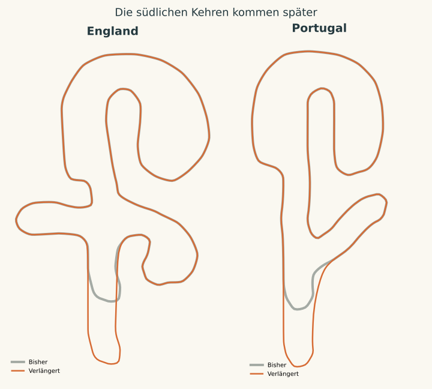

# England und Portugal: südliche Kehren später erreichen

Ausgangsbasis: veröffentlichtes `main` `31003409aa5af06939e352a72bad1b823c1a3106`.
Branch: `codex/pov-southern-extensions`. Kein automatischer Merge.

Die untersten Kehren beider POV-Strecken werden um 140 interne Welteinheiten
nach Süden verschoben. Ihre Anfahrten und Rückwege werden entsprechend länger.
Die Kehren selbst behalten ihre Form. England verändert nur die unterste Kehre;
die zusätzliche rechte Schleife bleibt an derselben Stelle. Norden und übrige
Streckenabschnitte sowie beide Fahrbahnbreiten bleiben erhalten.

| Strecke | Rundenlänge bisher | Neue Rundenlänge | Mehr Fahrweg |
| --- | ---: | ---: | ---: |
| England | 2.651,761 | 2.929,623 | 277,862 |
| Portugal | 2.442,548 | 2.709,654 | 267,106 |

Die Angaben sind interne Weltkoordinaten, keine Meter. Längere Fahrwege können
die Rundenzeiten erhöhen. Geschwindigkeit, Lenkung, Grip, KI-Tempoprofile und
Fahrzeuggröße werden nicht geändert. Die Verfolgerkamera bleibt unverändert;
die Übersicht passt die vollständige verlängerte Strecke ins Fenster ein.

## Gemeinsame Geometrie

`track-shape.js` ergänzt ein optionales `pov.southExtension` nach der bisherigen
Normierung. Nur der angegebene ursprüngliche Streckenabschnitt wird verändert.
Eine monotone Höhenverschiebung mit glatten Tangenten- und Krümmungsanschlüssen
verbindet die alte Anfahrt mit der nach Süden übersetzten Kehre. Der verlängerte
Bereich erhält ausreichend dichte Zwischenpunkte. Ein Profil mit versetzten
Abschnittsgrenzen lässt die Aufbereitung scheitern.

Sektoren bleiben an ihren ursprünglichen Streckenstellen verankert: Bewegte
Sektorpunkte werden in die neue Geometrie übernommen, die normierten Sektorwerte
werden aus den neuen Bogenlängen berechnet. Die Regel S1 → S2 → Ziel und die
Rundenzählung bleiben unverändert. Boxengassen und Startaufstellungen liegen
außerhalb der Verlängerungen.

Darstellung und Physik verwenden dieselbe `Surface`; beide Seilkonturen werden
neu erzeugt. Rennen, freie 3D-Fahrt, Draufsicht und Offline-Versionen enthalten
dieselben Änderungen. Geänderte Laufzeitmodule erhalten neue Cache-Versionen.

Die Originalzeichnungen in `index.html` werden nicht bearbeitet. Die anderen
20 POV-Datensätze, Geometrien und Seilkonturen bleiben exakt erhalten,
einschließlich der Brücken. Teams, Fahrer, Stammdaten und Spielstände bleiben gleich.

## Prüfung

Neue Geometrieprüfungen vergleichen die anderen 20 Strecken und die unveränderten
Fahrmodule mit dem veröffentlichten Stand. Für beide Kehren prüfen sie die
tatsächliche südliche Verlagerung, erhaltene Form, Breiten und Nordabschnitte,
die verankerten Sektorpunkte und gültige Runden über die volle Seilbreite.
Die vorhandenen Kalenderprüfungen fahren jeweils drei Runden mit allen 13 Autos
und testen Startaufstellung, Kamera und endliche Bewegung ohne Seildurchdringung.
Browserprüfungen fahren beide Strecken per Tastatur auf Desktop und Mobilformat.

Die vollständige bisherige Testserie bleibt aktiv. Es werden keine Referenzfixtures
ersetzt. Umfang und Grenzen des POV-Modus stehen in [POV_CALENDAR.md](POV_CALENDAR.md).
