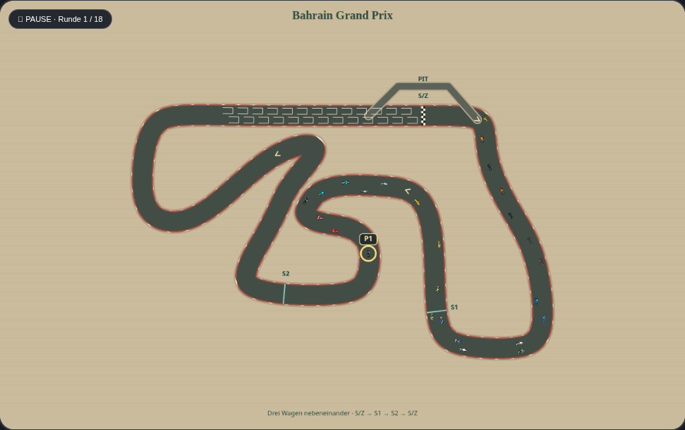

# Rennansicht mit größerem Streckenzoom

Entwicklungsbranch `codex/race-camera-fit`, Ausgangspunkt `2c9084c` auf `main`.
Der neue Zoom nutzt den freien Rand des vorhandenen Renn-Canvas. In Bahrain
werden Strecke und Fahrzeuge um rund 28 % größer dargestellt; bei den 22 Kursen
liegt der Gewinn zwischen rund 22 und 32 %.

Vorher, mit demselben pausierten Rennstand:

Nachher:

## Einbindung

`src/rendering/race-camera.js` berechnet aus den vorhandenen Streckenpunkten,
Straßenrändern, Boxengassen und den Positionen der Sektor-Beschriftungen einen
Zeichenrahmen. Die vorhandene Funktion `trackAt()` liefert unverändert die
Beschriftungspositionen. Der Rahmen wird proportional in den verfügbaren Platz
eingepasst: 20 Canvas-Einheiten Seitenrand, 64 oben für Titel/Rundenanzeige und
34 unten für die bestehende Fußzeile. Mindestens eine Achse nutzt den Platz aus;
bei schmalen Strecken bleibt seitlich ein geometrisch notwendiger Rand.

`drawRace()` speichert vor dem Zeichnen der Strecke den Canvas-Zustand und wendet
die Kameraverschiebung samt gleichmäßigem Zoom an. Straße, Autos, Startplätze,
Boxengasse, Brücken, Sektoren, Fahrerfokus, Schadens- und Führendenmarkierung
werden zusammen vergrößert. Vor Titel und Fußzeile wird der Zustand wiederhergestellt.
Das gilt für Startaufstellung, Live-Qualifying und Rennen.

Die berechnete Kamera wird je Geometrie und Canvas-Größe zwischengespeichert.
Es gibt keine Zufallsaufrufe und keine Änderung der Geometrie, Rennpositionen,
Kollisionsmaße, KI, Zeiten, Fahrzeugwerte, Spielstände oder Browsereinstellungen.
Ohne das Modul wird weiterhin die bisherige Ansicht gezeichnet. Der bestehende
Offline-Builder bettet das zusätzliche Script ein; GitHub Pages benötigt keinen Build.

## Nachweise und Grenzen

- Modultests prüfen alle 22 echten Geometrien in zwei Canvas-Größen: endliche
  Kamerawerte, vollständigen Rahmen im verfügbaren Bereich, gemeinsame Skalierung,
  Nutzung mindestens einer Achse und unveränderte Eingabedaten. Straßenränder,
  Boxengassen und Sektor-Beschriftungen werden einzeln abgesichert. Auch das
  bisherige Ersatzoval funktioniert.
- Browsertests prüfen die wirkliche Canvas-Transformation für Startaufstellung,
  pausiertes Qualifying und Rennen auf Desktop und Mobilformat. Nach dem Zeichnen
  muss die Transformation wieder auf Identität stehen. Die Kamera darf während
  des Zeichnens den Spielstand nicht verändern.
- Historische Bildvergleiche schalten ausschließlich im Test die Kamera aus;
  die übrige Oberfläche bleibt mit dem Original vergleichbar. Die neuen
  Kameratests, Spieltests und die Offline-Prüfung verwenden den tatsächlichen Zoom.
  Alte Bild- und Simulationsreferenzen werden nicht neu erzeugt.
- Der bytegenaue Quelltext-Rückvergleich nimmt zusätzlich ausschließlich die beiden
  markierten Kamerastellen und das externe Darstellungsscript aus. Die bisherige
  Streckenerzeugung und der gesamte Simulationscode bleiben unter dem Originalvergleich.

Die Strecke wird weder gestreckt noch beschnitten. Dies ist ein automatischer
Gesamtstreckenzoom; eine manuell steuerbare oder einem Fahrer folgende Kamera
ist nicht Bestandteil dieser Änderung.

Zum Prüfen das Artefakt **carpet-grand-prix-offline** aus dem erfolgreichen
PR-Testlauf herunterladen und die HTML-Datei öffnen. Bestehende Spielstände
lassen sich über die vorhandene JSON-Importfunktion testen. Übernahme nach
`main` erst nach Freigabe des konkreten PRs.
