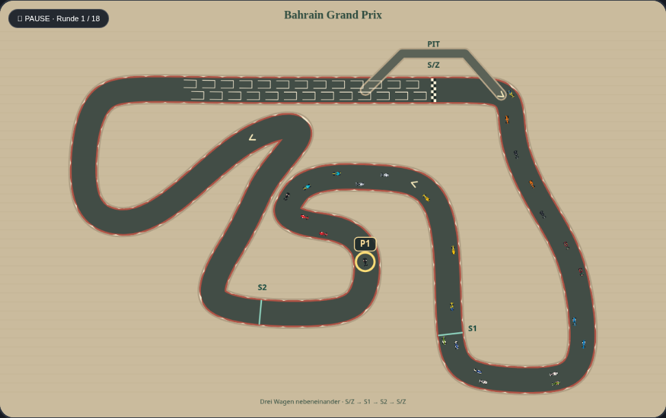
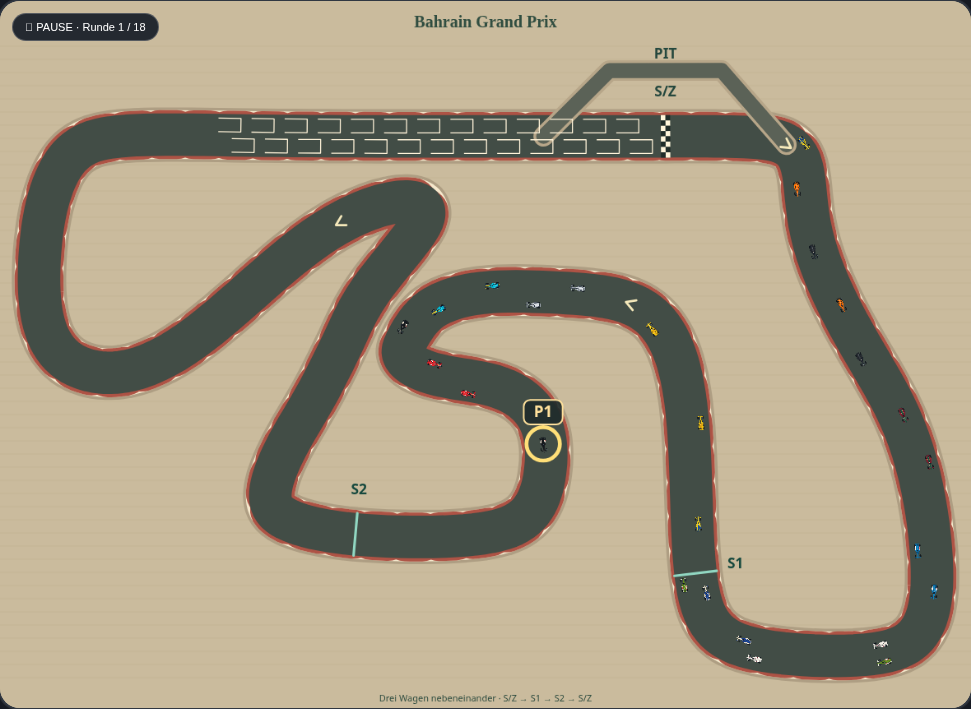

# Rennansicht fast bis zum Rand

Entwicklungsbranch `codex/race-edge-to-edge`, Ausgangspunkt `3d36927` auf `main`.
Die bisherige Kamera aus PR #7 behielt einen festen Rahmen von 1180 × 740 bei.
Der Rahmen passt sich jetzt zusätzlich an die Streckenform an. Bahrain nutzt die
Breite nahezu vollständig: 8 Zeicheneinheiten Seitenrand statt 20, bei einer
Zeichenfläche von 1180 × 860. Strecke und Fahrzeuge wachsen gegenüber PR #7
nochmals um rund 23 %, gegenüber der ursprünglichen Ansicht um rund 57 %.

Vorher, mit demselben pausierten Rennstand:

Nachher:

## Einbindung

`src/rendering/race-camera.js` berechnet aus den vorhandenen Streckenpunkten,
Straßenrändern, Boxengassen und den Positionen der Sektor-Beschriftungen einen
Zeichenrahmen. Die vorhandene Funktion `trackAt()` liefert unverändert die
Beschriftungspositionen. Der Rahmen wird proportional in den verfügbaren Platz
eingepasst: 8 Canvas-Einheiten Seitenrand, 48 oben für Titel/Rundenanzeige und
24 unten für die bestehende Fußzeile. `resize()` berechnet vor dem Zeichnen aus
dem Streckenrahmen die passende Canvas-Höhe, begrenzt auf 620 bis 1000 Einheiten.
Bei Kursen innerhalb dieser Grenzen werden beide Achsen nahezu vollständig
genutzt; sehr schmale Kurse behalten seitlich einen geometrisch notwendigen Rand.

`drawRace()` speichert vor dem Zeichnen der Strecke den Canvas-Zustand und wendet
die Kameraverschiebung samt gleichmäßigem Zoom an. Straße, Autos, Startplätze,
Boxengasse, Brücken, Sektoren, Fahrerfokus, Schadens- und Führendenmarkierung
werden zusammen vergrößert. Vor Titel und Fußzeile wird der Zustand wiederhergestellt.
Das gilt für Startaufstellung, Live-Qualifying und Rennen.

Die CSS-Seitenverhältnisvorgabe und die bisherige maximale Höhe werden nur am
Renn-Canvas durch `aspect-ratio: auto` und `max-height: none` ersetzt. Die Darstellung
folgt dadurch dem tatsächlichen Canvas-Format und wird nicht gestaucht. Die
Fußzeile wandert an den unteren Rand; das Hintergrundmuster reicht über die
gesamte Höhe. Die Gesamtfläche kann insbesondere bei schmalen Strecken höher
werden. Die Höhengrenze verhindert eine beliebig lange Karte.

Die Kameradatei wird aktuell mit `?v=3` geladen, um eine zuvor gespeicherte Scriptfassung
nicht erneut zu verwenden. Der Offline-Builder bettet auch diesen versionierten
Verweis ein. Das Spiel benötigt weiterhin keinen Produktions-Build.

Die berechnete Kamera wird je Geometrie und Canvas-Größe zwischengespeichert.
Es gibt keine Zufallsaufrufe und keine Änderung der Geometrie, Rennpositionen,
Kollisionsmaße, KI, Zeiten, Fahrzeugwerte, Spielstände oder Browsereinstellungen.
Ohne das Modul wird weiterhin die bisherige Ansicht gezeichnet. Der bestehende
Offline-Builder bettet das zusätzliche Script ein; GitHub Pages benötigt keinen Build.

## Nachweise und Grenzen

- Modultests prüfen alle 22 echten Geometrien in zwei Canvas-Größen: endliche
  Kamerawerte, vollständigen Rahmen im verfügbaren Bereich, gemeinsame Skalierung,
  Nutzung mindestens einer Achse und unveränderte Eingabedaten. Straßenränder,
  Boxengassen und Sektor-Beschriftungen werden einzeln abgesichert. Auch das
  bisherige Ersatzoval funktioniert. Zusätzliche Tests prüfen die adaptive Höhe,
  deren Begrenzung, wiederholte Aufrufe und nahezu bündige Ränder in Bahrain.
- Browsertests prüfen die wirkliche Canvas-Transformation für Startaufstellung,
  pausiertes Qualifying und Rennen auf Desktop und Mobilformat. Nach dem Zeichnen
  muss die Transformation wieder auf Identität stehen. Geprüft werden außerdem
  die proportional dargestellte Canvas-Größe, aufgehobene CSS-Höhenbegrenzung
  und die fast vollständig genutzte Breite. Die Kamera darf während
  des Zeichnens den Spielstand nicht verändern.
- Historische Bildvergleiche schalten ausschließlich im Test die Kamera aus;
  die übrige Oberfläche bleibt mit dem Original vergleichbar. Die neuen
  Kameratests, Spieltests und die Offline-Prüfung verwenden den tatsächlichen Zoom.
  Alte Bild- und Simulationsreferenzen werden nicht neu erzeugt.
- Der bytegenaue Quelltext-Rückvergleich nimmt zusätzlich ausschließlich die beiden
  markierten Kamerastellen, den Layout-Aufruf und das externe Darstellungsscript
  aus. Nur die beiden neuen Koordinaten für Hintergrund/Fußzeile werden im
  Vergleich ebenfalls auf das Original zurückgeführt. Die bisherige
  Streckenerzeugung und der gesamte Simulationscode bleiben unter dem Originalvergleich.

Die Strecke wird weder gestreckt noch beschnitten. Dies ist ein automatischer
Gesamtstreckenzoom. Der ergänzende [Verfolgungsmodus](FOLLOW_CAMERA.md) zoomt
per Fahrerwahl in diese Ansicht hinein und kehrt per erneutem Klick zurück.

Zum Prüfen das Artefakt **carpet-grand-prix-offline** aus dem erfolgreichen
PR-Testlauf herunterladen und die HTML-Datei öffnen. Bestehende Spielstände
lassen sich über die vorhandene JSON-Importfunktion testen. Übernahme nach
`main` erst nach Freigabe des konkreten PRs.
