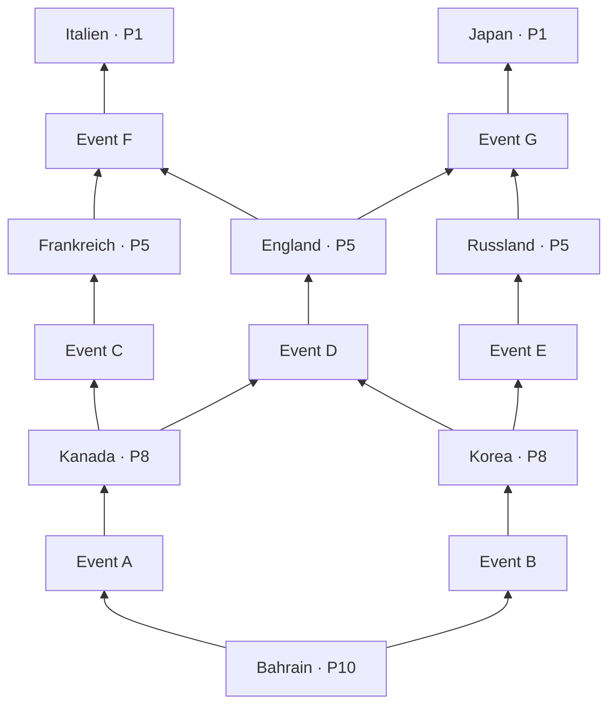

# Roguelite Phase 1 – feste Run-Map

Ausgangsbasis: `100d1835adbed180c92ac128172015341429f0be` (gemergter PR #54).
Feature-Branch: `codex/roguelite-run-phase1`. Keine erneute Legacy-Bereinigung,
keine neue Engine und keine Änderungen an Fahrwerten oder Rundenzahlen.

## Einstieg und tatsächlich implementierter Ablauf

`play.html` → **Kampagne** → `run.html` → Redwood GP → einer der drei bisherigen
Startfahrer → Teamfähigkeits-Platzhalter und drei gespeicherte Startangebote →
eine Startfähigkeit → Run-Map → Bahrain.

Die anderen zwölf Teams sind als gesperrte Karten sichtbar. Alle 39 bestehenden
Kampagnenfahrerplätze, ihre feste Teamzuordnung und die streckenabhängige
KI-Fahrerauswahl bleiben im gemeinsamen `CampaignConfig` erhalten. Es werden
keine historischen Fahreridentitäten oder Originalillustrationen verändert.

Ein neuer Run erzeugt genau einmal UUID, 32-Bit-Seed, drei unterschiedliche
Startangebote und Inhalte aller sieben Event-Knoten. Der eigene deterministische
Generator verwendet kein `Math.random` und beeinflusst die Rennsimulation nicht.
Die Angebote werden vor der Auswahl gespeichert. Neuladen öffnet denselben Schritt
mit denselben Angeboten; eine bereits gewählte Fähigkeit lässt sich nicht umwählen.

Die Teamfähigkeit besitzt eine eigene teamgebundene Kennung. Die zusätzliche
Startfähigkeit ersetzt sie nicht. Beide sind ausdrücklich als **Entwicklungsplatzhalter
 ohne Gameplay-Effekt** gekennzeichnet. Es gibt keine erfundenen Bonuswerte.

## Verbindliche Karte

Die Karte wird von unten nach oben gelesen. Rennkreise, Event-Rechtecke,
Flaggen, Papier, Raster und gestrichelte Verbindungen werden direkt als DOM/SVG/CSS
gezeichnet. Alle 15 Knoten sind von Anfang an vorhanden. Das aktuelle Ziel wird
beim Öffnen in den sichtbaren Bereich gescrollt; die Karte bleibt auch auf kleinen
Smartphones ohne horizontales Seitenscrolling lesbar. Die Bereichsnavigation
bleibt beim Scrollen erreichbar.

Die nachgereichte Kartenreferenz bestimmt die Darstellung: große Symbole mit
außenstehenden Ländernamen, gerade gestrichelte Wege, vier beschriftete
Rennebenen, Pokale an den Finalknoten und eine Startmarkierung unter Bahrain.
Die Startmarkierung bestätigt die bereits gewählte Fähigkeit und ist kein
zusätzlicher Graphknoten. Event-Typen bleiben entgegen den Fragezeichen der
Vorlage sichtbar, damit die vorgegebene Event-Vorschau erhalten bleibt.

| Rennebene | Knoten | Mindestplatzierung |
| --- | --- | --- |
| 1 | Bahrain | P10 |
| 2 | Kanada, Korea | P8 |
| 3 | Frankreich, England, Russland | P5 |
| 4, Finale | Italien, Japan | ausschließlich P1 |

Genau sechs vollständige Streckenrouten:

1. Bahrain → Kanada → Frankreich → Italien
2. Bahrain → Kanada → England → Italien
3. Bahrain → Kanada → England → Japan
4. Bahrain → Korea → England → Italien
5. Bahrain → Korea → England → Japan
6. Bahrain → Korea → Russland → Japan

Ein gewonnener Phase-1-Prototyp besitzt vier abgeschlossene Rennwochenenden und
drei besuchte Events. Die Karte hat 17 eindeutige Kanten; geteilte Kanten werden
nicht dupliziert. Keine weiteren Renn- oder Eventverbindungen sind hinzugefügt.

Die Anzeige unterscheidet aktuellen, erreichbaren, abgeschlossenen, später
freischaltbaren und nicht mehr erreichbaren Knoten sowie verfehlte Rennziele und
erfolgreiche Finalrennen. Nur `RogueliteRun.reachable()` liefert betretbare Knoten.
Die UI ist keine zweite Quelle für Erreichbarkeit. Eine Eventwahl wird sofort
und vor dem Öffnen der Angebote gespeichert; Schließen, Neuladen oder erneut
Öffnen macht die Wahl nicht rückgängig.

## Events und Entscheidungen

Fünf vorbereitete Typen: Werkstatt, Training, Rekrutierung, Der Deal und Service.
Ihre konkreten Zuordnungen werden pro Seed für A–G erzeugt und gespeichert.
Die Map zeigt den Typ, aber erst der geöffnete Knoten zeigt seine Angebote.

Jedes Test-Event bietet eine Vormerkung oder das Fortsetzen ohne Änderung an.
Beides speichert ausschließlich eine nachvollziehbare Entscheidung und führt
zum einzigen verbundenen Rennknoten. Es gibt keine Teile-, Trainings-, Crew-,
Schadens-, Reparatur- oder Deal-Effekte. Die vorhandene normale Boxengassenfunktion
wird nicht durch das Service-Testevent verändert.

## Rennwochenende, Ausscheiden und HUD

`RunWeekend` umschließt den bestehenden `CampaignWeekend` und damit dieselbe
native `RaceWeekend`-Session. Auslaufrunde und zwei schnelle Runden bleiben
verpflichtend. Die fertige Startaufstellung wird einmalig übernommen und sofort
gespeichert; der Rennstart wartet auf den Spieler. Kein Ausscheiden im Qualifying.

Mit „RENNEN STARTEN“ wird die Neustartsperre bereits vor dem ersten gewerteten
Frame gesetzt und als Checkpoint gesichert. Ohne erfolgreiche Speicherung wird
die Session synchron pausiert und das bestehende Speicher-Menü geöffnet. Nach
Wiederherstellung kann regulär fortgesetzt werden. Menü und API verweigern den
Neustart während und nach dem gewerteten Rennen, auch nach Neuladen. Das
ungewertete Wochenende darf vorher mit erneutem Pflichtqualifying neu beginnen.
Pause, Drei-Sekunden-Fortsetzung, Gesamtstrecke und normale Fahrzeugrücksetzung
bleiben erhalten.

Nach dem offiziellen nativen Endzustand mit allen 13 Zieleinläufen übernimmt
`RogueliteRun.capture()` das vollständige vorhandene Kampagnen-Ergebnisformat,
prüft die Zielplatzierung und erzeugt atomar Fortschritt oder Abschluss. Bis zur
offiziellen Ergebnisübernahme ist kein weiterer Knoten erreichbar. Es gibt weder
Punkte noch Puffer, zweite Chancen oder Qualifying-Ausscheiden. Doppelte Aufnahme
desselben Ergebnisses bleibt idempotent; ein abweichendes Ergebnis wird abgelehnt.

Die vorhandene relative HUD-Liste, das 13er-Pausenklassement und Rennergebnistabellen
verwenden dieselben tatsächlichen Positionen. Nur Positionsnummer und Fahrername
außerhalb des Ziels werden rot; eigene Zeilenhervorhebung, Zeitabstände und übriges
HUD bleiben bestehen. Qualifying-Tabellen und alle Modi außerhalb des Runs bleiben
neutral. Es wird kein zusätzliches permanentes Renn-HUD-Element eingeführt.

## Phasen und späterer vollständiger Run

`RunMap.phases` enthält derzeit ausschließlich `phase-1`. Die Abschlussprüfung
verwendet das `final`-Merkmal der konfigurierten Karte, keinen globalen Test
„vier Ergebnisse = gesamter Run gewonnen“.

- `phase.status: completed` bedeutet abgeschlossene Phase.
- `status: won` mit `outcome.reason: prototype-complete` beendet nur den momentan
  spielbaren Phase-1-Prototyp erfolgreich; es definiert keine zukünftige globale
  Run-Länge. Die Erfolgsansicht nennt ausdrücklich Phase 1.
- `status: failed` / `phase.status: failed` beendet immer den gesamten aktuellen Run.
- `phaseHistory` bewahrt Phase, Route, Entscheidungen und vollständige Ergebnisse.
- Team, Fahrer, Teamfähigkeit, Startfähigkeit und `build` liegen außerhalb der
  Phase. `build` reserviert getrennte Felder für Fahrzeugupgrades, Fahrerentwicklung,
  Items, Crew, passive Fähigkeiten und Synergien; diese sind in Format 1 leer.

Weitere Phasen benötigen später eigene versionierte Kartendaten und einen
expliziten Phasenübergang. Dabei wird ein neuer Wochenendkontext vorbereitet,
aber weder Run-ID noch Identität/Build noch bisherige Ergebnisse zurückgesetzt.
Unbekannte Phasen und neue Formate werden heute abgelehnt und erhalten, nicht
scheinbar unterstützt oder verlustbehaftet reduziert. Phase 2/3, echte Fähigkeiten,
Items, Crew, Meta-Freischaltungen und Belohnungen sind nicht implementiert.

## Speicherung und frühere Kampagne

Eigener Schlüssel: **`carpet_gp_roguelite_run_v1`**. Die Sicherung ist eine
versionierte Hülle `{ version: 1, kind: "roguelite-save", active, archive }`.
`active` und Archiveinträge sind validierte Runs mit folgenden Bestandteilen:

| Bereich | Gespeicherte Daten |
| --- | --- |
| Identität | Run-ID, Seed, Konfigurationsversion, Team/Fahrer und 39er-Zuordnung im nativen Kampagnenkontext |
| Start | Teamfähigkeits-ID, drei Startangebote, genau eine gewählte Fähigkeit |
| Karte | Phase und Status, aktueller Knoten, Route, besuchte Knoten, feste Event-Inhalte, Entscheidungen |
| Wochenende | Nativer Checkpoint, Qualifying/Startaufstellung, Neustartsperre und Optionen |
| Archiv | Vollständige 13er-Renn-/Qualifyinglisten mit damals eingesetzten Fahrer-/Teamnamen und Zeiten |
| Abschluss | Aktiv/gewonnen/gescheitert, Zielposition, tatsächlich erreichte Position, Abschlussgrund, Phasenhistorie |
| Erweiterung | Globale, bisher leere Build-Slots |

Ein neuer Run erhält die vorige Sicherung einschließlich Ergebnisse im Archiv.
Lesezugriff auf vergangene Ergebnisse schreibt keine Daten. Datei-Export enthält
Run und Archiv. Beim Import werden bestehende Archive erhalten. Fortschritt
desselben Run-IDs darf nicht rückwärtsgehen; einmal festgelegte Angebote, Fähigkeit,
Route, Entscheidungen, Ergebnisse und Niederlagen dürfen nicht ersetzt werden.

Schreibvorgänge prüfen den zuvor gelesenen Rohtext gegen den aktuellen Speicher
(CAS). Ein konkurrierender Tab, Quotenfehler oder gesperrter Storage lässt den
alten Inhalt erhalten und zeigt einen Fehler an. Exporte bleiben angeboten.
Es wird keine automatische Archivlöschung vorgenommen; bei Überschreiten des
8-MiB-Formats/Browserlimits ist ein Export nötig. Ein harter Abbruch während einer
laufenden Fahrt kann wie bisher die letzten fünf Sekunden seit dem Autosave
verlieren; bereits gesicherte Ergebnisse und die Start-Neustartsperre bleiben bestehen.

`carpet_gp_campaign_v1` (Format 2), POV-Spielstand und Einstellungen bleiben
unverändert. Der neue Haupteinstieg verlinkt die Run-Kampagne. Unter **Spielstand →
Bisherige Kampagne und Ergebnisse** bleibt `campaign.html` als gesonderter
Kompatibilitätszugang erhalten, einschließlich ihrer bisherigen Fortsetzung und
validierten v1-Migration. Keine alte freie Streckenfolge wird in eine erfundene
Run-Route umgerechnet. Dieser Zugang ist nicht die archivierte passive Simulation.

## Modulaufteilung und Offline

- `data/run-map.js`: einzige Quelle für Karte, Ziele, Typen, Platzhalter und Generator.
- `championship/roguelite-run.js`: validierter Zustandsautomat, Erreichbarkeit und Ergebnisübernahme.
- `championship/run-weekend.js`: dünne native Session-Hülle und Neustartsperre.
- `persistence/run-store.js`: eigener atomarer Speicher, Archiv, Import und Fortschrittsschutz.
- `ui/run-launch.js`, `run-map-ui.js`, `styles/run.css`: Auswahl, Karte, Testevents, Abschluss und Archive.
- `ui/run-race-ui.js`: Checkpoints, Autosave und Ergebnisnavigation im vorhandenen Rennmenü.
- `RacePresentation` / `RacingHUD` / `ResultDetails`: optionale Run-Farblogik; eine Positionsquelle.

`build:offline` erzeugt zusätzlich `carpet-grand-prix-run-offline.html`.
Map und Rennansicht teilen sich darin dieselbe Datei und unterscheiden sich nur
über `?mode=run`; dadurch bleibt auch bei pfadbezogenem file://-Storage der Run
zusammenhängend. Bestehende Offline-Dateien und Review-Pakete bleiben enthalten.
Relative Navigation funktioniert weiterhin unter `/carpet-grand-prix/`.

## Prüfungen und tatsächliche Spielaufnahmen

`roguelite-run.test.js` prüft die sechs vollständigen Routen, alle acht
Rennknoten mit exakten positiven/negativen Platzierungsgrenzen, ungültige Knoten,
Angebotsstabilität, Neustartsperre, doppelte Ergebniserfassung, Archive,
Speichertrennung und Ausscheidungsfarben. Für gezielte Rang-/Speichermatrixfälle
werden explizit synthetische, streng validierte Ergebnis-DTOs aus einem zuvor
tatsächlich gefahrenen nativen 13er-Finish geklont. Sie sind keine Timing- oder
Fahrbarkeitsnachweise und werden nicht als Spiel-Screenshots verwendet.

`roguelite-run.spec.js` führt tatsächliche Browseraktionen aus: Startangebote und
Reload, komplette feste Karte, Pflichtqualifying, vier gefahrene Wochenenden,
drei Events, Final-P1, ein echter P13-Finish, rote HUD-/Klassementzeilen,
Neustart-/Reload-/Speicherausfallschutz, neue Runs mit erhaltenem Archiv und
Netzwerk-freie Offline-Navigation. Die Feedbackfahrer senden normale Tastatur-
befehle; keine Position, Geschwindigkeit oder Zielzeit wird zugewiesen.

Die langen Testfahrten nutzen ausschließlich im temporären Test-Realm die
vorhandene öffentliche Ein-Runden-Option. Das Qualifying ist vollständig und
alle 13 Zieleinläufe bleiben echt. Ausgelieferte Rundenzahlen bleiben unverändert.
Die Eingabereferenz fährt für reproduzierbare Erfolge gegen die öffentliche
Anfänger-KI; das ist kein Nachweis menschlicher Schwierigkeit oder finalen Balancings.

CI ergänzt zwei Roguelite-Jobs (Desktop/Mobil), ohne bestehende Prüfungen zu
streichen. Regel-/Speichertests laufen in der zentralen Unit-Gruppe. Vorhandene
Tests schützen weiter Physik, KI, freie Rennen, alte Kampagne, POV-Meisterschaft,
Workshop, alle 22 Strecken und Originalassets. Die Cleanup-Quellfreeze nimmt
nur die ausdrücklich beauftragten Run-Hosts/HUD-Dateien aus; Daten, Engine,
Darstellung und historische Referenzen bleiben geschützt.

Echte Spielaufnahmen unter [roguelite/](roguelite/), unter anderem:

- [Startangebote](roguelite/chromium-abilities.png)
- [Run-Map, Desktop](roguelite/chromium-1280x720-map.png)
- [Run-Map, Smartphone hoch](roguelite/chromium-390x844-map.png)
- [Run-Map, Smartphone quer](roguelite/chromium-844x390-map.png)
- [Geöffnetes Testevent](roguelite/chromium-event.png)
- [Rote eigene Zeile im tatsächlichen POV-HUD](roguelite/chromium-elimination-hud.png)
- [13er-Klassement mit Ausscheidungszone](roguelite/chromium-elimination-classification.png)
- [Phase-1-Erfolg mit vollständiger Route](roguelite/chromium-phase-success.png)
- [Run-Niederlage](roguelite/chromium-phase-failure.png)

Viewportprüfungen: Desktop 1280×720, Smartphone 390×844, Querformat 844×390 und
kleines Smartphone 320×640; zusätzlich mobiles Chromium-Touchprofil. Es sind
Browseremulationen, keine Tests auf einem physischen iPhone/Safari. Der endgültige
CI-Status und konkrete Prüfresultate werden im Freigabe-PR verlinkt.
