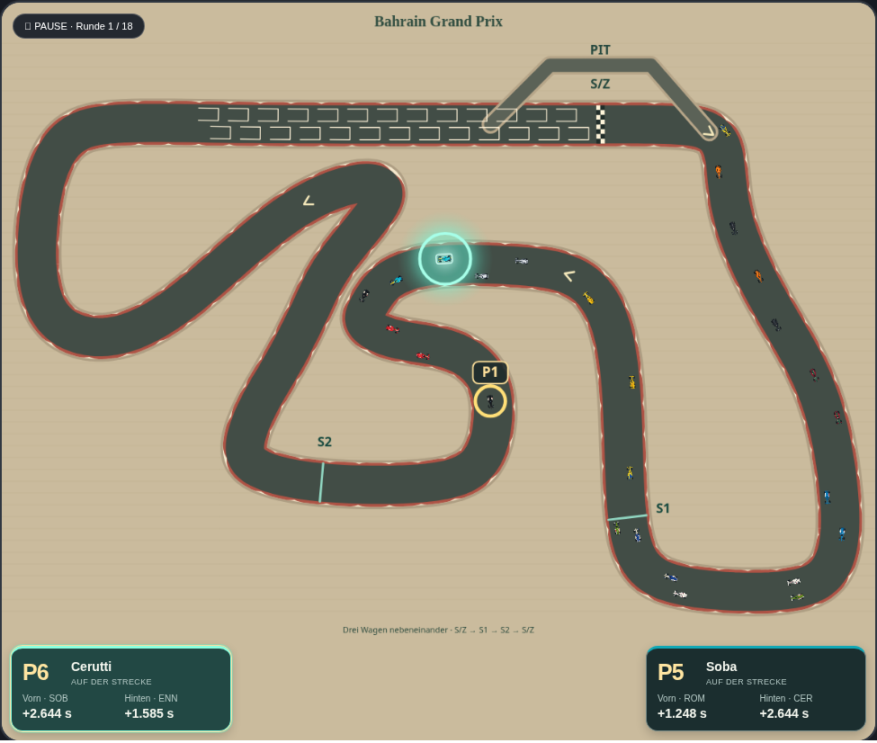
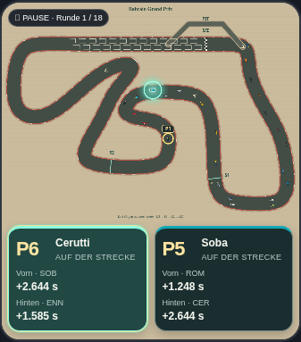

# Eigene Fahrer unten im Rennfenster

Entwicklungsbranch `codex/team-driver-cards`, Ausgangspunkt `2695f42` auf `main`.
Im laufenden oder pausierten Rennen erscheinen die beiden Fahrer des eigenen
Teams unten links und rechts innerhalb des Streckenfensters.

Jede Karte zeigt Name, aktuelle Position, Status und den Abstand zum Fahrer
unmittelbar davor und dahinter in der Rennreihenfolge. Die Karten bleiben ihren
Fahrern zugeordnet und tauschen bei einem Überholmanöver nicht die Seiten.
Die Abstände stammen unverändert aus `raceInterval()`, wie im Timing-Tower.
Für den hinteren Abstand wird das Intervall des nachfolgenden Fahrers zum
eigenen Fahrer verwendet. Es sind keine neuen Schätzformeln oder Abstände zum
Führenden. Sekunden erhalten eine Einheit; vorhandene Schätzzeichen `~` und
Rundenangaben bleiben erhalten. Die Kürzel nennen den jeweiligen Nachbarn.

Bei Führung steht vorn `FÜHRT`; ohne aktiven Verfolger steht hinten `—`.
Ausgeschiedene und bereits angekommene eigene Fahrer zeigen ihren Status und
keine irreführenden laufenden Abstände. Boxenaufenthalt beziehungsweise Reparatur
verwenden den vorhandenen Status. Positionen entsprechen dem Tower.

Ein Klick setzt dieselbe `focus-driver`-Aktion wie der Timing-Tower ab. Erneuter
Klick hebt die Markierung auf; Klick auf den anderen Fahrer wechselt den Fokus.
Tower, Karte und Leuchteffekt auf der Strecke bleiben synchron. Die Schaltflächen
sind auch per Tastatur bedienbar und zeigen den Fokus mit `aria-pressed` an.

## Anordnung

Die Karten sitzen in einer eigenen schmalen Zeile unter dem Canvas, innerhalb
des bisherigen Streckenrahmens. So verdecken sie weder Autos noch Kurven und
verändern den freigegebenen Rennzoom nicht. Der gesamte Rahmen wird dafür etwas
höher. Auf kleinen Bildschirmen bleiben die zwei Karten nebeneinander; ihre
Abstandswerte werden bei sehr schmalen Fenstern untereinander angeordnet.

[Ansicht bei 320 Pixeln Fensterbreite](previews/team-driver-hud-small.png)

Vor Rennstart, im Qualifying, im Beobachtermodus und beim fertigen Rennen/Podium
werden die Karten ausgeblendet. Eine einzige oder fehlende Fahrerzuordnung wird
ohne Platzhalter für fremde Fahrer behandelt.

## Einbindung und Prüfung

- `teamDriverHudCards()` in `index.html` liest den Rennstand, die aktuelle
  Teamzuordnung, Reihenfolge und vorhandene Intervallberechnung.
- `src/ui/team-driver-hud.js` zeichnet die Karten. Live-Updates ersetzen nur die
  Textwerte und Attribute; die Schaltflächen bleiben bestehen. Dadurch gehen
  Klickziele und Tastaturfokus beim Aktualisieren nicht verloren.
- `render()` und `refreshLive()` aktualisieren die Anzeige über eine schmale
  Schnittstelle. Es gibt keinen zusätzlichen Timer und keinen neuen Klickhandler.
- `styles/team-driver-hud.css` steht als achtes Stylesheet im Asset-Manifest und
  ist ausschließlich auf die neuen Karten begrenzt. Der Offline-Builder bettet
  Styles und Script mit ein.
- Modultests prüfen Teamzuordnung, stabile Seiten, Tower-Intervalle, Führung,
  letzten Platz, Boxen, Ausfall, ausgeblendete Zustände, sichere Textausgabe und
  unveränderte Eingabedaten.
- Desktop-/Mobiltests prüfen Positionen gegen den echten Tower, Fokus in beiden
  Richtungen, erneuten Klick, Tastatur, Speicherstabilität, Live-Updates mit
  denselben DOM-Schaltflächen sowie die Anordnung außerhalb der Fahrbahn.
- Historische Bildvergleiche deaktivieren nur im Test die neuen Karten und nehmen
  nur deren zusätzliches Stylesheet aus dem CSS-Vergleich aus. Der vollständige
  Quelltextvergleich nimmt nur das neue Stylesheet, den Kartenplatzhalter und
  die markierten Darstellungsblöcke zusätzlich aus. Alte Referenzen bleiben erhalten.

Physik, KI, Balancing, Rennzeiten, Spielstandformat und vorhandene
Fahrer-Markierung bleiben unverändert. Die Karten werden nicht gespeichert;
sie entstehen beim Laden wieder aus den vorhandenen Renndaten.

Zum Prüfen das Artefakt **carpet-grand-prix-offline** aus einem erfolgreichen
PR-Testlauf entpacken, die HTML-Datei öffnen und ein Rennen laden oder starten.
Übernahme nach `main` erst nach ausdrücklicher Freigabe des konkreten PRs.
