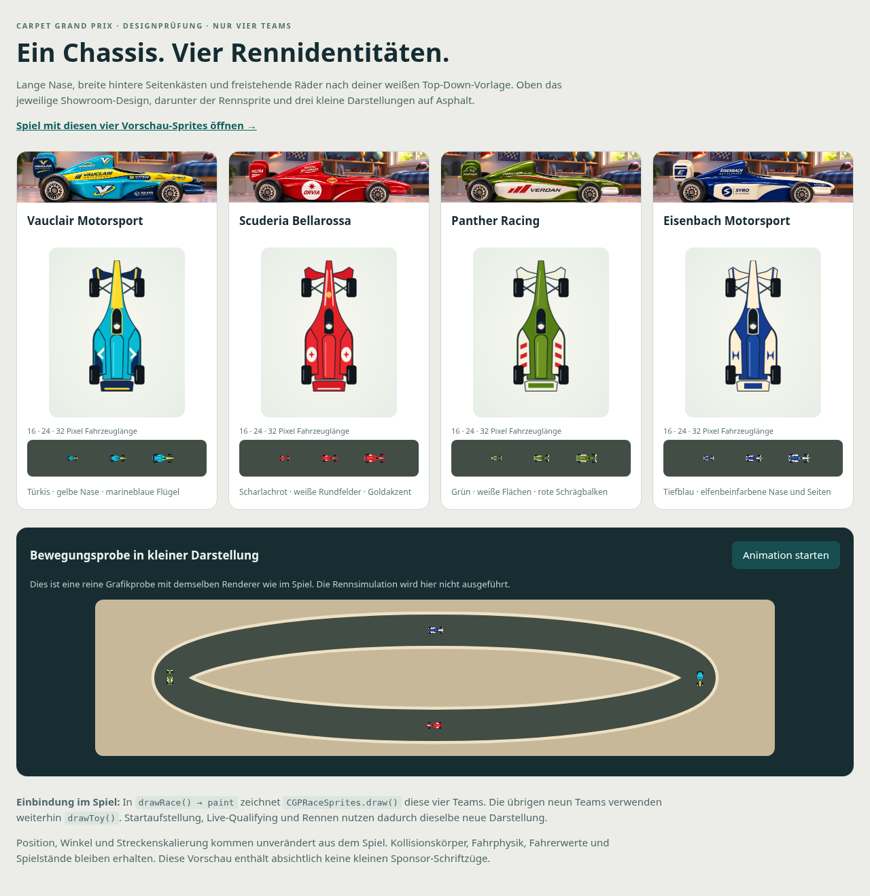
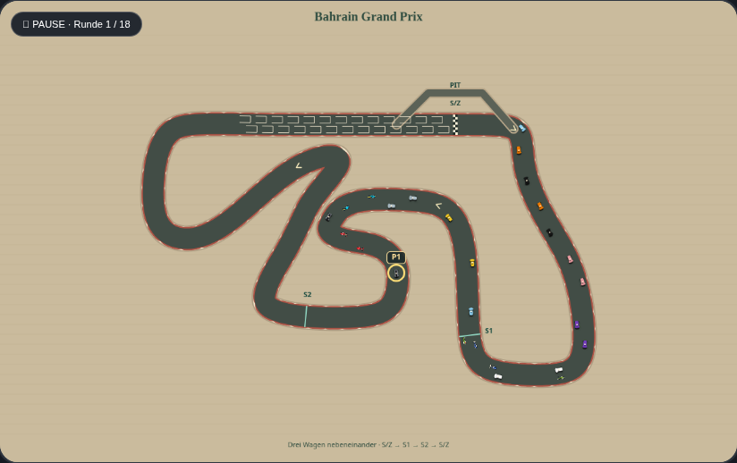

# Vier Top-Down-Rennfahrzeuge zur Designprüfung

Entwicklungsbranch `codex/topdown-four-car-preview`, Ausgangspunkt `4f29ee3`
auf `main`. Noch keine Übernahme nach `main` und keine Änderung der veröffentlichten
GitHub-Pages-Version. Zunächst werden nur die vier beauftragten Teams ersetzt.

## Gestaltung

Die gemeinsame Grundform folgt `assets/references/car_topdown_base.jpg`: lange,
schmale Nase, breite hintere Seitenkästen, freistehende Räder, geschwungener
Frontflügel und kurzer Heckflügel. Alle vier Modelle verwenden identische
Geometrie und dieselbe senkrechte Draufsicht, Kontur und dezente Beleuchtung.
Das Seitenverhältnis der Vorlage wird angenähert; es handelt sich um eine
stilistische Umsetzung, keine maßstäbliche Vermessung des Spielzeugautos.

| Team | ID | Umsetzung aus der Teamauswahl |
| --- | --- | --- |
| Vauclair Motorsport | t01 | Türkis, gelbe Nase, marineblaue Flügel, helle V-Zeichen |
| Scuderia Bellarossa | t04 | Scharlachrot, weiße runde Seitenfelder, kleiner Goldakzent |
| Panther Racing | t10 | Moosgrün, weiße Seitenfelder und Flügel, drei rote Schrägbalken |
| Eisenbach Motorsport | t05 | Tiefblau, elfenbeinfarbene Nase, Seitenfelder und Flügel |

Die unterschiedlichen Farbflächen und Muster gehen über ein einfaches Umfärben
hinaus. Kleine Sponsorenschriften entfallen; reduzierte geometrische Zeichen
stehen für die fiktiven Marken der Showroom-Modelle. Keine realen Logos.
Die Showroom-Bilder einschließlich Vauclair bleiben unverändert.

## Vorschau ohne Programmieren

Im erfolgreichen automatischen PR-Testlauf das Artefakt
**carpet-grand-prix-topdown-preview** herunterladen und das ZIP entpacken.
Beide HTML-Dateien im selben Ordner lassen. Zuerst
`carpet-grand-prix-topdown-preview.html` öffnen: oben Showroom und große Draufsicht,
darunter echte Fahrzeuglängen von 16, 24 und 32 Pixeln sowie eine startbare
Bewegungsprobe. Der Link oben öffnet die enthaltene Spielversion mit diesen vier
Fahrzeugen. Dafür ist keine Installation erforderlich.

Die Bewegungsprobe ist nur eine Grafikanimation; sie verwendet weder die
Rennsimulation noch Spielstände. Die Vorschauseite schreibt keinen Browserspeicher.
Die lokale Spielversion hat je nach Browser einen anderen Speicherbereich als
GitHub Pages. Bestehende Spielstände zum Testen bei Bedarf über die vorhandene
JSON-Export-/Importfunktion übertragen. Artefakte bleiben 30 Tage verfügbar.

Für Entwickler liegt die Vorschauseite unter `previews/topdown/index.html`;
`npm run build:offline` und `npm run build:race-preview` erzeugen das Download-Paar.
Die Webversion benötigt keinen Build und funktioniert unter dem Pages-Projektpfad.

## Einbindung und ersetzte Darstellung

- `src/rendering/race-sprites.js` enthält die gemeinsame Geometrie, die vier
  Lackierungen und `CGPRaceSprites.draw()`. Das Modul liest keinen Spielzustand
  und verwendet keinen Zufall.
- `index.html` lädt das klassische Script direkt vor dem bisherigen Spielscript.
  In `drawRace()` ruft die bestehende Funktion `paint` jetzt zuerst
  `CGPRaceSprites.draw(ctx, v.p, tm.id, g.width/64, !!v.r.dnf)` auf.
- Bei diesen vier Team-IDs zeichnet der Renderer den neuen Sprite. Für die übrigen
  neun Teams gibt er `false` zurück; derselbe Aufruf verwendet dann unverändert
  `drawToy()`. Auch ein fehlendes neues Modul lässt diesen alten Renderer greifen.
- Startaufstellung, Live-Qualifying und Rennen laufen durch dieselbe Zeichenstelle.
  Fokusmarkierung, Schadensanzeige und Brückenreihenfolge bleiben im vorhandenen
  Spielcode. Ausgeschiedene Fahrzeuge erhalten eine graue Variante.
- Das Modul zeichnet jede Variante einmal in einen unsichtbaren 280 × 120-Pixel-
  Canvas und verwendet danach diesen Zwischenspeicher. Dadurch entfallen erneute
  Pfadberechnungen und Bildladevorgänge pro Rennbild. Die vier SVGs unter
  `assets/cars/topdown/` werden aus derselben Quelle erzeugt und dienen zur
  Einzelansicht; der Renn-Canvas lädt keine SVG-Dateien nach.
- Position, Winkel und Streckenskalierung stammen unverändert aus dem Spiel.
  Die sichtbare Länge bleibt bei 23 Zeicheneinheiten; die proportional schmalere
  Draufsicht passt in die frühere Breite von 14 Einheiten. `bodyContact()` und
  die bisherigen Kollisionsmaße bleiben unverändert. Die sichtbaren Reifen sind
  deshalb keine neue, pixelgenaue Kollisionsgrenze.
- Der Offline-Builder bettet das neue Modul ein. Es gibt keine neue Abhängigkeit
  von einem Server, Bilddienst oder Build zur Laufzeit.

## Prüfung und Grenzen

Die Standardtests sichern die bisherigen Stammdaten, Spielstände, Rennreplays und
Geometriereferenzen. Der vollständige Quelltextvergleich nimmt ausschließlich die
bereits freigegebenen Showroom-Bilder sowie die zwei genau benannten neuen
Renderer-Einbindungen aus. Der übrige Spielcode muss bytegenau zum Original passen.

Neue Tests prüfen gemeinsame Form und Räder, vier unterschiedliche Lackierungen,
reproduzierbare SVGs, unveränderte Eingabepositionen, Canvas-Zustand, Zwischenspeicher,
graue Ausfallvarianten und den Rückfall für andere Teams. Browsertests auf Desktop
und Mobilformat zählen die tatsächlich gezeichneten vier Teams im echten
Renn-Canvas und prüfen, dass reines Neuzeichnen den gespeicherten Stand nicht ändert.
Die separate Vorschau und ihre Start-/Pause-Schaltfläche werden ebenfalls geprüft.

Historische Bildvergleiche schalten nur im Test auf `drawToy()` zurück, damit die
übrige Oberfläche weiterhin mit dem Original vergleichbar bleibt. Eigene neue
Browsertests und der Offline-Test laufen mit dem tatsächlichen neuen Renderer.
Es wurden keine alten Bild- oder Simulationsreferenzen neu erzeugt.

Die endgültige Wirkung der kleinen Farbflächen braucht deine Designprüfung.
Große Zoomstufen, andere Browser und echte Mobilgeräte können die Kantenglättung
anders darstellen. Vor den übrigen neun Teams erst Form, Lesbarkeit und
Farbverteilung dieser vier Fahrzeuge beurteilen. Übernahme nach `main` nur nach
ausdrücklicher Freigabe dieses konkreten PRs.
