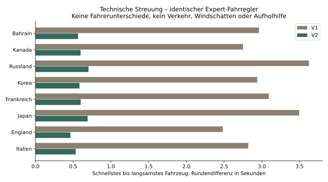
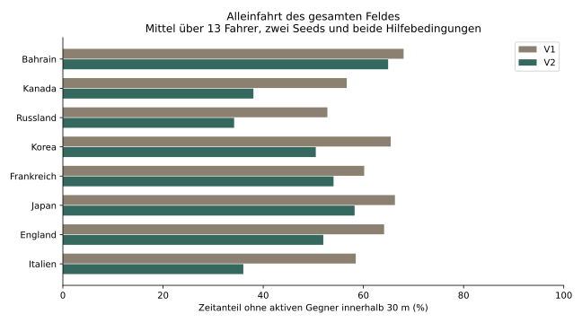
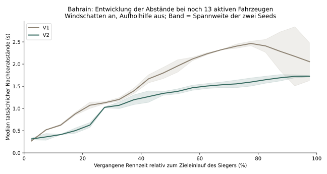
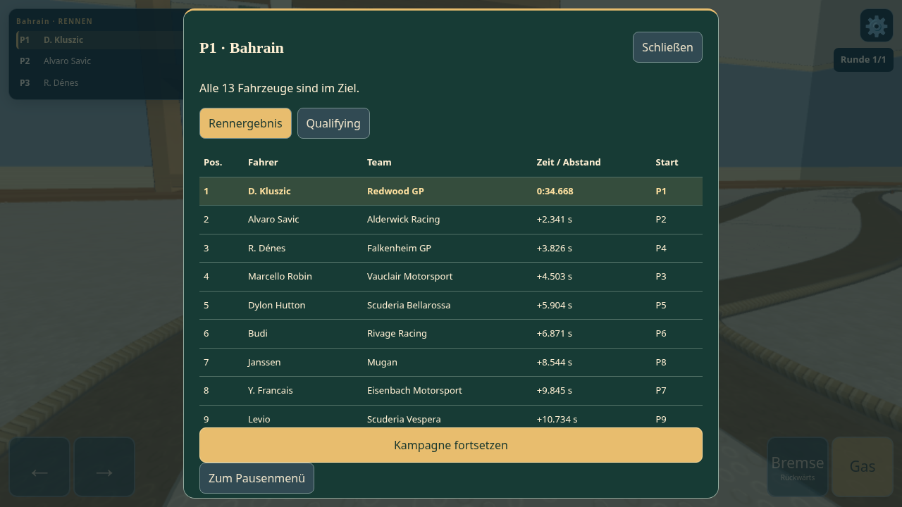
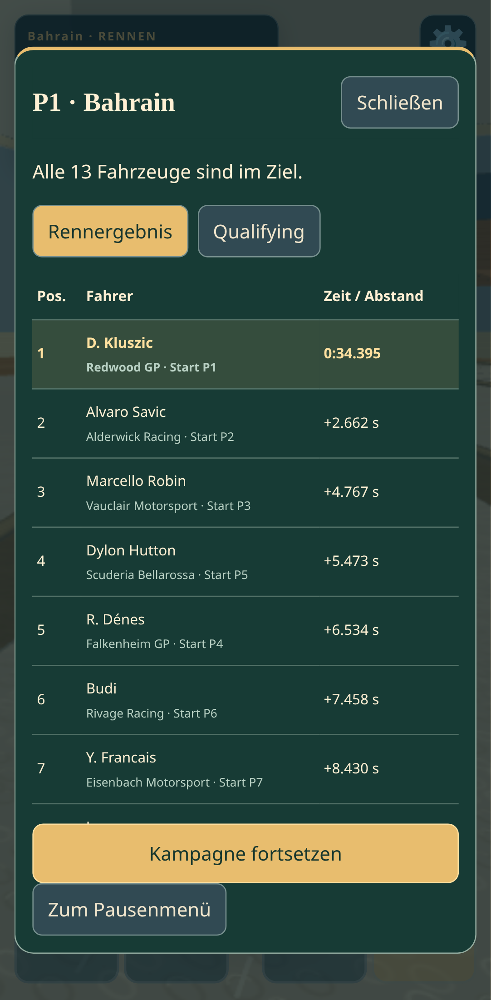

# Fahrzeugbalance V2 – engere Arcade-Rennen

Ausgangscommit: `622a1cf295437d38d9b12055a777e634777fb05d` (PR #57).
Branch: `codex/vehicle-balance-v2`. Historische Stammdaten, alle 39 Fahrerprofile,
Fahrbefehle, Physikkern, Geometrien, Rundenzahlen und Run-Regeln bleiben erhalten.

## Ziel und Ursache

V1 erzeugte im identischen Bahrain-Solotest etwa 2,961 Sekunden technische
Streuung pro Runde. Über acht Runden kann allein diese Differenz fast 24 Sekunden
öffnen. Fahrerphasen und gute Überholmanöver beseitigen diesen strukturellen
Vorsprung nicht. V2 reduziert deshalb die technischen Unterschiede; es schiebt
keine Fahrzeuge zusammen und korrigiert keine Ergebnisse.

## Formeln und gemeinsame Plattform

V1 bleibt unverändert als eigene, vollständig verfügbare Modellversion bestehen.
Für jeden Faktor gilt in V2:

```
f_V2 = Plattform + 0,20 × (f_V1 − Mittelpunkt)
```

| Faktor | Plattform | Mittelpunkt der bisherigen Qualitätsachse |
| --- | ---: | ---: |
| Beschleunigung | 0,940 | 0,910 |
| Topspeed | 0,975 | 0,955 |
| Bremsen | 0,970 | 0,950 |
| Lenkreaktion und Rückstellung | 0,970 | 0,950 |
| Basis-Kurvengrip | 0,970 | 0,940 |
| Zusätzlicher schneller Kurvengrip | 0 | 0 |

Die V1-Qualität `clamp((Stärke − 64) / 23, 0, 1)` und ihre Fokus-Zusätze bleiben
die Ausgangsdaten. Auch Fokus-Unterschiede werden auf 20 % komprimiert.
Power behält Motor-/Geradenvorteile; Handling behält Brems-, Lenk- und
Kurvenvorteile; Aero behält seinen mit der Geschwindigkeit wachsenden
Gripterm, jetzt maximal 0,008 statt 0,04. Damit können sich Schwerpunkte
überlappen: Ein nominell stärkeres Power-Auto dominiert nicht automatisch
Bremsen und schnelle Kurven.

Die gemeinsame Plattform liegt oberhalb der alten mittleren Qualitätsfaktoren.
Schwache Fahrzeuge werden verbessert; starke etwas zurückgenommen. Es handelt
sich nicht um 13 identische Autos oder ausschließlich um ein Abbremsen der Spitze.
Entwicklungspotenzial bleibt Metadatum ohne unmittelbaren Leistungsbonus.
Redwood hat in der Kampagne weiterhin 64, Vespera 72; historisch bleiben 72/64.

## Trennung von Auto, Fahrer und Hilfen

Alle Fahrzeuge verwenden unverändert dieselbe `Physics.step`-Funktion. Pro
Team, Kontext und Version werden feste Parameterpakete vor dem Start erzeugt
und wiederverwendet. Die bestehende KI-Planung berechnet ihre Geschwindigkeits-,
Brems- und Griptabellen mit genau diesen Parametern. Es gibt keine neue
Schwierigkeitsstufe und keine veränderten KI-Kompetenzwerte.

Die neun Attribute und die deterministischen Fahrerentscheidungen aus PR #57
bleiben bytegleich. Qualifying und Rennen verwenden dieselbe tatsächliche
Startliste, aber ihre getrennten Fahrerattribute. Manuelle Eingaben werden
nicht durch die Fahrerwerte begrenzt. Der Solovergleich schaltet Fahrer-
Unterschiede bewusst aus, der Rennvergleich verwendet alle tatsächlichen Profile.

Windschatten und vorhandene Aufholhilfe bleiben unverändert. Solofahrten (A)
verwenden weder Verkehr noch Hilfen. Vollständige Wochenenden vergleichen (B)
Windschatten ohne Aufholhilfe und (C) Windschatten mit vorhandener Aufholhilfe,
jeweils mit denselben zwei Seeds in beiden Fahrzeugversionen. Der 5-km/h-
Windschatten und die maximal 1,2 % bestehende Hilfe werden relativ zum eigenen
Fahrzeuglimit berechnet. Ihre tatsächliche Nutzung wird separat erfasst.

## Speichervertrag und Übergang

Neue Wochenenden speichern ausdrücklich:

```json
{"performance":{"version":2,"context":"campaign"}}
```

Freies Rennen und POV-Meisterschaft verwenden `context: historical`. Die API
stellt die aktuellen Deskriptoren unter `VehiclePerformance.current` bereit.
Die bisherigen expliziten Deskriptoren `campaign` und `historical` bleiben auf
V1 festgelegt, damit alte Messwerkzeuge und bewusste V1-Aufrufe reproduzierbar sind.
`get(teamId)` und die öffentlichen neuen Session-/Wochenendstarts verwenden V2.

- Gespeicherte V1-Wochenenden einschließlich Qualifying, Fahrer-KI-Version,
  Startaufstellung und Neustart bleiben V1.
- Fehlende Leistungskennung bleibt das ältere uniforme Modell; sie wird weder
  zu V1 noch zu V2 umgedeutet.
- Erst ein wirklich neues Wochenende ohne gespeicherte native Session verwendet
  V2. Das gilt auch beim Fortsetzen eines älteren Runs nach Abschluss seines
  V1-Grand-Prix: Der nächste neue Grand Prix wird V2, Ergebnisse/Route/Events/
  Fahrerwahl bleiben erhalten. Ein vorhandenes noch nicht gefahrenes, aber
  bereits gespeichertes Grid gehört weiterhin zum alten Wochenende und bleibt V1.
- Ein Neustart desselben Wochenendes ist kein Versionswechsel. Ein laufendes
  Rennen erhält keine anderen Leistungsgrenzen nach Reload, Import oder Pause.
- Root-Schlüssel und Speicherformate bleiben unverändert. Der vorhandene
  Validator erkennt die explizite Unterversion; unbekannte Versionen werden
  abgelehnt. Historische Ergebniszeiten werden nicht neu berechnet.

Die bisherigen echten PR-55-/PR-56-/Fahrer-v1/v2/v3-Referenzen bleiben erhalten.
Ihr unveränderter V1-Folgezustand und die 13 ursprünglichen Parameterpakete
werden weiterhin geprüft. Die Messungen von PR #57 sind historische Belege und
werden gegen ihren unveränderten Quellstand gebunden; V2 erhält eigene Daten.

## Messprotokoll

208 Solofahrten vergleichen alle 13 Teams auf acht Strecken in beiden Modellen.
Identischer Expert-Regler, 120-Hz-Physik, normale 30-Hz-Eingaben, stehende Anfahrt,
zwei vollständige Runden: gemessen wird die zweite. Gerade Messfläche: normales
Beschleunigen bis 80/100 km/h, danach normales Bremsen ab der tatsächlich zuerst
erreichten Geschwindigkeit ≥100 km/h. Kein Setzen von Geschwindigkeit oder Zeit.

64 vollständige Standard-Wochenenden vergleichen acht Strecken × zwei Seeds
(4171/9011) × B/C × V1/V2. Qualifying und Rennen fahren alle 13 Teilnehmer.
Der normale Eingaberegler des Spielerreferenzfahrzeugs verwendet D. Kluszic
und den vollständigen Verkehr; das ist kein menschlicher P5-Test. Der V1-Stand
wird aus einem separaten unveränderten Checkout von PR #57 geladen und anhand
von Git-Quellhashes geprüft. V2-Rohdaten enthalten ihre tatsächlichen Quellhashes.

Für Massenmessungen kann dieselbe Scriptliste wahlweise direkt in einem eigenen
Node-Prozess laufen (`--realm=process`), statt jeden Math-Aufruf durch die
isolierte Test-VM zu führen. Der Physikcode, feste Schritte und Fahrbefehle
ändern sich dabei nicht. Zwei vollständige V1/V2-Wochenenden, alle 104 V2-
Solofahrten und die Gerade-Benchmarks lieferten exakt gleiche Beobachtungsdaten;
[Prüfsummen](vehicle-balance-v2/loader-equivalence.json). Ein eigener Kindprozess-
Test wiederholt zusätzlich zehn native Referenzfortsetzungen einschließlich
aller gespeicherten Posen, Uhren und KI-Speicher. Normale Unit-Tests bleiben
isoliert. Beide Varianten verbieten Laufzeit-`Math.random`. Die Rohdaten nennen
die Ausführungsvariante je Wochenende. Mit `--resume` bleiben fertig gemessene
Wochenenden erhalten; nur noch fehlende vollständige Szenarien werden gerechnet.

Überholen benötigt wie in PR #57 vollständige Fahrzeuglänge plus drei Einheiten
Freiraum bei einem Reihenfolgewechsel; Überrundungen und bereits fertige Autos
werden ausgeschlossen. Positionswechsel sind eine getrennte Kennzahl. Kontakte
zählen Paarberührungsanfänge im unveränderten 120-Hz-Löser; nach Trennung kann
wieder eine Berührung beginnen. Die Anzahl ist keine Kollisionsschwere.

Nachbarabstände verwenden echte Passagehistorie; fehlende Werte bleiben fehlend.
Allein bedeutet keinen aktiven Gegner innerhalb von 30 Metern auf derselben
Ebene. Zusätzlich werden die Zeitanteile ab absolvierter Runde 3 (Runde 4),
Überholungen nach der Rennhälfte sowie Feld-Snapshots nach Führungsrunde 1/3
und beim Eintritt ins letzte Drittel gespeichert. Solokontakte werden bei
120 Hz, Feld-Wand-/Offroadkennzeichnungen bei 30 Hz beobachtet.

<!-- BEGIN MEASUREMENTS -->
## Gemessene technische Wirkung

| Strecke | Schnellstes V1 / V2 | Langsamstes V1 / V2 | Mittel V1 / V2 | Streuung V1 / V2 |
| --- | --- | --- | ---: | ---: |
| Bahrain | Vauclair Motorsport 31.635 / Vauclair Motorsport 32.271 | Redwood GP 34.596 / Lincoln 32.835 | 33.248 / 32.611 s | 2.962 / 0.564 s |
| Kanada | Vauclair Motorsport 29.433 / Vauclair Motorsport 29.986 | Redwood GP 32.183 / Redwood GP 30.584 | 30.905 / 30.311 s | 2.749 / 0.598 s |
| Russland | Vauclair Motorsport 37.201 / Vauclair Motorsport 38.033 | Redwood GP 40.824 / Redwood GP 38.735 | 39.238 / 38.435 s | 3.623 / 0.703 s |
| Korea | Alderwick Racing 33.731 / Alderwick Racing 34.267 | Redwood GP 36.670 / Redwood GP 34.851 | 35.242 / 34.583 s | 2.939 / 0.583 s |
| Frankreich | Vauclair Motorsport 35.432 / Vauclair Motorsport 36.088 | Redwood GP 38.525 / Lincoln 36.687 | 37.045 / 36.395 s | 3.092 / 0.600 s |
| Japan | Vauclair Motorsport 38.839 / Vauclair Motorsport 39.610 | Redwood GP 42.334 / Redwood GP 40.301 | 40.733 / 39.969 s | 3.495 / 0.691 s |
| England | Vauclair Motorsport 27.210 / Alderwick Racing 27.733 | Redwood GP 29.693 / Orange 28.197 | 28.509 / 27.984 s | 2.483 / 0.463 s |
| Italien | Vauclair Motorsport 30.067 / Vauclair Motorsport 30.699 | Redwood GP 32.888 / Redwood GP 31.232 | 31.601 / 30.986 s | 2.820 / 0.534 s |



### Alle 13 V2-Fahrzeuge

Werte in bisherigen Welteinheiten pro s², Lenkreaktion in 1/s; Geschwindigkeit mit unveränderten 0,3 m/Welteinheit. Aero bezeichnet den zusätzlichen schnellen Gripterm.

| Team | Stärke | Fokus | Motor | Topspeed km/h | Bremse | Lenkreaktion | Basis-Grip | Aero |
| --- | ---: | --- | ---: | ---: | ---: | ---: | ---: | ---: |
| Vauclair Motorsport | 87 | power | 52.965 | 117.089 | 141.955 | 3.916 | 206.010 | 0.0 % |
| Alderwick Racing | 86 | aero | 52.604 | 116.854 | 141.974 | 3.921 | 206.001 | 0.8 % |
| Falkenheim GP | 85 | power | 52.793 | 116.903 | 141.703 | 3.909 | 205.572 | 0.0 % |
| Scuderia Bellarossa | 84 | handling | 52.432 | 116.525 | 142.447 | 3.946 | 206.319 | 0.0 % |
| Eisenbach Motorsport | 76 | power | 52.018 | 116.067 | 140.568 | 3.878 | 203.600 | 0.0 % |
| Orange | 67 | handling | 50.968 | 114.945 | 140.303 | 3.886 | 202.593 | 0.0 % |
| Ragos Racing | 69 | handling | 51.140 | 115.131 | 140.555 | 3.893 | 203.032 | 0.0 % |
| Mugan | 78 | power | 52.190 | 116.253 | 140.820 | 3.885 | 204.038 | 0.0 % |
| Lincoln | 65 | power | 51.071 | 115.044 | 139.181 | 3.839 | 201.189 | 0.0 % |
| Panther Racing | 70 | handling | 51.227 | 115.224 | 140.682 | 3.897 | 203.251 | 0.0 % |
| Rivage Racing | 74 | aero | 51.571 | 115.738 | 140.461 | 3.879 | 203.371 | 0.8 % |
| Scuderia Vespera | 72 | handling | 51.399 | 115.410 | 140.934 | 3.904 | 203.689 | 0.0 % |
| Redwood GP | 64 | power | 50.985 | 114.951 | 139.055 | 3.836 | 200.970 | 0.0 % |

### Normale Beschleunigungs- und Bremsprobe

| Team | 0–80 V1 / V2 | 0–100 V1 / V2 | Topspeed V1 / V2 | Bremsweg ab ≥100 V1 / V2 |
| --- | ---: | ---: | ---: | ---: |
| Vauclair Motorsport | 1.425 / 1.525 s | 1.842 / 1.983 s | 119.750 / 117.089 km/h | 8.343 / 8.520 m |
| Alderwick Racing | 1.475 / 1.542 s | 1.917 / 1.992 s | 118.573 / 116.854 km/h | 8.380 / 8.470 m |
| Falkenheim GP | 1.450 / 1.533 s | 1.875 / 1.983 s | 118.821 / 116.903 km/h | 8.422 / 8.484 m |
| Scuderia Bellarossa | 1.508 / 1.542 s | 1.950 / 2.000 s | 116.930 / 116.525 km/h | 8.239 / 8.449 m |
| Eisenbach Motorsport | 1.567 / 1.558 s | 2.033 / 2.017 s | 114.637 / 116.067 km/h | 8.739 / 8.547 m |
| Orange | 1.767 / 1.592 s | 2.308 / 2.067 s | 109.027 / 114.945 km/h | 8.863 / 8.578 m |
| Ragos Racing | 1.733 / 1.583 s | 2.258 / 2.058 s | 109.957 / 115.131 km/h | 8.778 / 8.561 m |
| Mugan | 1.542 / 1.550 s | 2.000 / 2.017 s | 115.567 / 116.253 km/h | 8.695 / 8.584 m |
| Lincoln | 1.742 / 1.592 s | 2.275 / 2.067 s | 109.523 / 115.044 km/h | 9.203 / 8.676 m |
| Panther Racing | 1.717 / 1.583 s | 2.233 / 2.058 s | 110.422 / 115.224 km/h | 8.731 / 8.580 m |
| Rivage Racing | 1.650 / 1.575 s | 2.142 / 2.042 s | 112.994 / 115.738 km/h | 8.786 / 8.587 m |
| Scuderia Vespera | 1.683 / 1.575 s | 2.183 / 2.050 s | 111.352 / 115.410 km/h | 8.630 / 8.562 m |
| Redwood GP | 1.767 / 1.592 s | 2.300 / 2.067 s | 109.058 / 114.951 km/h | 9.248 / 8.658 m |

Alle 208 Solofahrten wurden beendet. Seilkontakt-Schritte V1/V2: 0 / 0; Offroad-Schritte: 0 / 0. Individuelle technische Kurven-/Ausgangsgeschwindigkeiten und Brückenpassagen stehen unverändert in den Rohdaten.

## Vollständige Rennen

Alle 64 Standardwochenenden beenden Qualifying und Rennen mit 13 tatsächlichen Teilnehmern. Je Zelle Mittel zweier Seeds; Überholungen, späte Überholungen und Kontakte sind die Summe beider Rennen. B = Windschatten ohne Aufholhilfe, C = Windschatten mit bestehender Hilfe.

| Strecke | Modus | P1–P5 V1 / V2 | P4–P5 V1 / V2 | P1–P13 V1 / V2 | Median Nachbar V1 / V2 | Überholen V1 / V2 | davon nach Hälfte | Kontakte V1 / V2 |
| --- | --- | ---: | ---: | ---: | ---: | ---: | ---: | ---: |
| Bahrain | B | 11.811 / 9.522 s | 3.598 / 2.147 s | 35.294 / 25.164 s | 1.488 / 1.305 s | 30 / 59 | 0 / 4 | 446 / 509 |
| Bahrain | C | 12.123 / 10.177 s | 4.851 / 2.295 s | 35.029 / 25.329 s | 1.597 / 1.359 s | 26 / 54 | 0 / 0 | 396 / 472 |
| Kanada | B | 11.297 / 8.460 s | 2.159 / 1.438 s | 28.084 / 18.503 s | 1.248 / 0.703 s | 22 / 78 | 0 / 19 | 342 / 809 |
| Kanada | C | 11.232 / 7.321 s | 3.158 / 1.223 s | 28.035 / 18.781 s | 1.252 / 0.886 s | 18 / 51 | 2 / 3 | 337 / 524 |
| Russland | B | 10.698 / 6.013 s | 1.135 / 1.325 s | 27.292 / 15.145 s | 1.114 / 0.748 s | 32 / 75 | 2 / 24 | 174 / 262 |
| Russland | C | 10.193 / 6.600 s | 0.940 / 2.001 s | 27.225 / 14.900 s | 1.027 / 0.665 s | 25 / 62 | 1 / 19 | 152 / 226 |
| Korea | B | 11.496 / 9.723 s | 4.179 / 1.678 s | 30.111 / 26.885 s | 1.317 / 0.897 s | 32 / 68 | 0 / 18 | 389 / 597 |
| Korea | C | 11.522 / 8.646 s | 4.154 / 1.116 s | 29.704 / 21.104 s | 1.229 / 1.121 s | 39 / 45 | 0 / 5 | 455 / 477 |
| Frankreich | B | 11.726 / 7.829 s | 1.509 / 1.789 s | 31.003 / 21.699 s | 1.281 / 1.110 s | 21 / 41 | 0 / 3 | 245 / 448 |
| Frankreich | C | 12.403 / 6.927 s | 2.870 / 1.595 s | 30.749 / 20.166 s | 1.305 / 1.167 s | 22 / 36 | 1 / 5 | 211 / 390 |
| Japan | B | 10.648 / 7.097 s | 3.492 / 1.450 s | 27.916 / 19.896 s | 1.308 / 1.169 s | 17 / 17 | 3 / 1 | 326 / 442 |
| Japan | C | 9.961 / 7.708 s | 2.770 / 1.315 s | 27.106 / 20.710 s | 1.267 / 1.150 s | 19 / 17 | 0 / 1 | 352 / 473 |
| England | B | 12.201 / 10.168 s | 3.387 / 1.212 s | 29.625 / 23.533 s | 1.371 / 1.082 s | 21 / 47 | 0 / 10 | 317 / 644 |
| England | C | 10.642 / 9.322 s | 2.800 / 1.484 s | 29.482 / 21.543 s | 1.318 / 1.139 s | 23 / 33 | 0 / 2 | 382 / 555 |
| Italien | B | 11.580 / 7.116 s | 2.728 / 1.264 s | 28.028 / 17.882 s | 1.187 / 0.826 s | 13 / 54 | 0 / 3 | 341 / 628 |
| Italien | C | 10.209 / 8.501 s | 1.460 / 2.041 s | 28.322 / 18.609 s | 1.250 / 0.509 s | 23 / 82 | 3 / 23 | 266 / 765 |

### Alleinfahrt und Fahrerwirkung

Die 30-Hz-Alleinfahrt berücksichtigt auch nahe überrundete Autos; weniger Überrundungsverkehr kann diese Kennzahl erhöhen, obwohl Ergebnisabstände kleiner werden. Der ergänzende Mittelfeldwert ist der Anteil der 2-Sekunden-Samples in der zweiten Rennhälfte, in denen P4–P10 keinen Rangnachbarn innerhalb 30 Metern haben; er erfasst keine Überrundungen oder Höhenunterschiede und ist separat zu lesen.

| Strecke | Modus | Feld allein V1 / V2 | Feld allein ab Runde 4 | Mittelfeld allein (Samples) | Redwood allein ab Runde 4 | Q/R Rangkorrelation |
| --- | --- | ---: | ---: | ---: | ---: | ---: |
| Bahrain | B | 65.7 % / 63.3 % | 84.7 % / 87.6 % | 90.0 % / 96.9 % | 88.0 % / 67.4 % | 0.923 / 0.777 |
| Bahrain | C | 70.3 % / 66.6 % | 87.8 % / 92.6 % | 89.2 % / 97.0 % | 79.1 % / 74.6 % | 0.953 / 0.827 |
| Kanada | B | 58.0 % / 33.6 % | 93.9 % / 51.9 % | 85.0 % / 38.7 % | 95.3 % / 27.7 % | 0.986 / 0.893 |
| Kanada | C | 55.4 % / 42.5 % | 90.6 % / 69.6 % | 81.9 % / 67.3 % | 85.3 % / 44.0 % | 0.981 / 0.962 |
| Russland | B | 56.7 % / 34.7 % | 90.3 % / 58.5 % | 84.7 % / 51.0 % | 95.5 % / 18.1 % | 0.970 / 0.909 |
| Russland | C | 48.9 % / 33.6 % | 80.2 % / 55.1 % | 61.4 % / 40.2 % | 69.3 % / 17.6 % | 0.967 / 0.904 |
| Korea | B | 67.7 % / 44.9 % | 99.3 % / 73.5 % | 99.3 % / 74.1 % | 100.0 % / 29.7 % | 0.962 / 0.813 |
| Korea | C | 63.2 % / 56.1 % | 94.7 % / 96.0 % | 90.3 % / 84.2 % | 100.0 % / 99.9 % | 0.942 / 0.893 |
| Frankreich | B | 58.7 % / 52.2 % | 91.2 % / 88.0 % | 92.2 % / 84.6 % | 85.7 % / 69.3 % | 0.909 / 0.948 |
| Frankreich | C | 61.6 % / 55.9 % | 98.7 % / 93.9 % | 96.2 % / 91.8 % | 100.0 % / 78.1 % | 0.956 / 0.940 |
| Japan | B | 65.8 % / 57.8 % | 99.7 % / 96.3 % | 93.4 % / 87.9 % | 100.0 % / 82.3 % | 0.981 / 0.967 |
| Japan | C | 66.8 % / 58.7 % | 99.4 % / 99.2 % | 96.4 % / 88.4 % | 99.9 % / 97.5 % | 0.959 / 0.951 |
| England | B | 65.0 % / 49.8 % | 98.3 % / 78.6 % | 97.9 % / 73.1 % | 99.4 % / 66.1 % | 0.986 / 0.920 |
| England | C | 63.3 % / 54.1 % | 95.0 % / 88.4 % | 93.1 % / 84.8 % | 90.0 % / 71.0 % | 0.964 / 0.942 |
| Italien | B | 58.7 % / 39.1 % | 92.8 % / 67.5 % | 87.5 % / 60.6 % | 98.8 % / 39.3 % | 0.953 / 0.843 |
| Italien | C | 58.2 % / 32.9 % | 92.4 % / 55.6 % | 92.5 % / 46.2 % | 88.7 % / 39.0 % | 0.975 / 0.766 |

Gesamtmittel: P1–P13 **29.563 → 20.616 s**, P4–P5 **2.824 → 1.586 s**. Feld allein: **61.5 % → 48.5 %**; ab Runde 4 **93.1 % → 78.3 %**. Dies sind Messwerte, keine garantierten Verbesserungen für jeden Lauf.



### Verlauf im Rennen

Die Rohdaten enthalten exakt beobachtete 30-Hz-Snapshots nach der ersten und dritten Führungsrunde sowie am Beginn des letzten Renndrittels. Abstände in dieser Tabelle sind tatsächliche Streckenmeter, keine aus einer pauschalen Geschwindigkeit geschätzten Sekunden.

| Strecke | P4–P5 nach Führungsrunde 1 V1 / V2 | nach Führungsrunde 3 | letztes Drittel |
| --- | ---: | ---: | ---: |
| Bahrain | 30.170 / 7.379 m | 57.587 / 61.043 m | 96.559 / 64.263 m |
| Kanada | 14.724 / 13.746 m | 46.069 / 26.925 m | 58.730 / 45.030 m |
| Russland | 20.084 / 10.813 m | 36.187 / 45.679 m | 34.527 / 48.268 m |
| Korea | 46.342 / 8.796 m | 90.113 / 38.649 m | 102.378 / 39.588 m |
| Frankreich | 15.923 / 20.247 m | 50.782 / 46.070 m | 55.804 / 43.499 m |
| Japan | 43.287 / 26.105 m | 77.395 / 44.709 m | 75.636 / 39.831 m |
| England | 15.375 / 7.741 m | 56.229 / 37.501 m | 69.019 / 40.160 m |
| Italien | 12.619 / 4.530 m | 44.871 / 31.766 m | 49.961 / 49.798 m |

### Windschatten und vorhandene Aufholhilfe

| Modell | Modus | Zeit mit nutzbarem Windschatten | Mittlerer Hilfefaktor | Größter beobachteter Hilfefaktor |
| --- | --- | ---: | ---: | ---: |
| V1 | B | 2.7 % | 0.0 % | 0.0 % |
| V1 | C | 2.9 % | 0.2 % | 0.9 % |
| V2 | B | 5.4 % | 0.0 % | 0.0 % |
| V2 | C | 5.3 % | 0.1 % | 1.0 % |

Hilfen wurden nicht neu balanciert. Ihre Nutzung wird über aktive Rennframes erfasst, Windschatten ab Stärke >0,05. Der Spieler erhält weiterhin keine KI-Aufholhilfe. Die Kombinationen B/C verwenden für jeden Seed dieselben Fahrer und dieselbe Qualifying-Ausführung.

### Unterschiedliche Persönlichkeiten

Beobachtete durchschnittliche Start-/Endpositionen je tatsächlicher Identität über ihre eingesetzten Strecken; unterschiedliche Strecken, Verkehr und Fahrzeugauslegung wirken mit. Dies ist eine Beschreibung dieser Rennen und kein isolierter kausaler Skill-Test. Alle individuellen Rundenzeiten und Positionswechsel bleiben in den Rohdaten.

| Fahrer | Team | Einsätze pro Modell | Qualifying V1 / V2 | Rennen V1 / V2 |
| --- | --- | ---: | ---: | ---: |
| Marcello Robin · d001 | Vauclair Motorsport | 12 | 1.167 / 2.000 | 1.333 / 2.583 |
| V. Romi · d002 | Vauclair Motorsport | 12 | 1.000 / 1.000 | 1.000 / 1.000 |
| Thi Wu · d003 | Vauclair Motorsport | 8 | 1.000 / 1.500 | 1.000 / 1.000 |
| Alvaro Savic · d004 | Alderwick Racing | 12 | 1.833 / 1.000 | 2.583 / 1.833 |
| M. Callivaro · d005 | Alderwick Racing | 12 | 2.333 / 2.333 | 2.667 / 3.417 |
| Malik Salvaro · d006 | Alderwick Racing | 8 | 2.000 / 1.500 | 2.500 / 3.250 |
| R. Dénes · d007 | Falkenheim GP | 12 | 3.000 / 3.000 | 2.333 / 3.750 |
| N. O'Conner · d008 | Falkenheim GP | 12 | 2.667 / 2.667 | 3.000 / 3.000 |
| N. Miguel · d009 | Falkenheim GP | 8 | 3.000 / 3.500 | 2.875 / 2.750 |
| Dylon Hutton · d010 | Scuderia Bellarossa | 12 | 4.000 / 4.000 | 4.583 / 4.500 |
| A. Parelli · d011 | Scuderia Bellarossa | 12 | 4.000 / 4.667 | 3.333 / 4.917 |
| Dukuzuremyi · d013 | Scuderia Bellarossa | 8 | 4.000 / 3.750 | 4.125 / 4.875 |
| Y. Francais · d014 | Eisenbach Motorsport | 12 | 6.000 / 5.167 | 6.583 / 4.333 |
| F. Aristi · d015 | Eisenbach Motorsport | 12 | 6.167 / 9.667 | 6.750 / 10.500 |
| S. Evans · d016 | Eisenbach Motorsport | 8 | 6.000 / 8.250 | 5.875 / 7.125 |
| L. Anderson · d017 | Orange | 12 | 12.000 / 12.000 | 12.333 / 11.000 |
| G. A. Montoya · d018 | Orange | 12 | 12.000 / 11.667 | 11.333 / 11.000 |
| Valentino · d019 | Orange | 8 | 12.000 / 12.000 | 10.875 / 10.750 |
| Di Luccio · d020 | Ragos Racing | 12 | 10.000 / 10.500 | 10.417 / 10.417 |
| Li Young · d021 | Ragos Racing | 12 | 10.000 / 7.333 | 10.083 / 7.750 |
| Bezetti · d022 | Ragos Racing | 8 | 11.000 / 11.000 | 9.625 / 10.375 |
| Janssen · d023 | Mugan | 12 | 5.000 / 5.833 | 4.417 / 6.500 |
| H. Mokahashi · d024 | Mugan | 12 | 5.000 / 4.333 | 5.167 / 4.583 |
| Kuno · d025 | Mugan | 8 | 5.000 / 4.750 | 5.000 / 4.250 |
| Solim · d026 | Lincoln | 12 | 11.000 / 9.667 | 11.000 / 9.000 |
| Zacharias · d027 | Lincoln | 12 | 11.000 / 8.833 | 11.167 / 8.500 |
| Elfinso · d028 | Lincoln | 8 | 10.000 / 6.000 | 11.250 / 7.375 |
| Sven N. · d029 | Panther Racing | 12 | 9.000 / 9.833 | 8.333 / 10.250 |
| E. Pastelli · d030 | Panther Racing | 12 | 9.000 / 10.333 | 9.000 / 9.750 |
| Felix N. · d031 | Panther Racing | 8 | 9.000 / 8.000 | 10.125 / 8.875 |
| Budi · d032 | Rivage Racing | 12 | 7.000 / 7.000 | 6.667 / 6.667 |
| Kolwero · d033 | Rivage Racing | 12 | 6.833 / 6.000 | 6.583 / 4.917 |
| Z. H. Kung · d034 | Rivage Racing | 8 | 7.000 / 10.000 | 6.875 / 10.000 |
| D. Kluszic · d035 | Redwood GP | 32 | 13.000 / 13.000 | 12.438 / 12.344 |
| Levio · d036 | Scuderia Vespera | 12 | 8.000 / 8.000 | 8.333 / 7.667 |
| Josuah · d037 | Scuderia Vespera | 12 | 8.000 / 9.167 | 8.250 / 9.250 |
| P. d. Grosso · d038 | Scuderia Vespera | 8 | 8.000 / 7.750 | 8.250 / 8.375 |

Die vollständigen tatsächlichen Ergebnisse sind als [races-v1.json.gz](vehicle-balance-v2/races-v1.json.gz) und [races-v2.json.gz](vehicle-balance-v2/races-v2.json.gz) enthalten, Solodaten als [solo-v1.json.gz](vehicle-balance-v2/solo-v1.json.gz) und [solo-v2.json.gz](vehicle-balance-v2/solo-v2.json.gz). Gzip verändert keine Messzahlen. Alle gepaarten Kennzahlen einschließlich seedweiser Unterschiede stehen in [summary.json](vehicle-balance-v2/summary.json).

<!-- END MEASUREMENTS -->

## Bewertung und verbleibende Probleme

Das technische Bahrain-Ziel ist mit 0,564 Sekunden erreicht. Alle acht Strecken
liegen zwischen 0,463 und 0,703 Sekunden. Gegenüber V1 sinkt der mittlere
Zielabstand P1–P13 um etwa 30 %, P4–P5 von 2,824 auf 1,586 Sekunden. Der mittlere
live beobachtete Nachbarabstand sinkt von 1,285 auf 0,990 Sekunden, im letzten
Drittel von 1,828 auf 1,318 Sekunden. Die absolute Hierarchie ist kleiner, aber
das gewünschte dauerhaft enge Mario-Kart-Feld ist noch nicht vollständig erreicht.

Überholungen steigen von 383 auf 819, nach der Rennhälfte von 12 auf 140.
Die Qualifying-/Rennrangkorrelation fällt von 0,961 auf 0,891. Fahrer und
Verkehr verändern die Reihenfolge stärker, ohne Ergebnisvorgaben. Im Beispiel
Bahrain/4171/B verbessert sich Lincoln 65 mit d026 von P13 auf P6; Falkenheim 85
mit d007 fällt von P3 auf P12. Die identischen Fahrer wurden nicht neu bewertet.

Gleichzeitig steigen Kontaktanfänge von 5131 auf 8221. Die 30-Hz-Beobachtung
zählt 0/0 Wandtreffer-Frames und 40/117 Offroad-Frames (V1/V2); das ist keine
vollständige Schwereklassifikation jedes Kontakts. Alle 64 Rennen enden mit
13 regulären Zieleinläufen, ohne erzwungene Bergung. Mehr Nähe und Manöver
bedeuten auch mehr Berührungen. Eine allgemeine Verbesserung der Kollisions-
oder Überhol-KI wurde in diesem Auftrag nicht eingebaut.

Bahrain bleibt besonders kritisch: P1–P13 sinkt im Mittel der vier Bedingungen
von 35,161 auf 25,247 Sekunden und P4–P5 von 4,224 auf 2,221 Sekunden. Der
Alleinanteil des Feldes sinkt dort aber nur von 68,0 % auf 64,9 %, und ab Runde 4
steigt er von 86,3 % auf 90,1 %. Der technische Umbau löst dieses konkrete späte
Bahrain-Problem also nicht ausreichend. Die Rundenprotokolle zeigen anhaltende
Verluste aus dem frühen Verkehr und anschließend weitgehend konstante freie
Runden. Weniger Überrundungsverkehr verändert zusätzlich die Nähekennzahl.
Die Werte werden nicht durch neue Hilfe, Teleportation oder Bremseingriffe kaschiert.

Vauclair gewinnt unter V1 30/32, unter V2 24/32 Vergleichsrennen; Alderwick
gewinnt die übrigen 2 beziehungsweise 8. Weitere KI-Teamsiege wurden in diesen
Läufen nicht beobachtet. Das ist kein Beweis, dass jedes KI-Team bereits dieselbe
Siegchance hat. Die vorhandenen Fahrer und Fahrregler bleiben eine wichtige
Quelle dieser Favoritenbildung; menschliche Eingaben unterliegen keinen
Fahrerabzügen und wurden mit diesen Automaten nicht nachgebildet.

Die gewünschte konkrete Panther-/Vauclair-Umkehr ist in den acht Frankreich-/
Italien-Vergleichen nicht beobachtet worden. Panther-d031 hat hohe Race Pace 89,
aber Konstanz 70, Präzision 64 und Racecraft 52. Vauclair-d003 hat Race Pace 79,
aber Konstanz 82, Präzision 76 und Racecraft 92. Ein hoher einzelner Pace-Wert
ist daher kein insgesamt überlegenes Profil. Eine weitere Beurteilung muss alle
Attribute, Verkehr und tatsächliche menschliche Fahrten berücksichtigen; Profile
wurden nicht passend zu einem gewünschten Ergebnis umgeschrieben.

Der Windschatten wird im Mittel in etwa 5,4 % statt 2,8 % der aktiven Frames
wirksam. Der durchschnittliche bestehende Hilfefaktor sinkt über B/C zusammen
von etwa 0,078 % auf 0,057 %; die tatsächlichen Spitzen stehen oben. Die Hilfe
wurde nicht erhöht und zeigt in diesen Messungen keine größere mittlere Dominanz.
Zwei Seeds je Strecke liefern reproduzierbare Vergleiche, aber noch keine breite
statistische Aussage über jedes mögliche Rennen.



## Echte Browsernachweise

Die beiden Bilder zeigen tatsächliche V2-Rennergebnisse nach Pflichtqualifying
und Reload. Nur diese Funktionsprüfung nutzt Anfänger-KI und die vorhandene
Ein-Runden-Testoption; die Balanceauswertung oben verwendet Expert-KI und
unveränderte Standardrundenzahlen. Das zusätzliche ältere V1-Qualifying blieb
beim Laden/Pausieren/Neuladen auf Desktop und mobilem Chromium ausdrücklich V1.




## Reproduktion und Abnahme

```sh
node scripts/calibrate-vehicle-balance.js
node scripts/measure-vehicle-balance.js --version=1 --root=/unveraenderter/PR57-Checkout --mode=solo
node scripts/measure-vehicle-balance.js --version=2 --mode=solo
node scripts/measure-vehicle-balance.js --version=1 --root=/unveraenderter/PR57-Checkout
node scripts/measure-vehicle-balance.js --version=2
node scripts/build-vehicle-balance-report.js --solo-v1=dist/vehicle-balance/v1-solo.json --solo-v2=dist/vehicle-balance/v2-solo.json --races-v1=dist/vehicle-balance/v1-race.json --races-v2=dist/vehicle-balance/v2-race.json
python3 scripts/plot-vehicle-balance.py
npx vitest run tests/unit/vehicle-performance.test.js tests/unit/vehicle-balance-v2.test.js tests/unit/performance-legacy-compatibility.test.js tests/unit/driver-personalities.test.js
npx playwright test tests/browser/driver-touch.spec.js tests/browser/vehicle-balance.spec.js
```

Die Kalibrierung ist ein Entwicklungswerkzeug, kein Parameter-Schalter im Spiel.
Werte werden nicht automatisch nachgebessert, wenn ein Ziel verfehlt wird.
Die endgültigen Regressionen und Offline-Builds sind im Pull Request dokumentiert.
Mobile Browserprüfungen sind Chromium-Emulation; kein echtes iPhone/Safari stand
für diesen Auftrag zur Verfügung. Menschliche Fahrbarkeit und der individuelle
Eindruck enger Rennen bleiben Gegenstand der Fahrabnahme.
