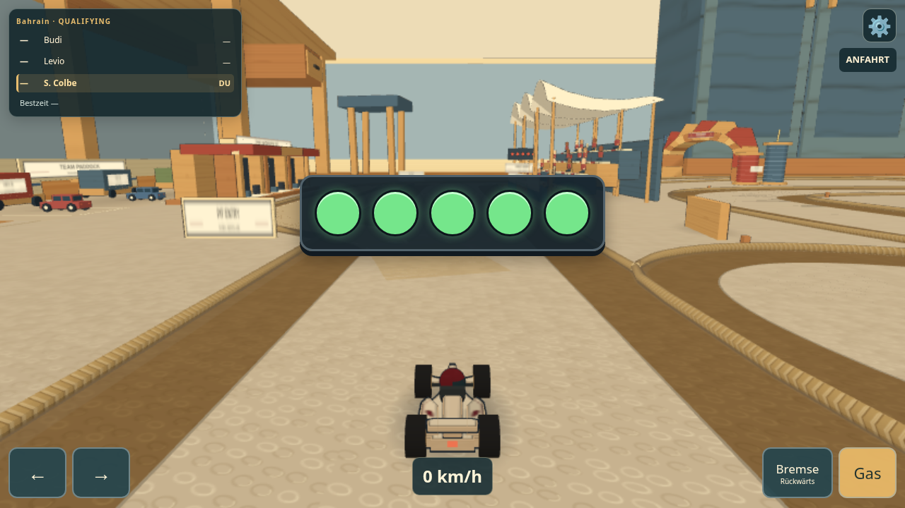
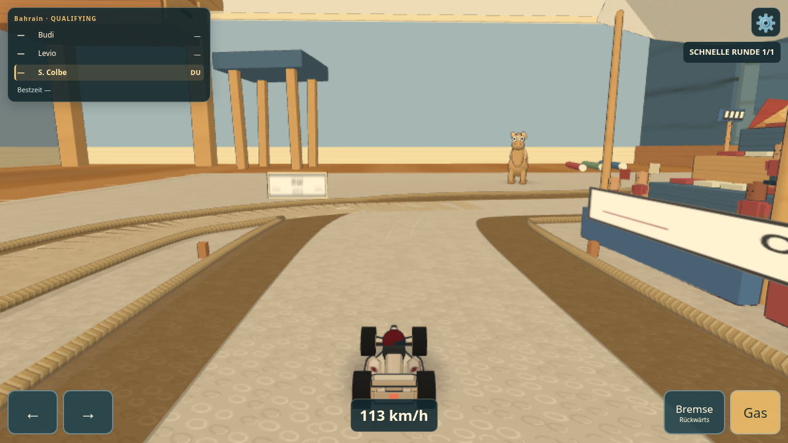
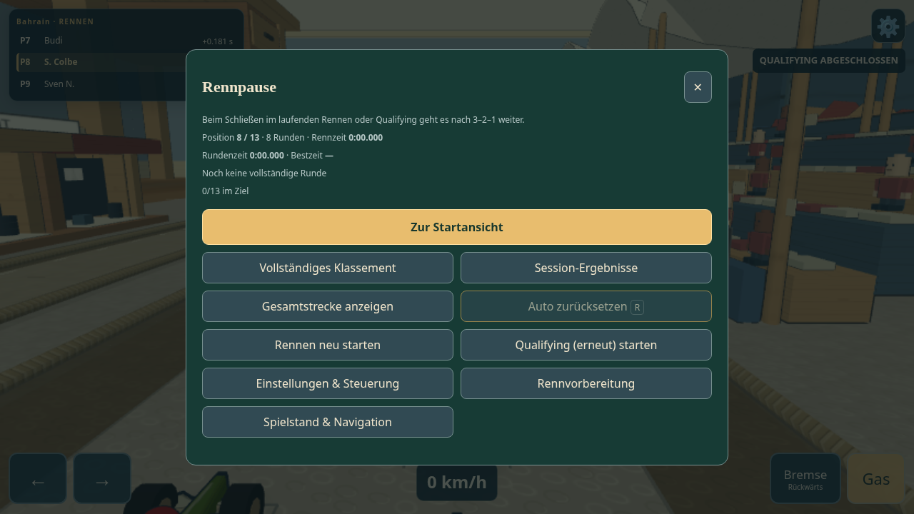

# Fahrzeugleistung und fliegendes Ein-Runden-Qualifying

Ausgangscommit: `b4a797c7b9b390243db6b72213e99fffb081e876` (gemergter PR #55).
Branch: `codex/vehicle-performance-one-lap`. Fahrzeugprofile wurden zuerst auf allen acht Kampagnenstrecken gemessen; danach folgte das neue Qualifying. Keine Änderung an historischen Stammdaten, Strecken, Rundentabelle, Run-Map, Platzierungszielen oder den vier KI-Schwierigkeitsprofilen.

## Leistungsmodell v1

`VehiclePerformance` stellt vor dem Sessionstart 13 eingefrorene Profile bereit. Das historische Modell liest `arcade-roster.js`; der Kampagnenkontext liest das bestehende `CampaignConfig`-Overlay. Damit fahren Run und Kampagnen-Kompatibilitätsmodus tatsächlich mit Redwood **64** und Vespera **72**. Freies Rennen und POV-Meisterschaft verwenden deren historische **72 / 64**. `developmentPotential` bleibt Metadatum für spätere Entwicklung; bestehende Werkstattwerte werden nicht als neue Upgrades in die Physik eingerechnet.

Für `s = clamp((baseStrength − 64) / 23, 0, 1)` gelten folgende Faktoren auf die bisherigen Grundparameter. Die Bereiche wurden mit identischen Expert-Eingabereglern und allen 13 Fahrzeugen auf acht Strecken überprüft. Sie wurden über diese Messungen und Kontaktfreiheit beurteilt, nicht über künstliche Ergebnisvorgaben.

| Eigenschaft | Grundfaktor | Power-Zusatz | Handling-Zusatz | Aero-Zusatz |
| --- | --- | --- | --- | --- |
| Beschleunigung | 0,82 + 0,18s | +0,025 | 0 | 0 |
| Topspeed | 0,91 + 0,09s | +0,008 | −0,004 | +0,002 |
| Bremsen | 0,90 + 0,10s | −0,005 | +0,025 | 0 |
| Lenkreaktion und Rückstellung | 0,90 + 0,10s | −0,005 | +0,045 | +0,005 |
| Basis-Kurvengrip | 0,88 + 0,12s | −0,005 | +0,018 | 0 |

Für Aero-Fahrzeuge gilt zusätzlich `a_lat(v) = a_basis × (1 + 0,04 × min(1, |v| / vmax)²)`. Bei anderen Teams entfällt der zusätzliche Term. `gripSpeedReference` bleibt am
nominalen Fahrzeuglimit, auch bei Windschatten, Aufholhilfe oder dem Pit-Limiter. Das unterscheidet schnellen Kurvengrip von reiner Lenkreaktion. Radstand, maximaler Lenkwinkel, Abmessungen, Rückwärtsgang, Untergrundregeln und Kontaktauflösung bleiben erhalten.

Alle Fahrzeuge rufen dieselbe `Physics.step`-Funktion auf. `RaceSession` übergibt das jeweilige Parameterpaket; auch der Spieler besitzt keine gesonderte Physik. `Opponents` verwendet die gleichen Pakete für Topspeed, Bremsvorschau, Lenkantwort und Randprognose. Die Kurvengrenze löst für Krümmung κ und bestehende Fahrkonfidenz c die Gleichung `v² = a_basis × c / max(ε, κ − a_basis × c × highSpeedGrip / vmax²)`. Geometrische Vorschauen werden gemeinsam vorbereitet, fahrzeugspezifische Geschwindigkeitstabellen vor der Fahrt berechnet.

Die Qualifying-Ausführung neuer Leistungsmodelle hängt ausschließlich von stabilen Team-ID-Stilen ab: `brakeLead = 0,5 + hashTerm × 0,5`, `caution = 0,018 + style × 0,01`, `execution = 0,006`; Phase und Rhythmus bleiben deterministische ID-Werte. Teamstärke wird dort nicht erneut als Fahrkompetenz verrechnet. Für alte Checkpoints bleibt die ursprüngliche Ausführung erhalten.

### Tatsächliche Fahrzeugwerte im Kampagnenkontext

Einheiten: Beschleunigung/Bremsen/Grip in bisherigen Welteinheiten pro s², Lenkreaktion in 1/s; Topspeed über die unveränderte Umrechnung `0,3 m/Welteinheit`. Es werden keine fiktiven PS-Werte verwendet.

| Team | Stärke | Fokus | Motor | Topspeed km/h | Bremse | Lenkreaktion | Basis-Grip |
| --- | ---: | --- | ---: | ---: | ---: | ---: | ---: |
| Vauclair Motorsport | 87 | power | 56.375 | 119.750 | 144.275 | 3.980 | 208.950 |
| Alderwick Racing | 86 | aero | 54.570 | 118.573 | 144.370 | 4.003 | 208.904 |
| Falkenheim GP | 85 | power | 55.514 | 118.821 | 143.014 | 3.945 | 206.759 |
| Scuderia Bellarossa | 84 | handling | 53.709 | 116.930 | 146.734 | 4.128 | 210.493 |
| Eisenbach Motorsport | 76 | power | 51.640 | 114.637 | 137.340 | 3.789 | 196.898 |
| Orange | 67 | handling | 46.391 | 109.027 | 136.016 | 3.832 | 191.867 |
| Ragos Racing | 69 | handling | 47.252 | 109.957 | 137.277 | 3.867 | 194.058 |
| Mugan | 78 | power | 52.501 | 115.567 | 138.601 | 3.823 | 199.089 |
| Lincoln | 65 | power | 46.905 | 109.523 | 130.405 | 3.597 | 184.846 |
| Panther Racing | 70 | handling | 47.683 | 110.422 | 137.908 | 3.884 | 195.154 |
| Rivage Racing | 74 | aero | 49.404 | 112.994 | 136.804 | 3.794 | 195.757 |
| Scuderia Vespera | 72 | handling | 48.543 | 111.352 | 139.168 | 3.919 | 197.345 |
| Redwood GP | 64 | power | 46.475 | 109.058 | 129.775 | 3.580 | 183.750 |

### Gerade und Bremsprobe

Normale Pedale auf einer ebenen geraden Messfläche, identische Physik bei 120 Hz. 0–80/100 sind die ersten erreichten festen Schritte; die Bremsprobe startet beim ersten Schritt ab 100 km/h. Die genaue Startgeschwindigkeit steht zusätzlich in den Rohdaten. Der Bremsweg verwendet die normale Bremskraft, keine Geschwindigkeitszuweisung.

| Team | 0–80 s | 0–100 s | Topspeed km/h | Bremsstart km/h | Bremsweg m |
| --- | ---: | ---: | ---: | ---: | ---: |
| Vauclair Motorsport | 1.425 | 1.842 | 119.750 | 100.069 | 8.343 |
| Alderwick Racing | 1.475 | 1.917 | 118.573 | 100.326 | 8.380 |
| Falkenheim GP | 1.450 | 1.875 | 118.821 | 100.115 | 8.422 |
| Scuderia Bellarossa | 1.508 | 1.950 | 116.930 | 100.258 | 8.239 |
| Eisenbach Motorsport | 1.567 | 2.033 | 114.637 | 100.016 | 8.739 |
| Orange | 1.767 | 2.308 | 109.027 | 100.265 | 8.863 |
| Ragos Racing | 1.733 | 2.258 | 109.957 | 100.226 | 8.778 |
| Mugan | 1.542 | 2.000 | 115.567 | 100.209 | 8.695 |
| Lincoln | 1.742 | 2.275 | 109.523 | 100.129 | 9.203 |
| Panther Racing | 1.717 | 2.233 | 110.422 | 100.177 | 8.731 |
| Rivage Racing | 1.650 | 2.142 | 112.994 | 100.105 | 8.786 |
| Scuderia Vespera | 1.683 | 2.183 | 111.352 | 100.022 | 8.630 |
| Redwood GP | 1.767 | 2.300 | 109.058 | 100.144 | 9.248 |

### Vergleichsrunden ohne Verkehr und Hilfen

Identischer Expert-Regler, keine individuellen Ausführungsstile, kein Windschatten, keine Aufholhilfe. Stehender Start bei s=−220; zwei vollständige Runden, gemessen wird die zweite. Keine Zuweisungen von Position, Geschwindigkeit, Torpassage oder Zeit. Alle **104 Nachher-Vergleichsfahrten** blieben ohne Seil- oder Randkontakt; Korea und Russland enthalten ihre tatsächlichen Brücken. Durchschnittliche technische Kurvengeschwindigkeit, Kurvenausgang, Spitzenwerte und Brückenpassagen stehen pro Fahrzeug/Strecke in den Rohdaten.

| Team | Bahrain | Kanada | Korea | Frankreich | England | Russland | Italien | Japan |
| --- | ---: | ---: | ---: | ---: | ---: | ---: | ---: | ---: |
| Vauclair Motorsport | 31.635 | 29.433 | 33.735 | 35.432 | 27.210 | 37.201 | 30.067 | 38.839 |
| Alderwick Racing | 31.866 | 29.600 | 33.731 | 35.508 | 27.333 | 37.544 | 30.252 | 39.019 |
| Falkenheim GP | 31.865 | 29.633 | 33.968 | 35.633 | 27.405 | 37.492 | 30.299 | 39.166 |
| Scuderia Bellarossa | 32.259 | 29.997 | 34.141 | 35.966 | 27.666 | 38.067 | 30.664 | 39.522 |
| Eisenbach Motorsport | 32.967 | 30.664 | 35.033 | 36.800 | 28.400 | 38.853 | 31.339 | 40.480 |
| Orange | 34.480 | 32.068 | 36.400 | 38.334 | 29.433 | 40.813 | 32.767 | 42.171 |
| Ragos Racing | 34.233 | 31.791 | 36.169 | 37.961 | 29.170 | 40.467 | 32.506 | 41.833 |
| Mugan | 32.700 | 30.398 | 34.755 | 36.598 | 28.155 | 38.539 | 31.095 | 40.200 |
| Lincoln | 34.433 | 32.000 | 36.537 | 38.368 | 29.535 | 40.650 | 32.764 | 42.168 |
| Panther Racing | 34.099 | 31.665 | 36.012 | 37.824 | 29.107 | 40.300 | 32.366 | 41.635 |
| Rivage Racing | 33.333 | 30.943 | 35.264 | 37.101 | 28.587 | 39.387 | 31.700 | 40.796 |
| Scuderia Vespera | 33.757 | 31.386 | 35.728 | 37.530 | 28.924 | 39.963 | 32.102 | 41.363 |
| Redwood GP | 34.596 | 32.183 | 36.670 | 38.525 | 29.693 | 40.824 | 32.888 | 42.334 |

Im unveränderten PR-55-Modell waren alle 13 Fahrzeuge unter diesen identischen Eingaben pro Strecke gleich schnell:

| Strecke | Vorher uniform | Nachher schnellstes Profil | Nachher Redwood 64 |
| --- | ---: | ---: | ---: |
| bahrain | 31.832 | 31.635 | 34.596 |
| canada | 29.634 | 29.433 | 32.183 |
| korea | 33.867 | 33.731 | 36.670 |
| france | 35.618 | 35.432 | 38.525 |
| england | 27.433 | 27.210 | 29.693 |
| russia | 37.487 | 37.201 | 40.824 |
| italy | 30.267 | 30.067 | 32.888 |
| japan | 39.072 | 38.839 | 42.334 |

Redwood ist in diesen acht Vergleichen das langsamste Gesamtpaket. Einzelattribute können wegen des Power-Schwerpunkts über denen benachbarter Teams liegen. Das stärkste Fahrzeug fährt in Bahrain etwa 8,6 % kürzere Runden als Redwood; sein Topspeed ist etwa 9,8 % höher, nicht 87/64-mal so hoch. Die Zeitdifferenz ist eine Regler-Messung und kein Nachweis einer menschlichen Siegchance.

## Ein gewerteter Versuch

Neue Wochenenden verwenden `qualifyingFormat: "flying-one-v1"`. Die Session wird vor dem ersten Live-Schritt mit `Physics.spawn` stehend initialisiert. Alle 13 isolierten Teilnehmer stehen an derselben Streckenposition; sie teilen weder Verkehr noch Fahrzeugkontakte.

1. ANFAHRT: normale Beschleunigung vom sicheren Startpunkt.
2. Erste gültige Zielpassage setzt `Timing.started` und `lapStart`; noch **null** vollständige Runden.
3. SCHNELLE RUNDE 1/1: Sektoren werden regulär durchfahren.
4. Zweite gültige Zielpassage setzt `completed = 1` und die einzige tatsächliche Rundenzeit.
5. QUALIFYING ABGESCHLOSSEN: nach allen 13 Versuchen übernimmt das Wochenende automatisch die Startaufstellung und bleibt pausiert. „RENNEN STARTEN“ startet erst auf ausdrückliche Eingabe.

Der Übergang funktioniert in Run, früherer Kampagne, freiem Rennen und POV-Meisterschaft. Er löst unmittelbar eine Speicherung und das Zurücksetzen gehaltener Eingaben aus. Das vollständige Qualifying-Klassement bleibt im Pausenmenü sowie in der Ergebnisansicht verfügbar. Fehlende laufende Zeiten werden als solche angezeigt, ungültige Messwerte nicht als Bestzeiten gewertet; beschädigte oder gemischte Sicherungen werden abgelehnt.

### Streckenabhängige Anfahrt

Der Planer schätzt für alle 13 Fahrzeuge konservativ `vmax² / (2 × (acceleration − rollingDrag − aeroDrag × vmax²))`. Mit 15 % Reserve und Fahrzeuglänge wählt er mindestens 220 Welteinheiten, begrenzt durch Streckenlänge und 450 Einheiten. Kandidaten werden auf der tatsächlichen Schlusssektion mit vollständigem Fahrzeugumriss, Seilkorridor, Brückenebene und Boxengassenausschluss geprüft. Falls nötig werden benachbarte Positionen in 5-Einheiten-Schritten gesucht. Der gewählte Wert wird gespeichert.

Für den vorhandenen Katalog war s=−220 auf allen 22 Strecken sicher (66 m entlang der jeweiligen realen Strecke). **286 echte Anfahrten** wurden bis zur ersten Linie geprüft, alle ohne Seil- oder Randkontakt. Alle Teilnehmer erreichen dabei praktisch ihr jeweiliges natürliches Tempolimit; bei diesem Katalog wurde kein Geometrie-Ausnahmefall beobachtet. Der Planer enthält keinen Boost und erzwingt kein Mindesttempo. Zukünftige Strecken mit kurzer Schlussgerade dürfen physikalisch bedingt langsamer ankommen.

| Strecke | Start s | erkannte Schlussgerade (Einheiten) | Redwood an Linie km/h | Minimum aller 13 km/h |
| --- | ---: | ---: | ---: | ---: |
| bahrain | -220.000 | 410.000 | 109.058 | 109.027 |
| luxembourg | -220.000 | 0.000 | 109.058 | 109.027 |
| canada | -220.000 | 350.000 | 109.058 | 109.027 |
| france | -220.000 | 0.000 | 109.058 | 109.027 |
| switzerland | -220.000 | 485.000 | 109.058 | 109.027 |
| portugal | -220.000 | 70.000 | 109.058 | 109.027 |
| india | -220.000 | 0.000 | 109.058 | 109.027 |
| brazil | -220.000 | 250.000 | 109.058 | 109.027 |
| south-africa | -220.000 | 0.000 | 109.058 | 109.027 |
| korea | -220.000 | 0.000 | 109.058 | 109.027 |
| usa | -220.000 | 265.000 | 109.058 | 109.027 |
| belgium | -220.000 | 0.000 | 109.058 | 109.027 |
| sweden | -220.000 | 300.000 | 109.058 | 109.027 |
| germany | -220.000 | 0.000 | 109.058 | 109.027 |
| japan | -220.000 | 600.000 | 109.058 | 109.027 |
| china | -220.000 | 170.000 | 109.058 | 109.027 |
| russia | -220.000 | 510.000 | 109.058 | 109.027 |
| australia | -220.000 | 275.000 | 109.058 | 109.027 |
| england | -220.000 | 0.000 | 109.058 | 109.027 |
| italy | -220.000 | 20.000 | 109.058 | 109.027 |
| hungary | -220.000 | 395.000 | 109.058 | 109.027 |
| abu-dhabi | -220.000 | 425.000 | 109.058 | 109.027 |

Die Geschwindigkeit an der ersten Linie wird aus den nativen Geschwindigkeitskomponenten mit demselben Überquerungsbruchteil wie `Timing.step` erfasst. Der Messbeobachter gibt den ursprünglichen Timing-Zustand unverändert zurück.

### Qualifying-Zeiten vorher/nachher

Die Vorhermessung startet die unveränderte PR-55-Engine aus einem separaten Git-Checkout: Auslaufrunde und zwei echte schnelle Runden, davon die bessere. Die Nachhermessung enthält eine echte Anfahrt und einen Versuch mit neuem Fahrzeugmodell. Die Gegenüberstellung beinhaltet bewusst beide Änderungen sowie die Entkopplung der Ausführungsstile; sie isoliert keinen einzelnen Effekt. Der Spielerplatz wird für den Vergleich mit normalen Expert-Eingaben gefahren, nicht von einem Menschen.

| Strecke | Redwood vorher | Redwood nachher | Schnellster nachher | 13 Zeiten vorhanden |
| --- | ---: | ---: | ---: | --- |
| bahrain | 32.120 | 34.620 | 31.638 | ja |
| canada | 29.743 | 32.098 | 29.362 | ja |
| korea | 34.252 | 36.637 | 33.640 | ja |
| france | 36.536 | 38.670 | 35.525 | ja |
| england | 28.067 | 29.675 | 27.244 | ja |
| russia | 37.557 | 40.826 | 37.215 | ja |
| italy | 30.526 | 32.857 | 30.076 | ja |
| japan | 39.820 | 42.369 | 38.839 | ja |

Vollständige vorherige/nachherige Qualifying-Zeiten aller 13 Teams stehen in `baseline.json` / `qualifying.json`.

## Rennen mit Verkehr und Aufholhilfe

Die Messung fährt pro Kampagnenstrecke zwei vollständige native Rennen mit allen 13 Fahrzeugen, den unveränderten normalen Rundenzahlen, Windschatten und Expert-KI. Nur die vorhandene Aufholhilfe wird für den A/B-Vergleich aus- beziehungsweise eingeschaltet. Die Ergebnislisten stammen ausschließlich aus regulären Zieleinläufen. Alle 16 Rennen wurden mit 13 regulären Zieleinläufen abgeschlossen.

| Strecke | Runden | Sieger ohne Hilfe s | Redwood ohne Hilfe | Sieger mit Hilfe s | Redwood mit Hilfe | max. KI-Hilfe |
| --- | ---: | ---: | --- | ---: | --- | ---: |
| bahrain | 8 | 255.048 | P6 · 280.443 s | 255.036 | P6 · 280.413 s | 0.884 % |
| canada | 6 | 178.194 | P8 · 198.359 s | 178.194 | P8 · 199.145 s | 0.572 % |
| korea | 5 | 170.182 | P5 · 187.135 s | 170.182 | P5 · 187.114 s | 0.710 % |
| france | 5 | 178.332 | P6 · 198.100 s | 178.332 | P6 · 197.767 s | 0.818 % |
| england | 6 | 164.566 | P6 · 184.064 s | 164.566 | P7 · 183.156 s | 0.690 % |
| russia | 5 | 188.033 | P8 · 207.722 s | 188.033 | P8 · 207.771 s | 0.500 % |
| italy | 6 | 182.082 | P6 · 200.600 s | 182.082 | P7 · 200.688 s | 0.900 % |
| japan | 4 | 156.668 | P4 · 173.342 s | 156.668 | P5 · 173.442 s | 0.740 % |

Die Spielerreferenz steuert den freien Expert-Linienregler über normale Eingaben; die Gegner verwenden ihre bestehende Verkehrsplanung. Kontakte werden für alle Fahrzeuge regulär aufgelöst. Die resultierenden Ränge sind deshalb ein Verkehrstest und keine Messung identischer Fahrerkompetenz.

Die vollständigen 13er-Listen, beobachteten Rand-/Seilframes und Spielerkontakte stehen in `traffic.json`. Die Hilfe bleibt auf maximal 1,2 % Längsunterstützung begrenzt und gilt weiterhin nicht für den Spieler. Sie ersetzt die Fahrzeugprofile nicht und verändert weder Grip, Bremswerte noch Fahrerkompetenz. Die tatsächlichen Rang- und Zeitänderungen enthalten auch Verkehr und Zweikämpfe; sie sind kein isolierter Kraftvergleich.

## Speichervertrag und Kompatibilität

- Eigene Modellkennung `performance: {version: 1, context: "campaign" | "historical"}` im Wochenend- und Session-Checkpoint. Alle statischen Profile werden einmal vor dem Start berechnet und über Wiederherstellung, Qualifying und Rennen identisch verwendet.
- Fehlende Leistungskennung bedeutet ausschließlich das frühere uniforme Modell mit den unveränderten Grundparametern. Ein laufendes altes Wochenende wechselt beim Reload oder beim Qualifying/Rennübergang nicht ins neue Leistungsmodell. Ein danach neu eröffnetes Wochenende verwendet die neuen Regeln.
- Fehlende Qualifying-Kennung erhält die alte volle Auslaufrunde und zwei schnelle Runden (`laps = 3`); neue Checkpoints tragen das eindeutige Ein-Runden-Format und den gewählten negativen Startwert (`laps = 1`). Datensätze und Ergebnisse beider Formate werden nach ihrer tatsächlichen Kennung validiert.
- Startaufstellung und Qualifying-Daten werden beim einmaligen automatischen Übergang gespeichert. Fremde/neuere Modellversionen und gemischte Formatangaben werden abgelehnt; gültige Slots bleiben erhalten.
- Run-, frühere Kampagnen- und POV-Speicherschlüssel sowie IDs und Archivdaten bleiben erhalten. Historische Zeiten werden gelesen und nicht nachgerechnet.
- Ein gewertetes Run-Rennen bleibt ab seinem Start gegen Neustart geschützt. Vorher ist der reguläre Wochenend-Neustart möglich. Es gibt keine neue Qualifying-Ausscheidung.
- Modell v1 ist durch die tatsächlich gemessenen 13 Parameterpakete festgeschrieben. Eine spätere Formel-/Overlayänderung benötigt eine neue Modellversion samt alter Implementierung. Weitere Fähigkeiten, Items, Crew und Werkstatt-Physik bleiben eigenen Aufträgen vorbehalten.

### Echte alte Checkpoints

`tests/fixtures/vehicle-performance-legacy-v1.json` wurde aus dem unveränderten Ausgangscommit mit normalen Fahrbefehlen erfasst. Es enthält ein laufendes Rennen, einen Stand in der alten **zweiten** schnellen Runde und die originalen Folgezustände. Quellhashes sichern die Herkunft. Die neue Engine reproduziert diese Folgezustände exakt, einschließlich aller 13 Fahrer, physikalischer Zustände, Rundenzeiten und Startaufstellung. Neue Tests ergänzen den Schutz; bestehende Geometrie-, Asset- und Speicher-Referenzen wurden nicht neu generiert. Frühere rein visuelle Quelltext-Freeze-Tests begrenzen ihre Ausnahmen ausdrücklich auf die hier beauftragten Module; der übrige Physikkern wird weiterhin bytegleich geprüft.

## Reproduktion und Rohdaten

```sh
# Aktuelle Messungen, jeweils dieselbe Expert-Steuerung und 120-Hz-Physik:
node scripts/measure-vehicle-performance.js --stage=vehicles
node scripts/measure-vehicle-performance.js --stage=qualifying
node scripts/measure-vehicle-performance.js --stage=approach --tracks=all
node scripts/measure-vehicle-performance.js --stage=traffic

# Vorhermessung braucht ausdrücklich einen separaten unveränderten Checkout:
node scripts/measure-vehicle-performance.js --stage=baseline --baseline-root=/pfad/zum/PR55-Checkout
```

Rohdaten: [baseline.json](vehicle-performance/baseline.json), [vehicles.json](vehicle-performance/vehicles.json), [qualifying.json](vehicle-performance/qualifying.json), [approach.json](vehicle-performance/approach.json), [traffic.json](vehicle-performance/traffic.json). Sie enthalten die tatsächlich verwendeten Quellhashes, alle Fahrzeugwerte und einzelnen Zeiten. Die gemeinsam genutzte Geometrie-Vorschau wurde anschließend ohne Änderung der Rechenreihenfolge zwischengespeichert; der Legacy-Replay und die aktuellen Browserfahrten prüfen die daraus unveränderten Fahrmanöver.

## Prüfung und reale Ansichten

19 finale Kernprüfungen einschließlich echter alter Checkpoints und des alten Sieger-Runs sind bestanden. 16 neue Qualifying-Browserfahrten (acht Strecken auf Desktop und mobilem Chromium) sind bestanden. Daten-, Fahrerart-, Seil-, Rundentabellen- und Renderer-Prüfungen sowie der Offline-Build sind bestanden. Die endgültige vollständige CI und die weiteren Regressionsergebnisse werden im Pull Request dokumentiert. Die Browserprüfungen fahren alle acht Qualifyings auf Desktop und mobilem Chromium, einschließlich Reload während der schnellen Runde, Autoübernahme, vollständigem Klassement und Hoch-/Querformat. Ein echter iPhone-/Safari-Test ist hier nicht verfügbar.

Die folgenden POV-Aufnahmen stammen aus freien Rennen mit historischem Redwood 72 (rund 113 km/h). Die Kampagne verwendet Redwood 64 (rund 109 km/h).





## Offene Balancing-Fragen

Die Messungen belegen Fahrzeugunterschiede und stabile Fahrt unter demselben Regler. Wie schnell ein guter menschlicher Fahrer Redwood fahren kann, benötigt neue reale Testfahrten. Die bisherigen 31,032 s wurden mit dem uniformen Modell erreicht und sind kein direkter Sollwert für dieses Modell. Die vier bestehenden Schwierigkeitsstufen und verbindlichen Top-10/8/5/Sieg-Ziele bleiben erhalten. Aktuelle Startfähigkeiten und Events haben weiterhin keine Leistungseffekte; besonders die Finalsiege auf Experte bleiben deshalb eine anspruchsvolle Prototyp-Anforderung. Die Entscheidung über „Legende“ folgt erst nach menschlichen Tests und späterem Build-Balancing.

### Run-Regression und frühere Siege

Der aktuelle Vier-Wochenenden-Browsertest prüft die tatsächliche Finaleentscheidung,
einschließlich Niederlage, wenn der neue Redwood unter der Teststeuerung P1 verfehlt.
Ein unveränderter automatischer Testfahrer ist kein garantierter Gewinner des
neuen Fahrzeugmodells. Die bestehenden sechs Routen-/Grenzwerttests prüfen
Weiterkommen und Sieg zusätzlich über ausdrücklich gekennzeichnete Ergebnis-DTOs.

Der Erfolgsbildschirm wird separat mit einem **nativ gewonnenen PR-55-Run** geprüft:
vier echte Qualifyings mit jeweils zwei schnellen Runden und vier echte Rennen
mit 13 Fahrzeugen. Nur die bereits vorhandene öffentliche Ein-Runden-Rennoption
verkürzt diesen historischen Regressionstest. Keine Zeiten oder Platzierungen
wurden umgeschrieben; dies ist kein Gewinnnachweis für das neue schwächere Auto.
`vehicle-performance-legacy-won-run.json` bleibt einschließlich aller 13er-Archive
lesbar. Der Generator schreibt ausschließlich nach `dist/`, damit bestehende
Referenzen nicht versehentlich ersetzt werden:

```sh
node scripts/capture-performance-legacy-fixtures.js --source-root=/pfad/zum/unveränderten/PR55-Checkout
```

Neue Referenzen stammen aus dem in ihnen genannten Ausgangscommit; aufgezeichnete
Kampagnendaten können bei erneuter Erfassung andere reale Aufzeichnungsdaten tragen.
Die Regelsimulation und die nativen Runden-/Rennzeiten bleiben reproduzierbar.
