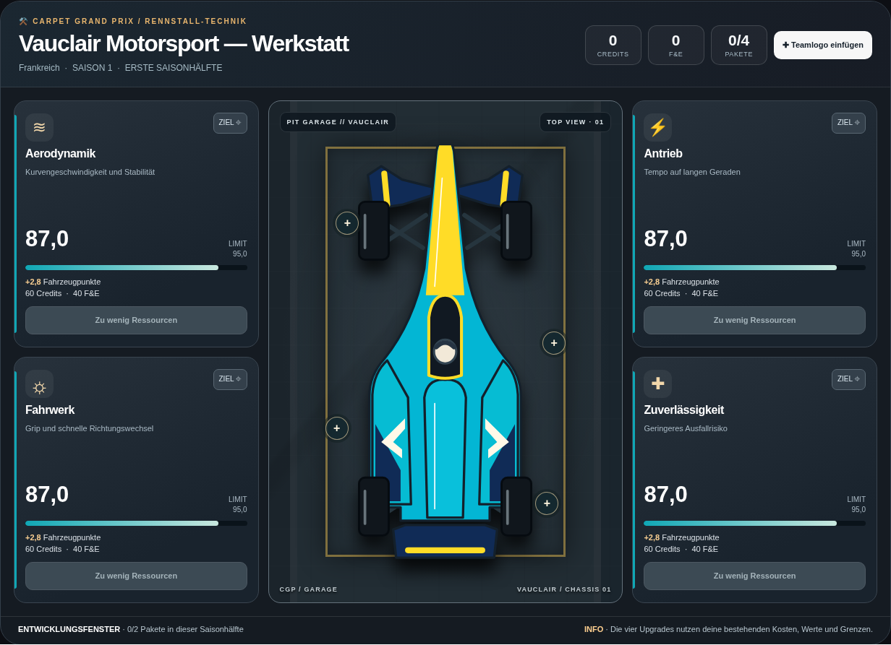

# Gemeinsame Top-Down-Fahrzeuge in der Werkstatt

Die Werkstatt zeigt für alle 13 Teams dieselben Formen und Lackierungen wie die
Rennansicht. Entwicklungsbranch `codex/workshop-topdown-cars`, Ausgangspunkt
`184e67a` auf `main`. Keine Änderung am Rennrenderer oder an den Fahrzeugdateien.

`cgWorkshopCar(t)` in `index.html` verwendet `CGPRaceSprites.svg(t.id)` aus dem
vorhandenen Modul `src/rendering/race-sprites.js`. Das SVG wird ohne Bildladevorgang
in die bestehende Werkstattdarstellung eingesetzt, um 90 Grad gedreht und
gleichmäßig vergrößert. Die Nase zeigt nach oben. Der bisherige Werkstattrahmen,
die responsive Größe und alle vier Bereichsschaltflächen bleiben erhalten.
Bei unbekannten Teams oder fehlendem Modul greift die bisherige Darstellung.

Ein hochgeladenes Teamlogo liegt als eigene Ebene auf der Motorabdeckung hinter
dem Cockpit. Upload, Entfernen und der bisherige Speicherschlüssel bleiben
unverändert; vorhandene Logos werden weiter angezeigt. Das Logo verändert keine
Lackierung und erscheint wie bisher nur in der Werkstatt.

Upgrade-Kosten, Ressourcen, Entwicklungsgrenzen und Werte bleiben unverändert.
Der gesamte bisherige Werkstattcode bleibt als Rückfall erhalten. Die neue
Darstellung benötigt keine CSS-Anpassung, keinen zusätzlichen Download und keine
Spielstandmigration. Der bestehende Offline-Builder bettet sie mit ein.

Die Standardtests vergleichen den übrigen Spielcode weiterhin bytegenau mit dem
Original. Zusätzlich ausgenommen wird ausschließlich der markierte neue
Werkstatt-Aufruf. Historische UI-Bildvergleiche schalten im Test auf die alte
Werkstattgrafik zurück. Eigene Browsertests vergleichen für alle 13 Teams die
tatsächlich eingefügten SVG-Flächen mit dem Rennrenderer und prüfen Bereichsfokus,
Logo-Upload, Neuladen, Entfernen sowie eine echte Paketentwicklung auf Desktop und
im Mobilformat. Die bisherigen Bild- und Spielreferenzen werden nicht ersetzt.

Zum Testen das Artefakt **carpet-grand-prix-offline** aus einem erfolgreichen
PR-Testlauf herunterladen, entpacken und die HTML-Datei öffnen. Darin die Werkstatt
aufrufen. Die öffentliche GitHub-Pages-Version ändert sich erst nach einer
ausdrücklich freigegebenen Übernahme nach `main`.
