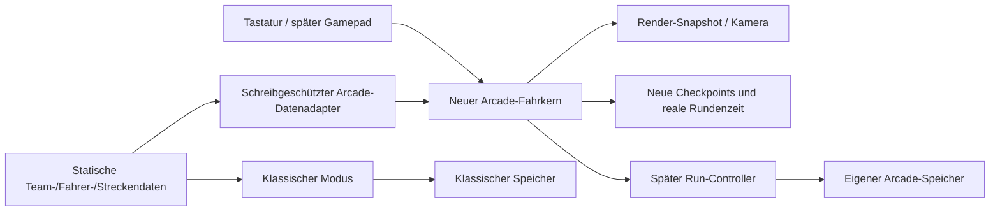

# Technische Bestandsaufnahme

Gelesen wurden `AGENTS.md`, `BASELINE.md`, `ARCHITECTURE.md`, `TESTING.md`,
`WORLD_AND_DRIVERS.md`, `ART_STYLE.md`, `SAVE_FORMAT.md` sowie der tatsächliche
Renn-/Speichercode in `index.html` und die ausgelagerten Renderer.
Die historischen Baseline-Dokumente beschreiben frühere Stände; für diesen
Entwurf gelten die aktuelle Implementierung und der Commit aus [README.md](README.md).

## Tatsächliche Architektur

Die große Spiel-IIFE enthält weiterhin Stammdaten, Management, Speicherung,
Qualifying, Rennkern und Ansichten. Grafikmodule unter `src/rendering/`,
Porträt-/Umgebungsdaten unter `src/data/` und UI-Helfer sind bereits getrennt.
Das veröffentlichte Spiel braucht keinen Anwendungsserver und keine externe
Grafikbibliothek. Es gibt eine getestete eigenständige Offline-Ausgabe.

| System | Tatsächlicher Einstieg | Wiederverwendung und Grenze |
| --- | --- | --- |
| Strecken | `digitizedTracks`, `makeGeometry`, `trackAt` | 22 Wege mit Breite, Start, Sektoren, Boxen und Brücken; als gelesene Daten und Geometriefunktionen geeignet |
| Fahrposition | `raceRoadPose`, `racePose` | Berechnet Pose aus Fortschritt und Spurversatz; gut als Referenz/AI-Ziel, ungeeignet als Spieler-Fahrzustand |
| Kurven/Ideallinie | `raceMeta`, `racingLine` | 4096 geglättete Positionsproben, 1024 Kurven-/Linienproben; Anhaltspunkte für spätere KI, nicht automatisch Fahrbahnmitte oder neue Collider |
| Bewegung | `stepRace`, `racingSpeed` | Beschleunigung und Bremshülle für automatisch geführte Wagen; kein frei gesteuerter XY-/Heading-Kern |
| KI | `raceMind`, `chooseLane`, `nearbyTraffic`, `safeLaneChange` | Vorhandene Angriffs-/Verteidigungsabsichten nützlich; aktueller Code wählt Spurziele, nicht Lenkwinkel/Gas/Bremse |
| Kontakte | `bodyContact`, `trafficBlocks`, `handleContact` | Trennachsenprüfung mit Orientierung/Ebene als Vorbild; topologische Spurreservierung nicht auf frei fahrende Spieler übertragen |
| Zeit/Ziel | `countCrossings`, `raceOrder`, `officialSeconds` | Prinzip zeitlicher Linienübertritte/Ergebnisordnung nutzbar; aktueller Rundenzähler setzt steigenden Fortschritt voraus |
| Rendering | `drawRace`, `race-sprites`, `pilot-world` | Bestehender 2D-Testblick/Trackdaten; die simplen Assets sind nicht die neue Art Direction |
| Kamera | `CGPRaceCamera.follow/apply` | Nur Translation und gleichmäßige Skalierung des Canvas; weder perspektivische Projektion noch Höhenkamera |
| Bewegungsdarstellung | `render-motion.js` | Zwischenrechnen zwischen festen Schritten ist als Prinzip wiederverwendbar; neue Zustandsfelder brauchen eigenen Adapter |
| Stammdaten | `MASTER` | 13 feste Team-IDs, 92 Fahrer-IDs; verbindliche Namen/Farben/Porträtzuordnung behalten |
| Spielstände | `save`, `validateV06State`, `validateSavedRace` | Gekoppelt an klassische Karriere/26 Autos; niemals für 13 Arcade-Autos umdeuten |

### Warum ein eigener Fahrkern notwendig ist

`stepRace` berechnet `progress += speed * dt` und bewegt `lane` zum KI-Ziel.
Die Fahrzeugausrichtung ergibt sich danach aus der Streckentangente. Alle
26 Wagen sind automatisch gesteuert. Selbst wenn die KI für ein Auto abgeschaltet
würde, entstünden daraus weder frei gewählte Fahrtrichtung noch nachvollziehbares
Untersteuern. Eine Lenkung darf das Fahrzeug nicht nur zwischen drei Korridoren
verschieben oder unbemerkt auf die Ideallinie ziehen.

Die heutige Kontaktauflösung reserviert Weg-/Spurintervalle und kann festgefahrene
Gruppen gemeinsam nach vorn bewegen. Dieses Verhalten gehört zur klassischen
Simulation. Es wäre bei einem Spielerauto eine unerwartete Fremdbewegung und
wird nicht als Arcade-Kollisionsreaktion übernommen. Zufällige Pace-, Fehler-
und Ausfallwürfe des klassischen Rennens werden ebenfalls nicht auf die
Spielersteuerung übertragen.

### Strecke als Datenbasis, nicht als Fahrzwang

Der neue Adapter übernimmt Originalpunkte, Breite, Sektoren, Boxen und Ebenen.
Die Fläche wird daraus einmalig vorbereitet; die freie Position wird nur zur
Abstands-/Fortschrittsmessung auf die Strecke projiziert. Kein automatisches
Einrasten auf den Pfad. An engen, nebeneinanderliegenden Streckenarmen und
Brücken reicht eine globale Nächstpunkt-Suche nicht: vorheriger Abschnitt,
Fahrtrichtung, erlaubter Fortschrittsbereich und Ebene müssen berücksichtigt
werden. Sonst springen Fortschritt und Rundenzähler auf einen anderen Arm.

`makeGeometry` normalisiert die Zeichnungen derzeit in einen Canvas-nahen
Koordinatenraum. Diese Einheiten sind keine Meter. Ein späterer 3D-Adapter muss
einen einheitlichen Maßstab und die Zuordnung `(x,y) -> (X,Höhe,Z)` festlegen;
Kollisionen, Physik und Fahrzeuggröße müssen denselben Maßstab verwenden.
Brücken haben bislang Ebenenmarker, keine durchgehenden Höhen-/Rampenprofile.
Deren Ausgestaltung gehört ausdrücklich zu Phase 2, nicht zum aktuellen Befund.

### Reale Rundenzeit für direktes Fahren

`officialSeconds` skaliert die heutige sichtbare Simulation auf Zielrundenzeiten.
Der vorhandene Test zeigt etwa 19,5 physikalische Sekunden als 89 offizielle
Sekunden. Für manuelles Fahren empfehlen wir echte aktive Spielsekunden bei 1×.
Diese Entscheidung betrifft nur den neuen Modus. Der klassische Zeitmaßstab
bleibt unangetastet. Neue Runden werden erst nach geordneten Checkpoints und
einem vorwärts überquerten Start-/Zieltor gezählt; Rückwärtsfahren oder Abkürzen
darf keine Runde erzeugen.

## Saubere Modul- und Zustandsgrenze

Der Adapter liefert Kopien/unveränderliche Daten, keine Referenzen auf das
laufende klassische `s`. Für Phase 1 wird keine Karriere gelesen oder verändert.
Die geschlossene IIFE wird nicht im Browser per Test-Hook geöffnet. Vorgesehen
ist ein kleiner Entwicklerexport der statischen JSON-Daten aus der Originalquelle,
dessen Ausgabe gegen die 22 Geometrien/13 Team- und 92 Fahrer-IDs geprüft wird.
Der bestehende VM-Testadapter dient nur Analyse und Tests, nicht dem neuen Spiel.

## Speicher und Kompatibilität

Der aktuelle Validator verlangt 13 Teams, genau zwei Fahrer je Team, 26 aktive
Fahrer und insgesamt 92 Identitäten. Das aktive Rennen verlangt `version:7`,
26 Autos und 18 Runden. Ein Arcade-Rennen dort hineinzuspeichern wäre ein
Formatbruch. `s.mode` akzeptiert nur `manager` und `observer`.

Die klassischen Schlüssel aus `SAVE_FORMAT.md`, insbesondere `carpet_gp_v072`,
bleiben unverändert. Vorgeschlagene spätere Arcade-Schlüssel sind
`carpet_gp_arcade_run_v1`, `carpet_gp_arcade_profile_v1` und
`carpet_gp_arcade_settings_v1`. Sie sind **nur ein Entwurf und werden noch nicht
angelegt**. Getrennte Validatoren, Export/Import und Versionswechsel gehören
vor ihrer Einführung in einen eigenen Prüfplan. Kein `localStorage.clear()`
und keine automatische Konvertierung klassischer Karrieren. Phase 1 kann als
ungespeicherte Fahrsitzung beginnen.

## Wichtigste Risiken

| Risiko | Gegenmaßnahme / Zeitpunkt |
| --- | --- |
| Altes und neues Rennen beeinflussen sich | Eigener Einstieg und Zustand; schreibfreie Stammdatenadapter; Phase 1 |
| Fahrbare Linie passt nicht zur sichtbaren Bahn | Fahrfläche, Projektion und Renderer aus demselben Modell; Phase 1/2 |
| Falsche Runde an Haarnadel/Brücke | Abschnittsbindung, Checkpoints, Ebenen; Phase 1/2 |
| Spieler wird von alter KI/Kollisionsauflösung bewegt | Eigenes Input-/Physikmodell; KI später nur als Eingabeerzeuger |
| Kamerasprünge/Sichtverlust | Kontinuierliche Blickrichtung, begrenzter Vorblick, Wand-/Brückenprüfung; Phase 2 |
| 3D sieht wie generischer Plastikbaukasten aus | Freigegebene PNG-Art Direction plus gesonderte technische Stilabnahme |
| Neue Grafiklast verschlechtert Steuerung | GPU-/CPU-Budgets, lokaler Assetexport, Kontextverlust-/Fallbackprüfung; Phase 2 |
| Neue Items ruinieren Fahrgefühl | Erst nach stabiler Basis; eigenes Balancing in Phase 4/5 |

Keine dieser geplanten Maßnahmen wird als bereits gelöste Arcade-Funktion ausgegeben.
