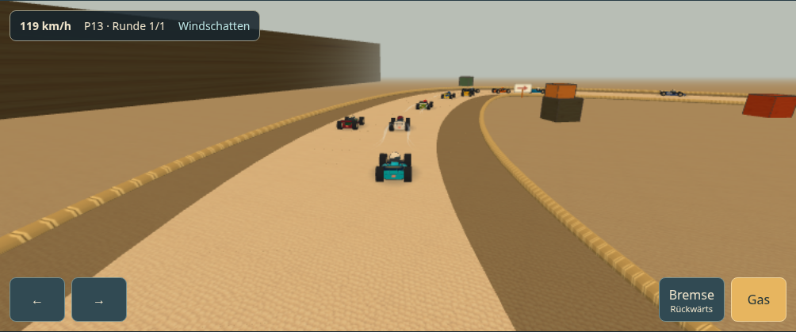

# Naher Windschatten: neue A/B-Fahrten

Ausgangsstand `f40de2d3f45fc6697dac04f2e4a3a73e0148e3b9` (PR #30), ergänzt
um die Arbeitsquellen mit den 19 SHA-256-Prüfsummen in [field-ab.json](field-ab.json).
Messzeit: 2026-11-17T15:48:27.691Z. Alle Prüfsummen wurden vor/nach den Fahrten geprüft.

Sechs tatsächliche RaceSession-Fahrten: Bahrain, Frankreich und Russland,
Windschatten an/aus, je zwei Runden, 13 Fahrzeuge, Schwierigkeit Normal.
Die Aufholhilfe ist auf beiden Seiten aus, um diese Änderung zu isolieren.
Physik läuft mit 120 Hz; binäre Spieler-Steuerbefehle und Beobachtungen mit 30 Hz.
Die Spielervertretung ist ein automatisierter Pilot, keine neue menschliche
Referenz. Vollständige Standardrennen und der 22-Strecken-Kalender laufen
zusätzlich in den bestehenden Tests mit beiden Mechaniken.

Alle sechs Felder enden mit 13 Ergebnissen (**78 Zieleinläufe**), ohne beobachteten
Seilkontakt. Im Feld liegt die höchste beobachtete Längsgeschwindigkeit bei
123,320 km/h. Der isolierte reale Verfolgungsversuch aus vier Längen erreicht
vor dem Kontaktbereich mehr als 4,9 km/h Vorteil; der stationäre Krafttest
bestätigt 123,8 statt 118,8 km/h. Kurven, Verkehr, Ausscheren und Bremsen
verhindern, dass jeder Feldwagen jederzeit den Maximalwert erreicht.

| Strecke | Spieler aus, s | Spieler an, s | Letzte KI aus, s | Letzte KI an, s | Spitze an, km/h |
| --- | ---: | ---: | ---: | ---: | ---: |
| bahrain | 67,786 | 65,509 | 67,002 | 68,439 | 123,084 |
| france | 90,551 | 90,711 | 89,734 | 91,534 | 122,040 |
| russia | 84,378 | 83,979 | 87,411 | 87,185 | 123,320 |

Die Kontakt- und Randbeobachtungen, Wirkungsdauer, alle Rundenzeiten, Rangwechsel
und Zielabstände stehen in den Rohdaten. Kontakte sind beobachtete Fahrzeug-
Frames, keine Anzahl unabhängiger Unfälle. Geänderter Windschatten verändert
reale Verkehrsentscheidungen; er garantiert weder Überholen noch einen festen
Rundenzeitgewinn. Auslaufrunden gehören weiter zu Tempo-/Kontaktbeobachtungen,
erzeugen und erhalten aber keinen aktiven Windschatten.

Die bis drei Fahrzeuglängen verlängerte Wirbelgeometrie wird mit demselben
aktiven Zustand wie die Physik gezeichnet. Abstandstests prüfen ausdrücklich
eine bis drei Längen, die Abschwächung bis 5,999 und den sofort leeren Zustand
ab sechs Längen auch bei zuvor voller Wirkung. Die echten 3D-Browsertests prüfen
zusätzlich die erlaubte Reichweite, Pause, Neustart und Streckenwechsel auf
Desktop und Mobil. Die neue Darstellung benötigt weiterhin höchstens einen
zusätzlichen Draw Call, 2.496 Dreiecke und keine neuen Texturen.



Die tatsächliche Browseraufnahme zeigt das Einfahren in den Effektbereich;
der volle Geschwindigkeitsvorteil baut sich danach auf. Der Browser-Testpilot
berücksichtigt jetzt ebenfalls den vorhandenen Windschattenspielraum, statt
ihn auf freien Geraden durch eine unbeabsichtigte Test-Bremsung zu unterdrücken.

Die alten Protokolle in `../slipstream/` und `../catchup/` beschreiben bewusst
ihre damalige 3-km/h-Abstimmung. Ihre Messzahlen und Quellprüfsummen wurden nicht
nachträglich auf neue Erwartungen umgeschrieben. Die Aufholhilfe wird separat
weiter mit maximal 1,2 % getestet; die neue gemeinsame obere Tempogrenze beträgt
bei maximaler Kombination 125,2256 km/h.

## Reproduzieren

```
npm run measure:slipstream -- bahrain france russia --output=docs/slipstream-close/field-ab.json
npx vitest run tests/unit/slipstream.test.js tests/unit/catchup.test.js
npx playwright test tests/browser/slipstream.spec.js
```

Die Messungen und beschleunigten Browserprüfungen sind keine Geräte-FPS-Abnahme.
Neue Parameter und Auslegung: [SLIPSTREAM_CLOSE.md](../SLIPSTREAM_CLOSE.md).
