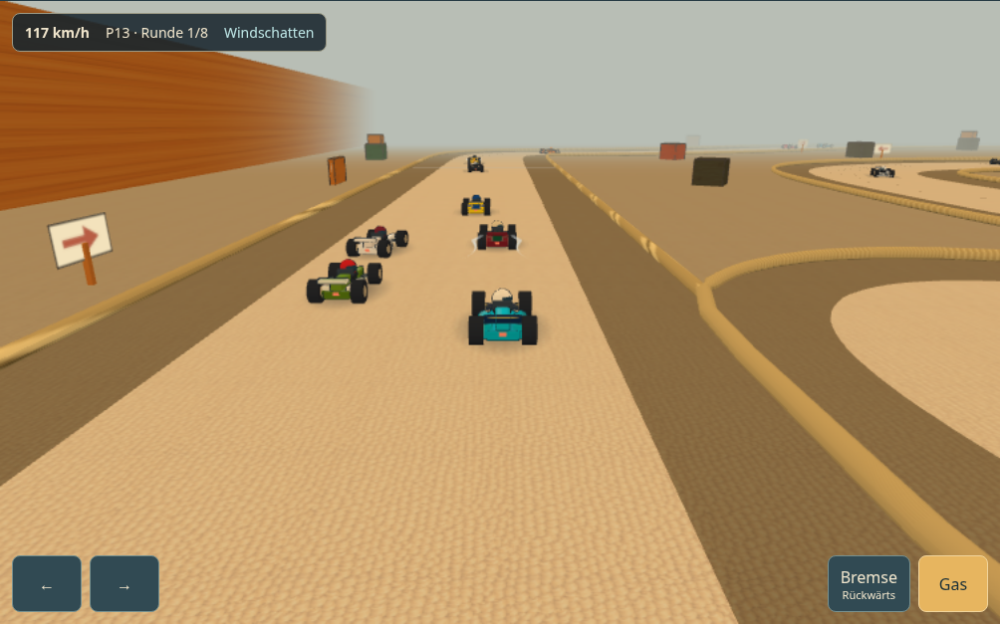

# Windschatten: Messprotokoll

Historischer 3-km/h-Stand. Die aktuelle nähere +5-km/h-Abstimmung und neue
Vergleiche stehen in [SLIPSTREAM_CLOSE.md](../SLIPSTREAM_CLOSE.md).

Ausgangsstand `1bf76bb90b0b5e99e693cab1b24ba57336a9746e` (PR #28), anschließend
Arbeitsquellen mit den 16 SHA-256-Prüfsummen in [field-ab.json](field-ab.json).
Die Prüfsummen werden vor dem Lauf erfasst und vor dem Schreiben erneut geprüft.
Gemessen am 2026-11-17T12:55:04.408Z.

Zwölf echte RaceSession-Läufe: sechs Strecken × an/aus, je zwei Runden,
13 Fahrzeuge, Normal, 120-Hz-Physik und normale Eingaben mit 30 Hz. Der Spieler-
Ersatz sendet binäre Lenk-/Pedalbefehle nach der gleichen Politik wie die
Browsertests. Keine menschliche Leistungsreferenz, keine direkte Zustands-
oder Geschwindigkeitsänderung, kein Aufholbonus. Beobachtungen erfolgen mit 30 Hz.
Vollständige Standardrennen werden zusätzlich von den bestehenden Tests geprüft.

Alle zwölf Felder beenden das Rennen mit 13 gültigen Ergebnissen. Kein beobachteter
Seilkontakt. Einzelne Zielzeiten werden trotz höherem möglichen Geradentempo
schlechter: Der Effekt verändert echte Verkehrs-/Kontaktentscheidungen und
verspricht weder einen konstanten Rundenzeitbonus noch ein garantiertes Überholen.
Die isolierte Kraftprüfung erreicht maximal +3 km/h; im Feld liegt der höchste
beobachtete Längswert bei rund 121,62 km/h.

| Strecke | Spieler aus, s | Spieler an, s | Letzter aus, s | Letzter an, s | Wind gesamt, Fahrzeug-s | Spitze an, km/h |
| --- | ---: | ---: | ---: | ---: | ---: | ---: |
| bahrain | 67,786 | 66,632 | 67,786 | 70,017 | 78.70 | 121,601 |
| france | 90,551 | 87,839 | 90,551 | 89,659 | 56.97 | 120,511 |
| portugal | 64,525 | 64,303 | 64,525 | 65,146 | 76.73 | 121,465 |
| japan | 95,942 | 95,299 | 97,538 | 96,973 | 30.27 | 121,427 |
| korea | 82,107 | 86,617 | 87,166 | 86,617 | 39.77 | 121,617 |
| russia | 84,378 | 84,709 | 87,411 | 87,878 | 221.90 | 121,558 |

Die führenden Fahrzeuge erreichen hier jeweils dieselbe Siegerzeit wie ohne
Effekt, weil sie keine vorausfahrende Quelle haben. Auf Bahrain wächst die
Spanne zwischen Erstem und Letztem von etwa 14,23 auf 16,46 s; Windschatten ist
kein Feldverdichter. Auf den übrigen Strecken gibt es je nach Spieler-/Endfeld-
vergleich andere kleinere Verbesserungen oder Verschlechterungen. Die Rohdaten
enthalten alle Positionen, Rundenzeiten, Siegerabstände und Rangwechsel.
Rangwechsel sind keine sicher klassifizierten Überholmanöver.

| Strecke | Kontaktbeobachtungen aus / an | Randbeobachtungen aus / an | Seilbeobachtungen aus / an |
| --- | ---: | ---: | ---: |
| bahrain | 301 / 320 | 0 / 0 | 0 / 0 |
| france | 294 / 304 | 0 / 0 | 0 / 0 |
| portugal | 154 / 255 | 0 / 0 | 0 / 0 |
| japan | 341 / 368 | 0 / 0 | 0 / 0 |
| korea | 284 / 234 | 0 / 0 | 0 / 0 |
| russia | 280 / 160 | 0 / 0 | 0 / 0 |

Dies sind aufsummierte Fahrzeug-Frames, keine Anzahl voneinander unabhängiger
Unfälle. Auslaufende Fahrzeuge gehören zu den Kontakt-/Spitzenbeobachtungen,
erhalten und erzeugen aber keinen Windschatten. Ein zuvor undefinierter
Kontaktstatus im Countdown wird als `false` gezählt. Nichtendliche Zahlen werden
vom Messwerkzeug vor der Ausgabe zurückgewiesen.

Bei Korea/Russland liegt die höchste gleichzeitig beobachtete Höhendifferenz
aktiver Paare bei etwa 2,00/2,19 Welteinheiten. Die Physik prüft die Grenze von
2 vor jedem Schritt, während diese Auswertung nach dem Schritt misst; Fahrzeuge
bewegen sich dazwischen auf Rampen weiter. Die unterschiedlichen Kreuzungsebenen
liegen 24 Einheiten auseinander und bleiben getrennt. Gezielte Modultests prüfen
alle 22 echten Strecken sowie Deck/Boden in beiden Richtungen.

## Echte Darstellung und Ressourcen



Die Aufnahme zeigt eine tatsächliche Spielerfahrt mit aktivem Effekt, kein
montiertes Grafikmuster. Die dünnen hellen Stiftkurven am vorausfahrenden Wagen
verwenden denselben Zustand wie die Physik. Browserprüfungen vergleichen den
gezeichneten Batch mit den wirkenden Quellen auf Desktop und im Mobilformat,
einschließlich Pause, Neustart, Streckenwechsel und Offlinefahrt.

[rendering-probe.json](rendering-probe.json) enthält zusätzlich eine kurze reale
SwiftShader-Zeitmessung mit 13 Fahrzeugen, Chrome 155, 1000×800, Qualität sparsam.
Sie wartet auf einen aktiven Effekt und zeichnet danach etwa zwei Sekunden auf.
In der kurzen Stichprobe war einer von acht ausgewerteten Frames mit aktiven
Wirbeln (zwei Quellen, 384 zusätzliche Dreiecke); 22 Texturen, kein Kontextverlust.
Die zugehörige Geometrie erhöht den GPU-Geometriezähler um eins auf 115.
Zeitwerte unter Software-WebGL und die wenigen Frames sind keine belastbare
FPS-Abnahme auf echten Geräten. CPU-Submitzeit ist keine GPU-Framezeit.
Die feste Batchgrenze bleibt ein Draw Call und höchstens 2.496 Dreiecke,
ohne Partikel oder neue Texturen.

## Reproduzieren

```
npm run measure:slipstream
npm run measure:arcade3d -- --race --software-webgl --wait-for-wake
```

Der zweite Befehl benötigt den laufenden Testserver. `--slipstream=0` am
3D-Messwerkzeug bzw. in der Renn-URL deaktiviert die Mechanik für A/B-Prüfungen.
Die Produktion enthält keine Mess- oder Test-Hooks.
